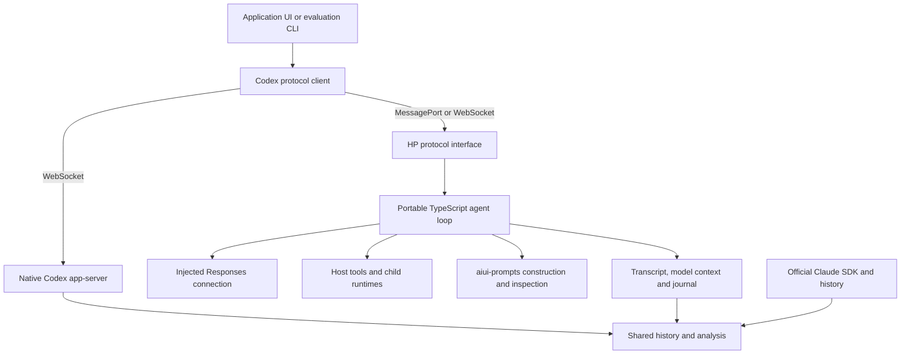

# HP Agent feasibility: browser execution, Codex compatibility and SDK choice

The [second-round findings](hp-agent-behavior.md) now qualify real tools,
compaction, model-selected delegation and a small coding comparison. This page
preserves the first round's evidence and limits.

**Completed 18 October 2026.** A small TypeScript agent can run inside a browser
Worker and under Node, expose familiar Codex conversation messages, and feed our
existing history tools. The combined prototype completed real model calls in both
environments. This is enough evidence to design its architecture alongside the
Codex client; it is not yet evidence of comparable coding quality.

I recommend building the agent loop over the **official OpenAI Responses client
and WebSocket transport**, while keeping the application's credentials, tools and
storage separately supplied. Use `aiui-prompts` for recorded prompt construction
and inspection. Continue with the native Codex client design, adding browser
message transports and explicit distinctions between the available operations of
each runtime. Claude should continue through its official SDK.

The Agents SDK was our preferred starting candidate. Tests found two concrete
mismatches in version 0.20.0: its built-in loop stops at a steered incomplete
response instead of following the successor, and it does not execute Codex-style
custom/freeform tool calls. Correcting both through a custom model implementation
would leave us owning much of the desired loop anyway. We should keep it as a
reference and reuse useful public components where they fit, without maintaining
a private SDK fork.

## Results together

The detailed reports live under `experiments/docs/spikes/`. Repository links
become available after these changes are committed and pushed. Each report links
the runnable code, source references and local evidence locations.

| Investigation | Finding | More detail |
| --- | --- | --- |
| Prompt and tool fidelity | The real prompt toolkit preserves the full upstream Luna instruction text and a native freeform tool schema, with source provenance and replay verification. Native Codex's request framing differs from ordinary public Responses framing. | [041: fidelity](https://github.com/habemus-papadum/pdum_agent_tools/blob/main/experiments/docs/spikes/041-hp-codex-fidelity.md) |
| Agents SDK fit | Ordinary SDK generation, function tools, input filters and usage work. Its steering and freeform-tool handling do not meet this runtime's requirements. Direct Responses passed both live checks. | [038: SDK comparison](https://github.com/habemus-papadum/pdum_agent_tools/blob/main/experiments/docs/spikes/038-hp-sdk-fit.md) |
| Portable runtime and client messages | One execution core works behind Node MessagePorts and a browser Worker. Selected native notifications validate against Codex's generated schemas. Full native protocol compatibility is not implemented. | [039: runtime](https://github.com/habemus-papadum/pdum_agent_tools/blob/main/experiments/docs/spikes/039-hp-agent-runtime.md) |
| Combined live demonstration | Both Node and Chrome completed tool execution, steering, child interaction, forking and replay. Actual prompt inspection and the existing history schema worked on the captured runs. | [040: integration](https://github.com/habemus-papadum/pdum_agent_tools/blob/main/experiments/docs/spikes/040-hp-integration.md) |

## What the demonstration feels like

The browser page starts a Worker and talks to it through the same small client
interface used in Node. A task invokes an application-supplied tool. While it is
working, the client adds an instruction; the UI can distinguish sending that
instruction, the provider accepting it, and its eventual inclusion in a response.
The client can inspect the parent, create an independent child, send the child
another task, and continue a fork without changing the parent conversation.

The demonstration then reads its saved transcript with no running agent. A prompt
viewer shows the original instruction text, its source location and the recorded
request. All five client model requests in each live run matched their semantic
reconstruction. The viewer uses the real AIUI prompt inspector's headless model
with a simple HTML presentation, not a new prompt-inspection framework.

Each live run produced **three threads, five visible turns, fourteen items and
five model responses**. One turn is inherited on the fork, so five visible turns
do not mean five newly submitted tasks. The parent called its host tool once.
The harness chose when to create and message the child; we have not yet evaluated
the model's own delegation decisions.

## Proposed architecture

In a browser, the app-server boundary is logical: a Worker can receive the native
message envelopes over a MessagePort. Under Node or Electron, the same core can
be hosted behind an appropriate process or socket boundary. The browser test
used a development relay that attached credentials to the upstream WebSocket;
the Worker still owned the agent loop. Existing development-key and federated
client factories remain the host's integration responsibility.

The runtime should own turns, tool execution, steering state and child lifecycles.
The prompt toolkit should own structured prompt records, rendering and inspection.
History should retain the transcript, the exact provider items used as model
context, and context replacement checkpoints separately. A transcript alone is
insufficient to reconstruct an interrupted model call or external tool process.

Children should remain independently addressable async runtimes. A fork copies
conversation context at a defined boundary; spawning establishes a new child's
lifecycle and relationship to its parent. Neither clones host files or undoes
side effects. Scheduling and durable recovery can be added when a use case needs
them; they are not prerequisites for the browser-local version.

## What can be faithful to Codex

Exact prompt text and native tool declarations are practical starting points.
The imported Luna template contains 18,037 UTF-16 units. We retain the source
revision and path instead of checking another copy of the prompt into this repo.
The source inventory covers model instructions, environment and workspace
context, tool selection, collaboration, skills/MCP, compaction and the turn loop.
The [inventory and flow comparison](https://github.com/habemus-papadum/pdum_agent_tools/blob/main/experiments/spikes/041-hp-codex-fidelity/README.md#source-inventory-and-execution-comparison)
give the detailed map.

There is a significant qualification: the inspected Codex revision uses a
Responses Lite layout and code-mode tool configuration for GPT-6. Its effective
request includes developer tool/context messages; copying a Markdown prompt into
ordinary Responses is not complete request parity. The spike preserves an
offline native framing specimen and separately implements the public Responses
translation used live. We should use supported public interfaces and measure
the resulting behavioral differences rather than claiming identical internals.

Likewise, recognizable client messages do not establish every native semantic.
The prototype supports idle-boundary forks, a small parameter subset, ephemeral
history and sequential tools. Native Codex has additional behavior for concurrent
turn submissions, joining, pagination, approvals and process tools. The prototype
rejects unsupported operations explicitly. No claim is made that the vanilla
Codex remote CLI can use this small server unchanged.

## Implications for the client API

The [Codex client design](specs/codex-client.md) remains a useful baseline. I would
make these adjustments before implementing it:

1. Keep the connection independent of WebSocket. Add a MessagePort adapter and
   use the same routing and request handling in either environment.
2. Retain the complete native Codex protocol surface. HP Agent implements a
   documented subset and named extensions; it should not limit Codex's API.
3. Separate starting a runtime, attaching a client, reading history and submitting
   work. Closing a page, disconnecting a native client and stopping a process
   have different consequences.
4. Make final items authoritative for transcript text. Streaming deltas are useful
   live updates, but a completed native item may supply corrected text or fields
   such as the message phase.
5. Preserve sent, accepted, pending, committed and failed steering evidence.
   Only committed input belongs in reconstructed model context. A successful
   send is not proof the model used it.
6. Share history, rendering and analysis where their meanings agree. Keep native
   Claude operations accessible through its official SDK rather than translating
   everything into an artificial common conversation protocol.

These are proposed refinements, not a newly implemented production API. The
existing production TypeScript workspace should be extended when construction
starts; it no longer needs the new-workspace setup described in the older plan.

## History and measurement findings

The existing agent-history v5 schema accepted both live exports. The evaluator's
measurement function read them without knowing how the agent ran. Real model
responses have their own usage rows; inherited fork items are marked as copied
context. The browser journal's 62 native notifications also passed the pinned
Codex schemas.

The exercise exposed three concrete issues in the existing evaluator to fix
before running a full comparison: its Luna rates differ by a factor of 100 from
the dated short-context prices used here; inherited tool bytes are included twice
after a fork; and choosing the root thread by largest response count can select
a child. These are measurement issues, not shortcomings of the new agent.
The baseline reports and evaluator code were left unchanged in this spike.

## Scope, confidence and next work

The evidence combines pinned-source inspection, real SDKs connected to local
scripted WebSocket/HTTP peers, native credential-free Codex execution, and small
live Luna calls in Node and Chrome. Local scripted checks isolate failures; live
checks establish the specific provider paths. They serve different purposes.

The prototype has not established coding quality, background-tab longevity,
Electron behavior, model-selected delegation, reasoning-heavy forks, or real
compaction quality. It does not implement skills/MCP execution or Codex's normal
filesystem, shell and patch tool suite. Its in-memory snapshots also leave durable
storage and large-history performance open. Context replacement was tested, but
it must not be described as model-generated summarization.

The next substantial step should build a small faithful Node tool set, skill/MCP
loading, and explicit compaction with reasoning-context preservation. Run a short
task through native Codex and HP using matched model settings, then use the
existing longer coding battery once the runtime can perform it. Test one useful
browser application task alongside that comparison. This would establish whether
the promising integration result also delivers useful agent behavior, before
committing to a large new runtime library.

## Spend and reproducibility

| Probe group | Responses with reported usage | Estimated API-equivalent USD |
| --- | ---: | ---: |
| SDK/direct comparison, including the limited-output attempt | 6 | 0.000199300 |
| Combined Node demonstration | 5 | 0.000641985 |
| Combined Chrome Worker demonstration | 5 | 0.000224225 |
| **Total observed usage** | **16** | **0.001065510** |

All calls used `gpt-6-luna`, default service and short context. Rates were checked
on 18 October 2026: USD 0.10 uncached input, 0.01 cached input, 0.125 cache writes
and 0.50 output per million tokens. [Published model pricing](https://developers.openai.com/api/docs/models/gpt-6-luna).
Actual billing is unknown. Three invalid-parameter requests and one browser
framing failure returned no response usage. Research/delegated-agent billing is
not exposed by this environment and is not included in the table.
The limited-output steering attempt closed before its final steering disposition
was observed; any subsequent uncaptured work is also outside the measured total.

The [integration runbook and ledger](https://github.com/habemus-papadum/pdum_agent_tools/blob/main/experiments/spikes/040-hp-integration/README.md)
record exact commands, artifacts and versions. Raw traffic and prompt captures
remain ignored; evaluation measurement copies live under `~/history/evals/`.
No new production library was introduced, and no commit, push or publication was
performed as part of this round.
