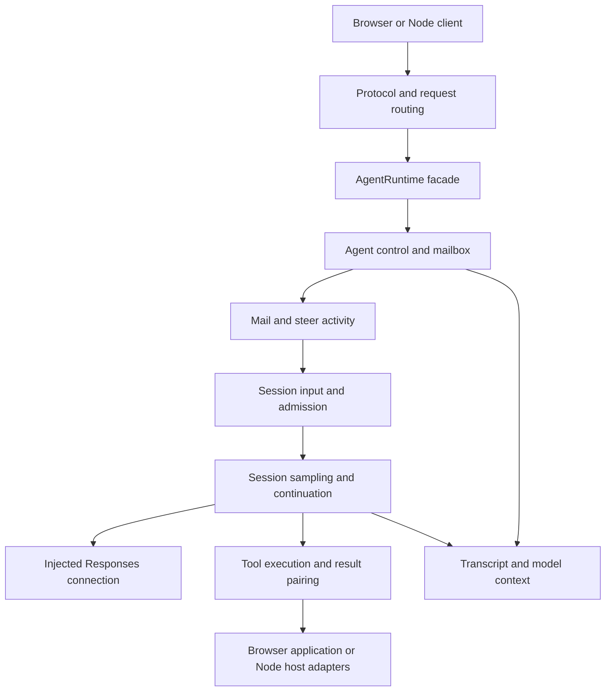

# HP Agent: power-user parity and control boundaries

The subsequent [parallel work round](hp-agent-work.md) implements the scheduling
and independent-job work identified here. This report preserves the preceding
046–049 findings; use the newer report for those capabilities' current status.

**Completed 18 October 2026.** This source-guided pass identified **36 advanced
contracts** worth preserving from Codex, corrected several control-flow gaps,
and reorganized HP around the same principal responsibilities. The runtime still
uses one portable TypeScript implementation in Node and a browser Worker.

The main improvement is precise control over **when input becomes work**. A
queue-only message, an explicit follow-up task, a user steer, a wait, a turn
interruption and a whole-subtree interruption now have separate meanings.
Those distinctions are essential for advanced applications with independent
agents and long-running tools.

The remaining gaps are documented as retained requirements or deliberate
deferrals. This is not a blanket compatibility claim and no production library
was added. The [first feasibility report](hp-agent-findings.md) and
[behavioral comparison](hp-agent-behavior.md) remain the earlier evidence.

## What changed

| Control | Current HP behavior |
| --- | --- |
| `send_message` | Queues an attributed note. An idle recipient remains idle. Queue acceptance is distinct from inclusion in model input. |
| `followup_task` | Starts an idle child or delivers explicit work to an active child at a safe boundary. A follow-up after the answer boundary starts a new turn. |
| `wait_agent` | Waits for the caller's activity, with timeout and cancellation. A note or steer wakes it; waiting does not itself consume the mailbox. |
| Child completion | Queues a result for the parent after each terminal child turn. The UI notification and model-readable result are separate. Idle parents do not start automatically. |
| Startup steering | Input can queue before a provider response ID exists. Local inclusion, dispatch, provider commitment, rejection and unknown outcome are distinguishable. |
| Thread/subtree interruption | Interrupting one thread leaves its children independent. Stopping the subtree requires explicit scope. |
| Interrupted tools | Context records distinguish calls that never executed from calls whose side effects are unknown. Missing call/output pairs are repaired without executing the missing action. |
| Late results | A late tool or preparation result is recorded, but cannot dispatch stale model work or silently alter a later turn's context. |

The previously demonstrated parent-wait problem is fixed: a parent can be
interrupted or steered while waiting for a child, without waiting for that child
to finish and without killing it. A stalled asynchronous preparation hook is
also interruptible. An unresolved or rejected inspection callback no longer
blocks or terminates the runtime.

There are still explicit boundaries. HP executes a selected tool batch
sequentially, and local queued input is consumed at its boundary. It does not
offer arbitrary queue-position or priority insertion. Provider steering follows
the provider's safe application boundary. A closed local connection is not an
acknowledgement that all upstream work stopped, and an uncooperative host tool
may finish after the turn has been interrupted.

## Source-aligned code structure

We aligned ownership and state transitions as well as module structure. The
reference is the clean Codex checkout at
`6c372fbef45f730b6d8aa727b0ec8332365588db`. Its GPT-6 multi-agent-v2 behavior is
the reference for messaging and waiting.

| Native responsibility | HP owner |
| --- | --- |
| Session input queue, admission and activity | `039/src/session/input-queue.ts` and `session/state.ts` |
| Sampling, tools, continuation and answer boundary | `039/src/session/turn.ts` |
| Agent addresses, follow-ups, waits, interruption and completion routing | `039/src/agent/control.ts` |
| Retained queue-only mail and wake subscriptions | `039/src/agent/mailbox.ts` |
| Tool execution, cancellation and interrupted-result repair | `039/src/tools/execute.ts` |
| Model-facing multi-agent tool handlers | `039/src/tools/agent-tools.ts` |
| Provider connection, native items and steering receipts | `038/src/direct.ts` and its injected connection factories |
| Host processes, files, skills and MCP | Separate 042 adapters; no Node branches in the session/agent core |

`AgentRuntime` remains the public facade used by the experiments. It owns the
session registry and composes these responsibilities. The native code contains
many more subsystems; the mapping preserves their important boundaries without
claiming to have ported all of them. Context normalization currently uses the
tool execution records; a fuller history manager remains future work.

In the browser, parent and child agents remain concurrent async executions in
one Worker. The same core runs in Node. Subprocesses belong to Node host tools;
an agent spawn does not launch another CLI process. A browser can invoke remote
host tools through an adapter, but that adapter must implement actual job,
polling and cancellation semantics.

## Edge cases that changed the design

**Input arrival and commitment differ.** A steer accepted by the provider while
it waits for a tool result is inserted before later continuation input. The old
adapter appended it to local context. It now preserves the provider's effective
order with correlated receipts and insertion positions. The outgoing request
correctly omits that already-accepted text because the provider inserts it.
Consequently, inspecting sent JSON and inspecting effective model context are
related but different views.

**The answer boundary matters.** Native Codex distinguishes completing a visible
answer from finishing the entire turn. A queued note should not always prolong
the turn; an explicit task or steer may. HP now tests both sides of that boundary
and reopens delivery when tool continuation requires it.

**Interruption needs truthful evidence.** A tool item can be announced before
its host callback actually starts. Cancellation in that interval must say
`NOT EXECUTED`, rather than falsely claim unknown side effects from an execution
that never began. Once execution has started, an interruption cannot promise
that effects were rolled back. Late results are separately observable.

**Preparation is part of the cancellable lifecycle.** An asset/prompt preparation
promise that never resolves must not keep an interrupted turn active forever.
Its late completion must not send the old model request. New checks cover this
as well as model-connection startup and cancellation between tool/model rounds.

**An observer can fail asynchronously.** Catching only a synchronous callback
exception missed rejected promises. Both runtime and client observation now
record those failures without awaiting the observer or preventing other clients
from receiving events.

## Important power-user features still to preserve

The [complete feature matrix](https://github.com/habemus-papadum/pdum_agent_tools/blob/main/experiments/spikes/046-hp-power-user-audit/feature-matrix.md)
has source and native-test references, HP evidence, priorities and explicit
remaining gates for every row. The references are checked; the audit did not run
the entire native Rust test suite. Its principal outstanding requirements are:

| Area | Contract to preserve and current limit |
| --- | --- |
| Background jobs | Native model-facing yielded shell sessions can survive turn interruption; managed one-shot commands have different lifetimes. HP's Node adapter still binds its processes to the originating turn. A job registry and explicit wait/interrupt/terminate/owner-close operations are needed before claiming parity. |
| Terminal controls and clocks | Raw pipe `0x03`, model-tool Ctrl-C normalization, PTYs, final output drain, wakeable sleep and time reminders are distinct. The existing pipe adapter does not implement all of them. |
| Tool concurrency and discovery | Native parallel eligibility and exclusive operations need deliberate scheduling. Dynamic calls must use the tool schema/handler snapshot that advertised them. HP currently uses a static registry and sequential execution. |
| Rich child configuration | Names, roles, selected history inheritance and captured per-step settings remain partial. Canonical path lookup and model/cwd inheritance are only part of the contract. |
| User submission queues | Native `thread/queue/*` ordering, inspection and editing are separate from agent mail and follow-ups. They remain unimplemented in HP and should remain available through the full native client. |
| Multiple clients and questions | Multiple HP observers work. Native join/history/pending-request replay and competing-answer arbitration still need a proper request broker. Conversational questions and optional approvals are separate; approvals remain off by default. |
| MCP, skills and rich input | Retain schema/results, elicitation, source updates and media delivery. Stringifying image metadata is not equivalent to giving the model an image. Current tests qualify selected tool/skill/MCP paths. |
| Context, observations and durability | Preserve transcript, opaque model context, actual request shape, usage and auxiliary-call cost separately. Offline replay does not recreate processes or in-flight model calls. Background capture/storage performance remains a gate. |
| Revert, goals and extensions | Conversation rewind is distinct from undoing files. Goal-driven continuation and stop hooks need explicit admission/idle semantics. These are deferred, with their boundaries retained in the design. |

A useful source correction concerns the shell comparison. Installed Codex 0.163.0
and HP raw app-server pipe checks both treated `0x03` as input. Pinned **model
unified-exec** tests describe additional Ctrl-C and session-lifetime behavior.
Matching the lower pipe endpoint therefore did not establish full model-tool
parity. Both layers and their versions are now identified in the evidence.

## Validation and reports

| Investigation | Evidence |
| --- | --- |
| [046 source audit](https://github.com/habemus-papadum/pdum_agent_tools/blob/main/experiments/docs/spikes/046-hp-power-user-audit.md) | 36 feature contracts with source/test references and a separate credential-free native/HP pipe probe. |
| [047 dynamic control](https://github.com/habemus-papadum/pdum_agent_tools/blob/main/experiments/docs/spikes/047-hp-dynamic-control.md) | 17 portable race checks plus the original 13 runtime regressions. |
| [048 provider edges](https://github.com/habemus-papadum/pdum_agent_tools/blob/main/experiments/docs/spikes/048-hp-steering-edges.md) | 11 real-SDK/local-WebSocket fault cases; prior real steering trace replayed offline. |
| [049 composition](https://github.com/habemus-papadum/pdum_agent_tools/blob/main/experiments/docs/spikes/049-hp-control-integration.md) | Same 17 runtime checks and six additional scenarios in actual Chrome; local multiple-client/observer tests; six real Node provider responses and six real browser delegation responses. |

The real Node checks returned `MAIL_OK` after message delivery, `STEER_OK` after
waking a wait with user input, and `RECOVERED` on a new turn after interrupting a
wait. The rebuilt browser dashboard again used model-selected child work to
display **41**, with separate histories and verified prompt records. Scripted
race tests and actual provider observations remain separately labeled.

Current reports and code are local and uncommitted; repository links above become
available after commit/push. The detailed runbooks include local paths and commands.

## Spend and next discussion

This round observed twelve Luna responses: Node controls estimated at
USD 0.000704200 and browser regression at USD 0.000841860, totaling
**USD 0.001546060 estimated reported usage**. Source inspection and local fault
peers made no paid calls. Actual billing and the cost of the assistants doing
the research are unavailable. The dated rate basis and raw usage are recorded
in the [integration ledger](https://github.com/habemus-papadum/pdum_agent_tools/blob/main/experiments/spikes/049-hp-control-integration/README.md#evidence-and-costs).

The next design discussion can use this matrix to evaluate the advanced
application: which retained contracts it exercises first, which host owns its
jobs, what wakes an idle agent, and which operations must survive a client or
process ending. Those answers can set the production milestones without losing
the native capabilities identified here. No new production library, commit, push
or publication is part of this round.
