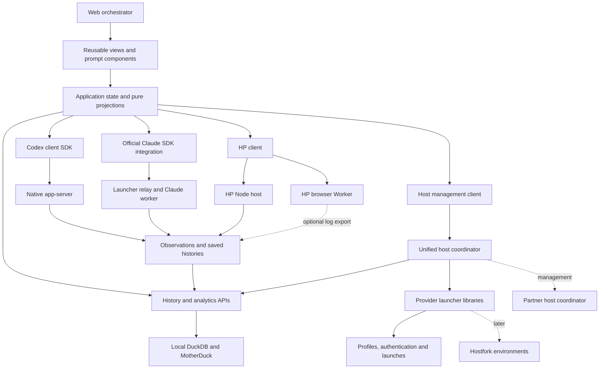

# Agent orchestrator: component map

**Status: design stubs for discussion, updated 19 October 2026.** This is the working map
for a web application that becomes an everyday place to find, launch, observe
and interact with Codex, Claude Code and HP agents across configured machines
and profiles. HP has one portable runtime with Node and browser hosts.

The application will drive development of the client SDKs and reusable UI
components. We will shape the experience through small mocks and real vertical
slices, then add sophistication. This map creates reviewable component stubs;
it does not establish a production application, new packages or a fixed public
API. Two disposable browser mocks now explore overview and session interaction;
their notes and feedback will feed a later concrete specification. The
application's final name and packaging remain open.
The [next mock rounds](next-mock-rounds.md) track the agreed three-round sequence,
starting with native history access, rich read-only rendering and authentication.
The [runtime contracts and gotchas](../../runtime-contracts.md) collect subtle
backend behavior to retain during implementation, including subscriptions,
resume side effects and background-job teardown. Use their RC IDs in slice plans.
The [visual direction](visual-direction.md) records the operator's evolving
preferences for density, color, motion and Habemus Papadum design-system reuse.
The [unified host coordinator](components/21-host-coordinator.md) is now an
accepted direction. Its [failure/recovery sketch](failure-recovery.md) explicitly
allows loss and agent-assisted relaunch from history; exact policies remain open.

The user has reviewed all 21 cards and added guidance to selected ones. Read the
[working method](methodology.md) for question timing and explicit intent, then
the [first-slice proposal](first-slices.md) for the two user-requested disposable studies.
Original comments remain in the cards; linked summaries carry cross-cutting
requirements to the appropriate owners without treating unanswered questions as
implicit decisions.
The new [O22 development/delivery entry](components/22-development-delivery.md)
and [development-flow sketch](development-flow.md) cover browser/Electron choices
and concurrent isolated dev instances without blocking the mocks.

## The experience we are working toward

Open the application and see the configured hosts, profiles and agents that
matter to the current work. Understand which are working, waiting for input,
disconnected, finished or worth investigating. Open one or several sessions,
submit rich prompts, select supported model/effort/service settings for a turn,
follow tools and children, and return to the overview without losing place.

Launch another agent with a chosen host, profile, working directory and per-run
overrides. Create a profile or complete its authentication when necessary. Search
past work, inspect a trace without activating an agent, and explicitly resume or
branch a conversation from a supported historical point. Query activity, health
and estimated cost across the corpus, locally or through MotherDuck. Later,
connect launches to Hostfork environments and stronger recovery workflows.
Basic recovery can already be designed around inspecting retained history and
relaunching work; it need not wait for environment restoration.

Conversation history does not restore a filesystem, reverse tool side effects,
recreate a process or replay a tool call. Those are separate environment
operations with their own evidence.

## Components to discuss

Each linked card contains purpose, existing foundations, an initial experience,
later directions and a place for your additions. IDs `O01`–`O22` are only local
discussion references; they do not prescribe package boundaries or delivery order.
Add, split, merge or rename cards as the application becomes clearer.

| Area | Card | Main question for the experience |
| --- | --- | --- |
| Client foundation | [O01 — Connections and shared client mechanics](components/01-client-foundation.md) | How does an app connect, observe, detach and recover its view without duplicating actions? |
| Provider SDK | [O02 — Codex client](components/02-codex-client.md) | How do we expose the complete native protocol and useful session handles? |
| Provider SDK | [O03 — Claude client integration](components/03-claude-client.md) | How does the official SDK fit the app and launcher lifetimes? |
| Provider SDK | [O04 — HP client and execution hosts](components/04-hp-client.md) | How does the same client experience reach Node and browser-owned agents? |
| Unified management | [O21 — Host coordinator and management client](components/21-host-coordinator.md) | How does one host service compose launchers, expose status and recover useful work? |
| Management | [O05 — Hosts, discovery and tracked sources](components/05-hosts-discovery.md) | Which machines/profiles/runtimes are in view, and how current is the inventory? |
| Management | [O06 — Profiles and authentication](components/06-profiles-auth.md) | How do I create/configure a profile and get its credentials working? |
| Management | [O07 — Launch and working configuration](components/07-launch-configuration.md) | What exactly will run, where, and with which effective settings? |
| Daily overview | [O08 — Agent overview and attention](components/08-agent-overview.md) | What is happening across my agents, and where should I look next? |
| Live work | [O09 — Session workspace and turn controls](components/09-session-workspace.md) | How do I interact with several conversations and control individual turns? |
| Live work | [O10 — Transcript and tool visualizations](components/10-transcript-tools.md) | How do I read streamed work and inspect the important details? |
| Live work | [O11 — Subagents and background jobs](components/11-subagents-jobs.md) | Who is doing what, who owns it, and what does stopping it affect? |
| Prompting | [O12 — Prompt composer and inspection](components/12-prompt-composer.md) | What will the agent receive, and how do I assemble and inspect it? |
| Prompting | [O13 — Voice, screen and pencil inputs](components/13-multimodal-inputs.md) | How do captures and editable input become intentional prompt material? |
| Historical work | [O14 — History, search and branching](components/14-history-branching.md) | How do I find, mark, inspect, clone or continue earlier work? |
| Understanding behavior | [O15 — Traces, health and cost](components/15-observation-health.md) | Why is a session stuck, failing or expensive, and what evidence supports that? |
| Across the corpus | [O16 — Ingestion and analytics](components/16-ingestion-analytics.md) | How do histories from many sources become useful shared queries? |
| Host interaction | [O17 — Files and remote commands](components/17-files-commands.md) | How do I inspect the working environment independently of an agent turn? |
| Later infrastructure | [O18 — Environments and recovery](components/18-environments-recovery.md) | What can be recreated or resumed when machines and processes disappear? |
| Application | [O19 — Shell, navigation and operator preferences](components/19-application-shell.md) | How do these views fit into one fast, dependable daily workspace? |
| Reuse and exploration | [O20 — Component lab and AIUI integration](components/20-component-lab.md) | Which pieces should stand alone, and what should move upstream? |
| Development and delivery | [O22 — Isolated development instances and packaging](components/22-development-delivery.md) | How do browser/Electron development and concurrent agents get independent working contexts? |

## Proposed composition and existing boundaries

The accepted direction is one host coordinator, initially foreground and
optionally daemon-hosted later, composing the existing launcher libraries.
A unified TypeScript management client handles discovery/status/launch; the
provider SDK handles the resulting session connection. Direct endpoints are
preferred where practical, with explicit relay paths when required. This does
not impose one provider protocol or a single central traffic route.

The coordinator can select observation processors, host local query/ingestion
services and relay management requests to partner hosts. Individual launchers
retain their library ownership boundaries. Worker placement, service hosting and
survival guarantees are still design questions; the existing libraries do not
gain coordinator-independent lifetimes merely by being composed here.

| Concept | Meaning to preserve |
| --- | --- |
| Host | A configured machine endpoint for managed runtimes. Availability and ownership are explicit. |
| Browser-local runtime | A facilitation/test agent owned by the current application/browser session, outside remote-coordinator administration. Optional log export does not change that ownership. |
| Host coordinator | The unified discovery/management/launch service on a machine, run foreground or later as its optional daemon; distinct from a live conversation endpoint. |
| Profile | Reusable provider configuration and authentication scope. Several runs/sessions may share it. |
| Launch/run | A particular runtime/process instance with an owner and lifecycle. It is not the whole saved conversation. |
| Session/thread | Provider-identified conversation and lineage, with live and historical views. Keep native IDs and host/profile provenance. |
| Turn | Submitted input and its effective settings; acceptance, execution and completion differ. |
| Subagent | A related agent with its own conversation and lifecycle. Provider-native delegation is distinct from future cross-provider orchestration. |
| Job | Work such as a command or async computation; stopping a wait, a turn, a job or an owner can have different effects. |
| Observation | Evidence from a named source and time. Missing/stale evidence is not proof that an agent stopped. |

Codex retains full typed/raw protocol access, including experimental APIs. Claude
uses its official browser/Node SDKs; the Python relay does not own a second
query. HP has a shared core and explicit host adapters. Shared views should
reuse meaningful concepts while preserving native fields and capability
differences. Unsupported controls need an explanation, not a simulated success.

Browser HP initially runs locally inside the overview application as a testing
and reuse vehicle for future static AIUI apps. Its smaller application tool set
does not imply native filesystem access, central administration or cross-tab
sharing. Local history/reload and any future same-browser coordination remain
questions to resolve when that slice needs them. The UI can combine these local
entries with host-managed inventory while preserving their separate origins.

Discovering an agent does not establish that it can be attached to or controlled.
The initial default is to launch through our owners. Native/external sessions
can appear as inventory/history where supported; live attachment needs a
qualified provider path. In particular, Claude's current managed worker ends
when its owning SDK client disconnects. Browsing saved Claude history is a
different operation, and arbitrary native-session attachment is not established.

Multiple views and clients are part of the intended experience. Where a provider
supports several live participants, preserve that. Do not impose a blanket
single-client rule. Request/answer races, view detachment, reconnect gaps and
provider-owned connections need explicit behavior.

The trusted-operator stance remains in effect: configurable sources, sandbox and
approval prompts off by default, optional MITM, and practical path/process
hygiene. Health findings are advisory until a separate automation workflow is
designed. There is no new authorization/grant framework in these stubs.

## Pragmatic recovery direction

The [recovery sketch](failure-recovery.md) distinguishes rediscovering a surviving
process, reconnecting to a live conversation, and reconstructing/relaunching work
from saved history. Prefer the strongest supported outcome that is practical;
do not require seamless continuation before delivering a useful internal tool.

Losing live execution or some unrecorded information is acceptable when the
outcome and uncertainty are visible. An operator or authorized recovery agent
can inspect available history/current workspace state and relaunch useful work.
Do not disguise that reconstruction as uninterrupted execution, or automatically
replay uncertain tool effects. Exact automation, acceptable-loss thresholds and
provider-specific policies remain open to preferences and failure spikes.

## Existing foundations and current limits

| Foundation | What exists now | What the application still needs |
| --- | --- | --- |
| [Launchers and profiles](../../implementation-status.md) | Python profile/process libraries, CLIs and selected management adapters. | Browser management SDK, configured host inventory and coordinated UI flows. |
| [Unified coordinator](components/21-host-coordinator.md) | Accepted direction and pragmatic recovery sketch. | Library composition, management client, peer routing and measured failure behavior. |
| [Codex client design](../../specs/codex-client.md) | Reviewed API plan and native protocol feasibility evidence. | Production TypeScript client and integrated browser experience. |
| [Claude integration](../../claude-handoff.md) | Official browser/Node examples, authentication and saved-history qualification. | Reusable app integration, clear ownership and wider platform/auth qualification. |
| [HP runtime](../../hp-agent-work.md) | Research implementation with Node/browser, tools, children, jobs and live checks. | Production extraction and a supported client-facing surface. |
| [Agent history](../../agent-history.md) | Python ingestion/sync and TypeScript query/forensics over a shared schema, local or MotherDuck targets. | Browser views, richer source adapters and live/historical reconciliation. |
| [AIUI source link](../../development.md#local-aiui-source-and-future-browser-apps) | Current framework source, public components and prompt toolkit; the disposable mocks now qualify source-linked dependencies, tools and selected graph/UI HMR. | Production app composition, live-runtime lifetimes and published-package qualification. |

The application remains at design-stub stage, with throwaway overview/session
mock studies now available. The new development/delivery entry is still proposed.
A future card should
record its actual maturity as **mock**, **implemented** or **qualified**, with
the relevant scope and evidence. An upstream component or a successful research
spike does not make the orchestration feature implemented.

## Progressive development

Apply the [question review](methodology.md#decide-which-questions-matter-now)
before each slice. The user subsequently authorized two parallel throwaway
overview and session/file-reference/explicit-submission studies, each with an
essence Markdown for later specification. See [first slices](first-slices.md)
for scope and investigation triggers. Review the experiences before broadening
the implementation or freezing shared interfaces.

The component catalog organizes responsibilities. Build order follows AIUI's
four layers for each selected vertical slice: pure functions, controls/cells,
components, then application composition. Cells own chosen asynchronous
boundaries; they are not copies of every SDK field or function.

| Phase | Pure functions | Controls and cells | Components | Application and review |
| --- | --- | --- | --- | --- |
| 0 — This discussion | Identify concepts and outcomes. | Identify owners/lifetimes; leave policies open. | Editable component stubs. | Add color, split components and choose the first experience. |
| 1 — Standalone mocks | Small transparent fixtures and view models. | Script realistic progress, errors and changes. | Explore one or two candidate presentations. | User reviews behavior and density; fixtures are visibly mocks. |
| 2 — Thin real workflow | Use SDK events and actual history projections. | Foreground coordinator composition and one qualified backend. | Reuse the reviewed components. | Launch/join, one turn, inspect a tool, detach/read history; show honest failure and relaunch outcomes. |
| 3 — Everyday multi-provider use | Preserve provider capabilities and identity. | Add host/profile inventory and concurrent views. | Integrate settings, jobs, history and basic rich prompts. | Exercise Codex, Claude and HP, adding each real provider without claiming parity. |
| 4 — Deeper tools | Shared diagnostics, corpus queries and richer prompt assembly. | Trace/ingest/asset lifecycles and background progress. | Advanced inspectors, capture inputs and analytical views. | Review real operator workflows and failure cases. |
| 5 — Stronger environments and recovery | Explicit recovery plans and evidence. | Integrate Hostfork and any chosen durable owners. | Recovery/workspace views. | Improve on the history-based fallback where cloud/fleet survival earns its complexity. |

These phases are a menu for selecting coherent slices, not a requirement to finish
every component at one level before proceeding. Early overview mocks should show
all three providers so shared UI choices are tested before the SDK boundaries
harden. The first backend and mockup are still open for your direction.

The existing Codex delivery stages C1–C5 remain the technical checklist. This
application supplies the concrete consumer and replaces a throwaway reference
UI as the eventual integration target. New multi-host profile/launch management
is broader than the old client's narrow `/launcher` status/capture/stop adapter;
keep that as a separate management responsibility rather than quietly expanding
the Codex protocol layer. O21 owns that unified management interface. Its optional
daemon and recovery modes require their own evidence rather than being implied
by client reconnection.

## Repository and reuse direction

Keep this discussion and initial application work in `pdum_agent_tools`. Candidate
homes, to create only when a slice needs them:

| Location | Intended responsibility |
| --- | --- |
| `typescript/apps/agent-orchestrator/` | Private browser application: routes, composition and operator preferences. |
| `typescript/packages/codex-client/` | Reviewed native Codex client. |
| Unified management client module/package in `typescript/` | Browser/Node client for the coordinator; exact package name is open. |
| Provider/client modules in `typescript/packages/` | HP client and thin Claude integration where real consumers establish a package boundary. |
| Reusable UI module/package in `typescript/` | Transcript views, session controls, prompt/capture composition and inspectors, with injected data/actions. Name and split undecided. |
| Existing Python packages | Storage readers, profiles, process ownership, capture and Hostfork adapters. |
| Coordinator composition module/package, location TBD | Initially Python library composition with foreground hosting; optional daemon/service mode later. |
| `experiments/` or an app/component lab | Disposable protocol experiments and clearly labelled interactive mocks. |

No manifests, dependencies or empty runtime packages are added by this map.
When creating an app, extend the production workspace deliberately and preserve
its catalogs/lock. Keep SDK and pure analysis imports usable without Solid.
UI code uses AIUI's four-layer methodology; presentation must not own provider
queries merely because a component mounts.

New orchestration-specific pieces may start here with clear data/action
boundaries so they can be reused or relocated. Improve existing AIUI primitives
upstream when they are the right owner; do not copy them into this repo. The
local `.dev/aiui` checkout is authoritative. Its catalog distinguishes shipped,
spike and proposed pieces; its internal voice/dock scaffolding is not a supported
consumer dependency. User-authorized local component incubation takes precedence
over a blanket requirement to place every new piece upstream immediately.

The [AIUI control/observation contract](../../specs/hp-aiui-integration.md) remains
a later lab: change published controls, correlate graph processing, then apply a
pure result selector. Conservative error/supersession defaults with caller policy
hooks are recorded; the orchestrator does not need to implement that mechanism
before showing sessions.

## How to add detail

Pick any card by title or ID and describe the desired interaction. Add that to
its **Your additions** section; retain the original comments and add linked
summaries/accepted decisions in the appropriate components. Record when an
unanswered question will matter using the working method. A new component gets the next unused ID
and a row above. Proposals for what should be mocked are not implementation
authorization by themselves; the next selected slice should state its visible
experience, inputs, owner and review point.

The immediate review can use the two runnable mock studies and their notes,
alongside this map. The [preview runbook](https://github.com/habemus-papadum/pdum_agent_tools/blob/main/experiments/spikes/055-orchestrator-mock-lab/README.md)
has the command and paths. These studies make no provider calls, native-agent
launches or history-ingestion writes.
