# Agent orchestrator: system and library proposal

**Library boundaries accepted; review guidance recorded 26 October 2026.** This is
the construction direction after the spikes, not a claim that the system has
been built. The original
[component cards and your comments](index.md) remain the requirements record.
This page is the short review: library responsibilities, governing decisions,
dependencies and delivery order. Implementation detail is linked underneath.

**S0 now has working code:** [the foundation guide](../../orchestrator.md) describes
the coordinator identity service, shared contracts/management client, portable
pricing and AIUI app/dev supervisor. Provider launch/session integration remains
the next slice; the full library roles below are still the broader target.

## The recommended shape

Build a browser application over **one management service per host**, with direct
provider connections for conversations. Reuse the five existing Python backend
libraries, add one Python coordinator, add six focused TypeScript libraries, and
extend the existing TypeScript history library. Components within those libraries
are modules/subpaths, not another package for every widget or feature. Names below
are proposed; they do not authorize publication or prescribe a separate service
process for each library.

The application manages Codex, Claude and HP without pretending they share every
operation. Common views and calculations share evidence and explicit actions;
native provider APIs remain available. HP has one portable runtime with different
execution/storage adapters for Node and browser. A browser-hosted HP agent can
also be embedded in a static AIUI application without the coordinator.

[Open diagram](system/diagrams/layout.svg) · [Mermaid source](system/diagrams/README.md).

This is the runtime layout, not an import graph. A second host has its own
coordinator and ownership; relaying through a partner is optional. A separate
session URL does not promise survival of the process that owns its relay.

## The libraries

TypeScript names below use the `@habemus-papadum/` scope. **New** means proposed
production extraction; research implementations are evidence, not finished packages.

| Library and role | Principal components / functionality | Design choices that govern it |
| --- | --- | --- |
| **`agent-core` — shared foundation, new TS** | Scoped host/profile/run/conversation references; observation and coverage types; action target/timing/outcome; display contracts; small transport/request mechanics where Codex and HP genuinely share them. | No UI, database, credentials or provider agent loop. Retain native payloads and unknown outcomes. Do not invent one universal conversation API. |
| **`codex-client` — provider client, new TS** | Generated native protocol; connection and requests; threads/history; live turns, steering and approvals; files/processes; Codex projections. | Preserve the reviewed full typed/raw API, experimental access and native errors. Read is passive; join/resume can have effects. Multiple responders are allowed; uncertain sends are not blindly retried. |
| **`claude-client` — provider integration, new TS** | Official Agent SDK integration; feed/replay decoder; connection replacement; shared permission state; native history handoff; Claude projections. | Reuse the SDK with the client wrapper qualified in 071. Historical controls must not execute again. The server owns the native process; clients interpret its output. Hook/MCP callback ownership remains explicit. |
| **`hp-agent` — portable agent and client, new TS** | Runtime/turn/input control; tools, subagents and jobs; model connector; client protocol; archive/read/restore/fork; `/node` and `/browser` adapters. | One core for both hosts. Storage uses an async opaque-key/byte seam. Restore context into a new owner; do not revive old tools or jobs. Preserve source-aligned Codex behavior and name deliberate HP extensions. |
| **`orchestrator-client` — management client, new TS** | Hosts, profiles/auth jobs, launch/status/stop, history references, ingestion jobs and typed connection descriptions. | Works in browser/Node without mandatory provider SDK imports. Launch, create conversation, attach and send remain separate. A returned endpoint includes ownership and lifetime facts. |
| **`agent-history` — shared analysis, existing TS extended** | Pure pricing/usage/health calculations; SQL/questions/invariants; provenance and lineage; query-driver adapters; annotations and existing terminal tools. | One calculation owner for live clients, host processors and historical analysis. Separate browser-safe `/analysis` and SQL from Node I/O. Missing usage is not zero; estimated cost is not a subscription bill. |
| **`agent-ui` — reusable UI, new TS** | AIUI controls/cells and action bindings; dense agent collections; transcript/tool entries, lenses and timelines; composer; source view; history/profile/analytics panels. | Solid/AIUI reads explicit data/action contracts. Components do not launch or own agents. Preserve compact, colorful, progressively detailed presentation and keyboard/mouse/tool parity. |
| **`pdum.orchestrator` — host composition, new Python** | Run/operation registry; provider adapters; profile/auth jobs; endpoint handoff; host file/command access; observations, ingestion/query coordination and partner-host routing. | One foreground owner, optionally daemon-hosted later. Compose libraries rather than CLI scraping. No second conversation engine, provider daemon or semantic Claude command arbiter. |
| **`pdum.codex_launcher` — existing Python** | Native homes/config/auth; process launch, relay, observation and PID-aware stop. | Native settings and concurrent-home behavior stay native. Launch overrides do not edit profile config. Idle retention and tool lifetime retain their actual Codex semantics. |
| **`pdum.claude_launcher` — existing Python, lifetime revision needed** | Profiles/auth; native workers and byte relay; SDK history helpers; new independent launch/attach and running-process journal. | Adopt 068's process ownership while preserving 071 SDK compatibility. Disconnect detaches one client; explicit stop ends the process. No private recovery reconstruction. |
| **`pdum.agent_history` — existing Python, HP adapter needed** | Source readers; `history.yaml`; incremental ingestion/staging; schema, provenance and coverage; local/MotherDuck writes. | Keep the existing schema/config owner. Native local readers stay here; HP's portable reader exports records through a Node helper rather than duplicating its codec in Python. |
| **`pdum.mitm` — existing optional Python** | Explicit upstream interception, generic capture and processor hooks. | Remain independent of agent vendors. Off unless selected; observation/export never gates healthy forwarding. |
| **`pdum.hostfork` — existing optional Python** | Host-derived execution environments, storage and process-scope lifecycle. | Add environment-backed launches after the ordinary workflow works. Reopening management does not restore lost pipe handles or roll back tool effects. |

Detailed components, APIs and evidence: [backend libraries](system/backend.md)
and [client/UI libraries](system/client-ui.md). The application itself and a
private component lab compose these libraries; they are not additional general
frameworks.

## What we reuse upstream

- **AIUI/Solid and Habemus Papadum design:** scoped controls/actions, cells, mode
  engine, keys, lenses, rich content, source tooling and design tokens. Browser
  DuckDB-WASM/Mosaic supports the small changing overview table and crossfilters;
  corpus analytics uses its configured database separately.
- **Current `aiui-prompts` and `aiui-prompts-inspector`:** prompt records,
  compilation/provenance, delivery lowering and rich inspection. The local package
  is now TypeScript, unlike the earlier Python-based HP probes. Migration/fidelity
  against this current source is an explicit first-stage check, not a required
  Python prompt service. Public audio/STT/screen/pencil packages supply later
  modalities; credential adapters remain host-injected.
- **Provider surfaces:** generated Codex app-server types, the official Claude
  Agent SDK and its history helpers, and the existing direct OpenAI Responses
  connector for HP. We do not replace HP's proven loop with another agent framework.
- **Existing infrastructure:** Typer/FastAPI, current Python/TS history packages,
  DuckDB/MotherDuck and optional observation exporters. Internal AIUI dock/oracle
  scaffolding can support development but is not a production dependency.

Read the definitive `.dev/aiui` checkout and its package contracts during each
slice. Improve useful primitives upstream when appropriate; assess affected demos
instead of imposing an invented backwards-compatibility guarantee.

## Decisions carried across all libraries

**Context and default scope:** seed launch host/project/cwd from the place where
the UI action occurred, make the origin visible, and allow overrides. Working
model/turn settings carry forward within that conversation; only a separate
explicit Save as default action changes profile/application defaults. Include
worktree selection, preferring a verified native/existing provisioner over a new
custom worktree manager.

**Simple initial policy:** no Codex host subscription solely for keepalive or
observation. Expose a longer unload interval at launch, with its actual native
server-wide scope visible. Avoid electing a main Claude observer unless a concrete
callback makes it necessary. Credential changes do not coordinate or protect
other sessions; native failures remain visible.

**Simple initial composer:** a text-only placeholder produces a structured
rendered prompt. Provider adapters turn it into the destination's native input.
The boundary can later carry images and richer content; authoring those inputs
belongs to separate disposable experiments and does not gate the main workflow.

**Separate four sources:** native history for ordinary browsing; a Claude running
process's feed for attachment; optional debug captures for development; and
ingested tables for corpus statistics. Similar-looking views do not make these
sources complete or interchangeable. HP owns its persisted conversation format.

**Separate lifetimes:** a profile, conversation, runtime, client connection and
job are different resources. A component unmount is not a runtime stop. Same-PID
reconnection differs from restoration from history; loss and uncertain outcomes
remain visible. Full crash recovery is not a prerequisite.

**Keep intent explicit:** show target, timing and effect—new turn, steer, queued
work, interrupt, detach or stop. Shared clients can observe and respond; native
outcomes settle conflicts where supported. Convenience inference comes later,
with visible reasons and overrides.

**Reuse computations, not infrastructure assumptions:** price/health reducers
run in browser, offline Node or one optional coordinator-owned analysis worker.
That worker only consumes observations; it does not create conversation queries.
Local DuckDB reads/writes have one coordinated owner rather than competing Python
and Node file handles. Higher-scale remote placement can follow measured demand.

**Build in the trusted operator environment:** retain the agreed native config,
easy auth reuse, all-interface listeners and optional interception. Keep wrong-path
and wrong-process hygiene without adding grants, arbitrary expiry, capture caps
or a permission framework to this application.

## Delivery order and review

| Stage | Outcome to review |
| --- | --- |
| S0 — contracts and isolated development | Small shared types and pure pricing entrypoint; source/SDK pins; one command starts an isolated frontend/coordinator; current prompt-toolkit migration checked. |
| S1 — one useful Codex workflow | Select profile, launch, inspect history, attach, send, see tools/usage, respond from either browser and stop explicitly. Read-only source links begin here. |
| S2/S3/S4 — independent lanes after that foundation | Claude persistent-worker integration; HP portable extraction; shared analysis and real ingestion. They share contracts, not mutable implementation files. |
| S5 — integrated daily application | Multi-provider overview/session/history, profile/auth flows, source viewing and simple text composer, statistical drill-down, keyboard navigation and diagnostics. |
| S6 — extensions chosen through use | Additional hosts/relay, MotherDuck publishing, Electron, Hostfork/cloud environments and more automated health/recovery. Rich prompting has an independent experimental lane. |

The [implementation plan](system/implementation.md) gives the dependency graph,
acceptance checks and ownership for parallel work. Each UI slice follows pure
functions → controls/cells → components → application. A useful vertical slice
comes before broad extraction, and the user reviews the experience before widening it.

The library boundaries and browser-first direction have been accepted.
Precise APIs and package layouts can be refined during implementation within those
boundaries. The [decision register](system/decisions.md) records the review answers,
delegated choices and remaining product questions, with their needed-by triggers.
This review update changes documentation only; it does not claim runtime migration
or package implementation.
