# Client libraries, shared calculations and UI

**Library boundaries accepted; review updated 26 October 2026.** This is the client/UI part of the system
design. It consolidates the reviewed [Codex API baseline](../../../specs/codex-client.md),
the [component map](../index.md), the user's comments and the later experiments.
`agent-history` and referenced AIUI packages are existing libraries. S0 now adds
small production-workspace `agent-core`/`orchestrator-client` packages, a portable
analysis entry and the application foundation; see the [checkpoint](../../../orchestrator.md).
The full roles below remain targets. Vendor clients, HP extraction and reusable
`agent-ui` are still upcoming; publication is a separate decision.

## The boundary to preserve

Share identities, evidence and presentation where their meanings agree. Keep each
provider's native operations available. A common transcript does not imply a common
queueing rule, disconnect lifetime, callback protocol or recovery guarantee.

The UI consumes explicit data and action interfaces. It does not own a hidden
second agent loop, infer acceptance from a successful socket write, or turn
reading old data into a resume operation. The [runtime contracts](../../../runtime-contracts.md)
are implementation inputs, especially RC-01–05, RC-07–10 and RC-12–14.

[Open diagram](diagrams/dependencies.svg) · [Mermaid source](diagrams/README.md).

Arrows mean code dependencies, not network traffic. The app selects provider
drivers; a management-only consumer need not install or initialize every provider
SDK. Provider projection subpaths transform native records into shared facts;
the analysis library does not import vendor clients. Database or SDK construction
does not occur merely because a module is imported.

## The proposed TypeScript libraries

### `@habemus-papadum/agent-core`

**Role:** the small, framework-independent vocabulary shared by clients, analysis
and UI. It should remain much smaller than the provider libraries.

| Components | Function and design rule |
| --- | --- |
| References | Host, profile, run, conversation, turn, item, job and source references. Keep their identities distinct; include provider and source scope where collisions are possible. |
| Observation and view contracts | Source/version, receipt sequence/time, native reference, freshness and coverage; transcript blocks and typed measurement facts with original records reachable. Missing, not collected and zero remain distinct. |
| Action/result contracts | Explicit target, timing and effect, requested/effective settings, pending/accepted/committed/rejected/unknown outcomes. No universal `send()` whose meaning silently changes while a turn is active. |
| Assets and navigation | Recorded asset reference versus retrieval capability, source selection and cross-view location. A current host file is not labelled as the historical bytes from a prior turn. |
| Reused transport mechanics | Small disposal, subscription and JSON-RPC mechanics where Codex and HP actually share them. Claude retains its SDK routing; an NDJSON feed is not forced into the Codex protocol. |

This library has no Solid, DOM, filesystem, DuckDB, provider SDK, automatic clock
or process dependency. It does not define another persistent ingestion schema:
the Python-owned history schema remains the analytical storage contract. Core
contracts represent application facts and references, with adapters between them
and that schema. Evidence: RC-07/09/10/12 and [069's source distinctions][s069].

### `@habemus-papadum/codex-client`

**Role:** full native Codex access in browser and Node, with useful conveniences
that use the same connection. Preserve the reviewed package name and API depth.

Components are generated protocol types and metadata; WebSocket and later
qualified transport adapters; bidirectional requests/notifications; pending server
questions; native session/history/admin operations; explicit turn controls; remote
file/process operations; and pure native-record projections. Keep the generated
wire surface and raw/unknown-message access available alongside conveniences.
Experimental negotiation is part of the default design, as already reviewed.

Reading native history never calls resume. Joining is explicit and can load a
runtime or activate a saved goal. Multiple listeners and responders remain valid;
the client reports native outcomes instead of inventing an exclusive controller.
Connection loss does not justify resubmitting an input whose outcome is unknown.
Codex's snapshot/notification join is not promised to replay the whole previous
stream. Final native items reconcile partial text that a late join missed.

Pure projection code belongs on a separately importable subpath so the browser,
an optional coordinator analysis host and historical diagnostics can interpret
the same observed records without opening a connection. Cross-provider pricing
and health calculations live in `agent-history/analysis`, rather than remaining
duplicated inside the earlier proposed Codex `/analysis` module.

**Evidence:** [025–034 findings](../../../codex-client-findings.md), the reviewed
[API](../../../specs/codex-client.md), RC-01–07 and [064/065][s064]. Existing native
types, method names and source-aligned organization are the starting point; HP's
subset must not limit Codex's full interface.

### `@habemus-papadum/claude-client`

**Role:** official TypeScript Agent SDK reuse behind an application-owned client
attachment/replay layer. The Python owner manages the native process; it does not
own another conversation query or arbitrate conversation semantics.

Components are management-descriptor attachment, feed framing and replay progress,
an independent raw record view, an SDK query adapter, connection replacement,
pending-question reconciliation and pure native-record projections. Browser and
Node entrypoints share these semantics while using different SDK transport seams.

The wrapper keeps historical control frames passive before they reach executable
SDK callbacks. A new Query replaces a disconnected Query against the same live
process; that is not native history resume. Native initialization re-arms qualified
pending permissions, and accepted native responses settle obsolete local question
state. Prompts with uncertain delivery are never automatically replayed.

The Node SDK has the public virtual-process seam already exercised by our examples.
The browser export needs framing and environment adaptation. [071][s071] qualified
that inside an isolated realm without an SDK source patch. Production extraction
must isolate it, for example in the SDK's own Worker, rather than replacing an
entire application's WebSocket behavior. This is an implementation gate, not a
claim that a public browser custom-transport factory already exists.

SDK-hosted MCP functions and hooks still belong to a JavaScript owner; disconnect
does not preserve that owner's code. Re-initialization may re-register hooks.
Qualify the particular callbacks the application exposes instead of treating the
tested tool permission as proof of every SDK feature. Keep official history
helpers in the existing host-side history path. **Evidence:** [068][s068], [071][s071]
and RC-08/13. The existing production launcher still has its older disconnect
behavior until the new owner path is implemented.

### `@habemus-papadum/hp-agent`

**Role:** one portable agent implementation and client protocol, with host-specific
execution and storage adapters. Begin with subpaths, not separate Node and browser
agent implementations.

| Subpath / components | Function |
| --- | --- |
| `/core` | Session/turn loop, input queue, context, source-aligned tool dispatcher, parallel tool scheduling, agent mailboxes and independent job registry. No Node or browser imports. |
| `/client` | Selected native-shaped messages, explicit HP extensions, MessagePort/network binding and replay attachment. Unsupported native methods remain explicit. |
| `/history` | Versioned archives, passive catalogue/read, exact completed-checkpoint fork, fresh-owner restore, provenance and storage-independent codec. |
| `/node` | Process/filesystem/tool adapters, filesystem store and Node hosting entrypoint. Native handles remain host-owned. |
| `/browser` | Worker/application hosting, MessagePort binding and browser storage adapter. IndexedDB is the tested adapter, not a required storage technology. |

The provider connection remains injected. The current implementation uses direct
Responses over WebSocket because the [SDK-fit experiment][s038] did not establish
the needed steering/freeform behavior through the Agents SDK. Keep prompts and
tools faithful to the inspected Codex baseline while exposing HP-specific jobs
and application tools deliberately. A subagent is another async execution; it
does not imply an OS subprocess.

Archive restore imports context into a new owner and rebinds tools/credentials.
It does not recreate a Promise, a terminal, a live job or queued-message delivery.
Fork points identify exact owner/sequence checkpoints because pre/post-compaction
contexts can share a turn ID. Browser-owned HP stays visibly local to its page/
Worker application; it is not silently administered by the remote coordinator.
**Evidence:** [HP work](../../../hp-agent-work.md), [070][s070], RC-04/08/12/14.
The future production package and network/management adapter do not yet exist.

### `@habemus-papadum/agent-history`

**Role:** retain the existing owner for analytical schema/query logic and shared
usage/health computations. Extend its boundaries instead of creating a parallel
statistics package.

Proposed entrypoints are `/analysis` for pure identity-aware calculations,
`/sql` for query definitions over an injected runner, and `/node` for native
DuckDB access, CLI and table-refresh I/O. A browser-safe entrypoint must not import
the current Node root transitively or require loading a native DuckDB binding.
Node dependency installation/export packaging is a qualification task; changing
only an import spelling is insufficient.

The orchestrator's local SQL runner calls the coordinator-owned database executor.
Direct `/node` file access is for standalone/offline tools or an explicit handoff
with handles closed; the analysis worker must not hold that file open while the
Python ingestor writes it. See [database ownership](backend.md#observation-analysis-and-the-four-stores).

Analysis accepts facts from provider projections, history documents or ingestion
adapters. It counts a response once, preserves source/actor/endpoint scope, and
retains unknown coverage. Live context occupancy, cumulative billed usage and
estimated API cost are different measurements. Health takes an explicit `asOf`
and evidence: repeated tools, sandbox problems, pending questions, context or
cost pressure are advisory facts before any operator-selected automation policy.

One computation can run in a browser, Node, an optional coordinator analysis host
or offline diagnostics. Where it runs is a hosting decision; Python remains the
reader/writer of local provider storage and does not duplicate the calculations.
Native conversation history and analytical DuckDB tables remain separate sources.

**Concrete extraction work:** split pure pricing from Node refresh imports;
recognize legitimate out-of-turn compaction in invariants; register the HP source
adapter; review existing unscoped query joins; and preserve annotation provenance.
Schema v5 already accepted the tested HP rows. **Evidence:** [061][s061], [069][s069],
[070][s070], RC-09/10/14. Do not fix an invariant by inventing data it expects.

Reuse the existing `Annotations` owner for analytical tags: a sibling local tags
DuckDB file, or the `tagsdb` schema on MotherDuck, so rebuilding facts need not
erase annotations. Native Codex attachments are a different owner and have their
own add/remove semantics, not an assumed upsert or two-way sync. Before exposing
cross-provider tagging, decide whether a subject means a logical conversation or
a particular host/profile/source capture; existing identifiers alone do not settle
that choice. Do not introduce a second tags configuration/store in the UI.

### `@habemus-papadum/orchestrator-client`

**Role:** typed browser/Node management access to the unified host coordinator.
It lists configured hosts/profiles/runs, drives existing profile/auth/config
operations, launches/stops owned work, reads operational freshness and returns
provider connection descriptors. It does not replace the provider session SDKs.

Components are management transport, host selection and reconnect state,
profile/auth operation progress, launch/stop requests and scoped identity mapping.
A descriptor carries provider, host/profile/run identity, endpoint, native session
identity when known, capabilities and lifetime facts. The app chooses a provider
driver from it. A second host/coordinator is another configured target; discovery
does not imply permission to attach to an arbitrary externally started process.

The library depends on core contracts, not on Solid or all vendor packages.
It preserves the last observation on contact loss and labels it stale. Provider
login status, credential reference and last successful model access are separate
facts. Forms map to existing owner operations; they do not create a new durable
native-config schema. **Evidence:** [060][s060], [062][s062], [063][s063], [066][s066],
[O21](../components/21-host-coordinator.md), RC-01/07/11.

## UI libraries and application composition

### Which facts are computed where?

This answers the [O01 review](../components/01-client-foundation.md#your-additions)
without requiring every view to subscribe to every full conversation.

| Fact or operation | Initial source and computation placement | Consequence |
| --- | --- | --- |
| Profiles, owned PIDs, endpoints and launch/stop outcomes | Coordinator over existing launcher libraries; management client receives observations. | Cheap inventory works without loading every transcript. A stale PID record does not become a live session claim. |
| Detailed turn stream, pending questions and submission outcomes | Selected provider client and pure provider projection. | The session view has the strongest evidence from its actual connection; protocol-specific unknowns remain visible. |
| Fleet summaries and advisory health | Process metadata initially; optional coordinator observation plus one application-owned TS analysis host can derive richer summaries using the same projection/analysis modules. | Analysis runs asynchronously off forwarding. Failure marks derived summaries stale; Python does not duplicate TypeScript semantics. |
| Usage/cost/cache and time/context views | Shared `agent-history/analysis` over whichever evidence source is available: selected live client, host observation or historical input. | Location changes do not change the formula; source coverage can still change the answer. No fabricated context meter from cumulative billing. |
| Native historical reading and continuation | Native host history helpers or HP archive repository; provider-specific adapter. | Reading starts no model. History remains available independently of optional debug captures or a rebuilt analytical database. |
| Corpus statistics and annotations | Existing ingestion writer plus `agent-history/sql` over local DuckDB or a configured MotherDuck target. | SQL cost/grouping queries need source-scoped identity and explicit freshness. Reuse the existing annotation owner. |
| Overview filtering/grouping and visible totals | Small browser summary table, Mosaic selections and pure view projections. | Full tracked-set versus filtered known-cost/count denominators stay available; filtering never changes underlying execution. |
| File/image retrieval | Explicit source/asset resolver using the appropriate native file API, host service or captured bytes. | A relative link carries working-directory/host scope. Current file contents and historical captures retain different provenance. |

Start with 30–40 entries and drill-down. Measure receipt, projection, transfer and
rendering cost before promising thousands of detailed views. View density is not
proof that fetching/parsing the underlying records is cheap. The optional analysis
host is one hosting choice for shared functions, not one process per plugin.

### `@habemus-papadum/agent-ui`

**Role:** reusable agent-facing presentation and interaction slices built on
public Solid/AIUI packages. Keep one library initially, with optional heavy
subpaths for rich content, Mosaic statistics and later multimodal input. It takes
view data and explicit action functions; it does not create provider processes
or import a provider SDK merely to draw a component.

| Component family | Main pieces and interaction |
| --- | --- |
| Overview | Compact metrics, provider/status glyphs, detail levels, cards/list, independent grouping/sorting, group collapse/focus, selected-agent inspector and stale/unknown evidence. Keep filtered/all counts and known-cost proportions visible. |
| Session | Transcript items, compact tool pills, pending questions, model/effort/tier controls, explicit input delivery mode, runtime/connection state and multi-client outcome presentation. |
| Navigation through evidence | Usage/context/cache plots, time/cost/token minimap, compaction and error marks, parent/child/job tracks, and jumps back to the referenced native item. Preserve real clocks and coverage. |
| Rich content and source | Markdown, code, math, Mermaid and images; preview → detail lens → optional pinned selection pane; raw records and unknown message fallback. File links resolve against the correct host/workspace, with source selection usable in prompting. |
| Management journeys | Context-seeded host/project/cwd, reviewable launch/worktree choice, native-config preview/editor, authentication progress and explicit lifecycle effects. Working overrides are separate from explicit default edits; credential changes do not coordinate other sessions. |
| History and analysis | Passive native-history catalogue/viewer, explicit resume/fork point and unsent draft handoff; separate ingestion configuration/progress and SQL/Mosaic views, connected by scoped references. |
| Input and commands | Initial text-only draft producing structured rendered content, simple source-text insertion, command palette and shortcut hints. Rich authoring/assets belong to independent side experiments. Space opens a grouped map when not typing; keyboard, mouse and agent tools share actions. |

The design follows the [provisional visual direction](../visual-direction.md):
dense anchored chrome, independently scrolling work areas, useful color, texture
and motion grounded in Habemus Papadum's design system, with detail available on
demand. Provider identity is separate from execution state. Filters and collapsed
groups never alter runtime ownership or accounting denominators. Phone layout
reflows the same component tree; it is not a second application implementation.

The overview can upsert its relatively small summary set into browser DuckDB and
use actual Mosaic crossfilters. Keep that table distinct from the historical
ingestion database. Corpus statistics can use the same query contracts against
local DuckDB or later MotherDuck. The database/coordinator/selections are durable
resources; selected dimensions are declared once and shared by widgets and tools.
Do not open thousands of full session streams merely to draw aggregate cards.

Launch selectors derive values from the action's UI context, with visible origin
and overrides. Model/effort/tier selectors edit the current conversation's working
settings, carried into its next turn. They never imply saving profile/application
defaults; that has its own explicit action. Avoid cross-session settings locks or
credential coordination. Codex has no host keepalive subscription; longer unload
timing is exposed with its real server-start scope.

**Evidence:** [053/054][s053], [059][s059], [061][s061], [064/065][s064] and [067][s067].
Those pages establish interaction and selected data behavior; their entire stores
and backend scaffolding should not be copied into the reusable package.

### AIUI is the framework boundary, not the provider boundary

Use the current local checkout `.dev/aiui` as the definitive source. Its
`skills/aiui-architecture/SKILL.md` and `packages/aiui-viz/CATALOG.md` were read
for this design at commit `e17191ff19447121882b19de890739cc8b9f6835`.
The [pinned catalog][aiui-catalog] and [architecture skill][aiui-skill] preserve
that source boundary. Relevant public dependencies are:

| Existing dependency | Reuse |
| --- | --- |
| `@habemus-papadum/aiui-viz` | Pure-to-reactive slices, scoped controls/actions, cells, durable resources, source-aware tools, Lens, TextView/TeX/Mermaid, keys/mode engine, Mosaic/DuckDB bridges, testing and page boundaries. Respect each catalog row's shipped/spike status. |
| `@habemus-papadum/aiui-design` | Typography, color, geometry and chart/theme hooks. Dense agent components can contribute reviewed recipes upstream. |
| `@habemus-papadum/aiui-source-processor` | Identity/source stamps and dev source inspection; installed before the Solid transform. It does not launch backends or mount a dock. |
| `@habemus-papadum/aiui-prompts`, `aiui-prompts-inspector` and `aiui-prompts-vite` | Structured prompt records, compilation/provenance, delivery lowerers and inspection; separate prompt-JSX routing from Solid JSX. Validate provider lowering and migration before using it for the first real composer. |
| Public audio, dictation, screen-capture and pencil packages | Later voice/screen/ink acquisition into explicit prompt assets. Keep provider support and asset retention visible rather than silently reducing unsupported input to text. |

**Prompt source update:** earlier HP work used the Python prompting toolkit. The
current local `packages/aiui-prompts/package.json` identifies a TypeScript
`@habemus-papadum/aiui-prompts` package, version `0.23.0+dev`, with portable semantic
records and no Python runtime dependency. Use that current source for the proposed
browser/Node composer. Migrating the old Python-based HP prompt preparation and
preserving its native prompt bytes/provenance is an extraction gate, not an
implicit completed migration or a reason to add a browser Python service.
The current [prompt inspector][prompt-inspector] already provides `PromptPreview`
with a raw-text toggle and full-inspector dialog. Its `onExpand(controller)` hook
can put that same controller in the host's pinned side panel, preserving selection
and folds. Reuse that public surface when the separate prompt-editor experiments
call for it; the initial composer needs only text entry and the structured-content
contract, not a full inspector. It is not a
claim that every native session message is already a structured prompt record;
ordinary transcript blocks still need their own source adapter.

Build each UI slice in the established order: pure projections → controls/cells
→ components → application. A reusable slice is a scoped store factory plus a
cells factory inside the app's graph; do not share one global graph instance among
panes. Cells handle asynchronous reads and projections. Launch/send/interrupt are
explicit actions, not side effects of a cell recomputation or a render.

Keep live controllers, Workers, connections and database instances under explicit
durable ownership. Component remount/HMR or route deactivation must not accidentally
close them. Neither HMR durability nor storage persistence promises survival of
browser destruction. The mode engine manages UI mode/resource claims; it does not
replace turn queues, native agent mailboxes or the job scheduler.

Publish normal controls/actions through the same AIUI tool surface used by the UI.
Source/selection/report and optional raw debug captures support the operator-agent
development loop. Do not depend on the upstream internal dock/oracle/live packages
as production libraries. A development-only dock may remain disposable scaffolding;
the public tools and component inspection should remain useful independently.

The later [control/observation contract](../../../specs/hp-aiui-integration.md)
still means changing published signals/actions and observing their consequences,
not asking a cell to compute. Its revision correlation, supersession and progress
policies remain a later focused integration; they do not block this session UI.

### Applications, not more foundational packages

The orchestrator app composes the libraries: tracked hosts, provider-driver
selection, live controller registry, routes/panes, drafts and pinned selections,
native history, statistical views, and optional browser-local HP entries. A common
navigation reference can open an item from a statistical result, native history
or live transcript without confusing their source or activating work implicitly.
Native versus application-owned tags/read markers retain explicit ownership.

The component lab consumes the same UI slices with real recorded examples and
labelled fixtures. Its previews use pure data and cannot launch sessions merely
because all preview cards are mounted. Reusable capabilities stay in their owning
library; app-specific navigation and workflow composition stay in the app.

Start with one browser-compatible frontend plus an isolated foreground backend.
Use per-instance ports, state/profile roots, databases, caches, logs and browser
contexts so parallel agents do not accidentally share runtime work. A single
document routes between views, preserving its deliberate client ownership.
Electron can later host the same frontend when a concrete desktop interaction
requires it; do not commit to two independently implemented UIs. See
[development flow](../development-flow.md) and [O22](../components/22-development-delivery.md).

## Dependencies, acceptance and questions at the right time

The first common contracts must be small enough for provider and UI work to
proceed independently: scoped references, connection descriptors, observation
coverage and explicit action outcomes. First integrate and review the S1 Codex
workflow. Then Claude, HP and broader analysis proceed in the parallel lanes of
the [implementation plan](implementation.md); independent preparation can happen
earlier without freezing conflicting contracts. Integrated UI wiring waits for the relevant actual operation,
while presentation components can be developed against captured records and
labelled unsupported capabilities.

Each provider must pass actual Node/browser checks at its supported boundary.
Retain native request outcomes, history-without-resume, late join gaps and multi-
responder behavior. Claude additionally gates production on passive callback
replay and pending-permission reattachment. HP gates on fresh-owner context,
historical fork source preservation and storage-adapter parity. Shared metrics
must match live, saved and actual database sources within their stated coverage.

UI acceptance adds pure projection checks, AIUI surface/graph tests, real browser
operation through published tools, source inspection, HMR lifetime checks and
desktop/phone review. These checks establish different things; a fixture-driven
UI test is not upstream provider compatibility. Future SDK upgrades re-run the
relevant native contracts, rather than silently inheriting old evidence.

| Decision status | Question and needed-by point |
| --- | --- |
| Already selected | Native capabilities stay accessible; multiple clients are allowed; explicit intent comes first; ordinary history is provider-native; storage is host-independent; browser HP is locally owned. |
| Delegated engineering | Package/module cuts, pure adapter shape, renderer implementation and isolated development mechanics. Choose from source/evidence and report material tradeoffs. |
| Selected lifetime direction | No retained Codex host subscription; offer longer native server-start unload timing. Claude process ownership remains independent of clients; HP uses the delegated completed-checkpoint policy. Stronger survival promises need separate evidence. |
| Avoid primary Claude observer | Do not elect a main client now. Bring back a specific hook/MCP case only if its actual execution requires an owner-selection mechanism. |
| Context and overrides selected; other persistence deferred | Launch context supplies host/project/cwd with review/override. Conversation working settings carry forward; saved defaults require explicit action. Draft/pin/layout reload or cross-browser persistence beyond that still needs concrete examples. |
| Ask before cross-provider tagging | Does an annotation target a logical conversation or one host/profile/source capture, and should the operation use native metadata or the existing analytical annotation store? No implicit two-way synchronization. |
| Ask before automatic health actions | Which thresholds should draw attention or trigger work? Start with inspectable facts and operator-selected diagnostics; do not infer a stop/restart policy from a chart. |
| Deferred until relevant slice | Cross-tab HP hosting, arbitrary unfinished-tool restore, asset retention/cloud retrieval, voice/pencil capture policy, Electron delivery and the slow-cell observation contract. |

Credential changes remain independent of other sessions, exposing native outcomes
instead of protective coordination. Rich prompting is explicitly off the main
workflow's critical path: text placeholder → shared prompt record → structured
rendered content → destination-specific native messages. The interface can later
carry images while each destination retains its actual capability limits.

AIUI is a young library. Make pragmatic upstream improvements where a primitive
belongs there, with relevant tests and affected-demo migration. Keep orchestration
semantics here; avoid copying AIUI internals to work around an incomplete public
surface. The [working method](../methodology.md) controls when a deferred question
becomes an implementation dependency.

[s038]: https://github.com/habemus-papadum/pdum_agent_tools/blob/main/experiments/docs/spikes/038-hp-sdk-fit.md
[s053]: https://github.com/habemus-papadum/pdum_agent_tools/blob/main/experiments/docs/spikes/053-orchestrator-overview.md
[s059]: https://github.com/habemus-papadum/pdum_agent_tools/blob/main/experiments/docs/spikes/059-historical-viewer.md
[s060]: https://github.com/habemus-papadum/pdum_agent_tools/blob/main/experiments/docs/spikes/060-authentication-flows.md
[s061]: https://github.com/habemus-papadum/pdum_agent_tools/blob/main/experiments/docs/spikes/061-ingestion-statistics.md
[s062]: https://github.com/habemus-papadum/pdum_agent_tools/blob/main/experiments/docs/spikes/062-launcher-connections.md
[s063]: https://github.com/habemus-papadum/pdum_agent_tools/blob/main/experiments/docs/spikes/063-profile-workbench.md
[s064]: https://github.com/habemus-papadum/pdum_agent_tools/blob/main/experiments/docs/spikes/064-history-continuation.md
[s066]: https://github.com/habemus-papadum/pdum_agent_tools/blob/main/experiments/docs/spikes/066-claude-setup-token.md
[s067]: https://github.com/habemus-papadum/pdum_agent_tools/blob/main/experiments/docs/spikes/067-live-session-workspace.md
[s068]: https://github.com/habemus-papadum/pdum_agent_tools/blob/main/experiments/docs/spikes/068-claude-feed-replay.md
[s069]: https://github.com/habemus-papadum/pdum_agent_tools/blob/main/experiments/docs/spikes/069-provider-history-matrix.md
[s070]: https://github.com/habemus-papadum/pdum_agent_tools/blob/main/experiments/docs/spikes/070-hp-backend-parity.md
[s071]: https://github.com/habemus-papadum/pdum_agent_tools/blob/main/experiments/docs/spikes/071-claude-sdk-replay.md
[aiui-catalog]: https://github.com/habemus-papadum/pdum_aiui/blob/e17191ff19447121882b19de890739cc8b9f6835/packages/aiui-viz/CATALOG.md
[aiui-skill]: https://github.com/habemus-papadum/pdum_aiui/blob/e17191ff19447121882b19de890739cc8b9f6835/skills/aiui-architecture/SKILL.md
[prompt-inspector]: https://github.com/habemus-papadum/pdum_aiui/blob/e17191ff19447121882b19de890739cc8b9f6835/packages/aiui-prompts-inspector/README.md
