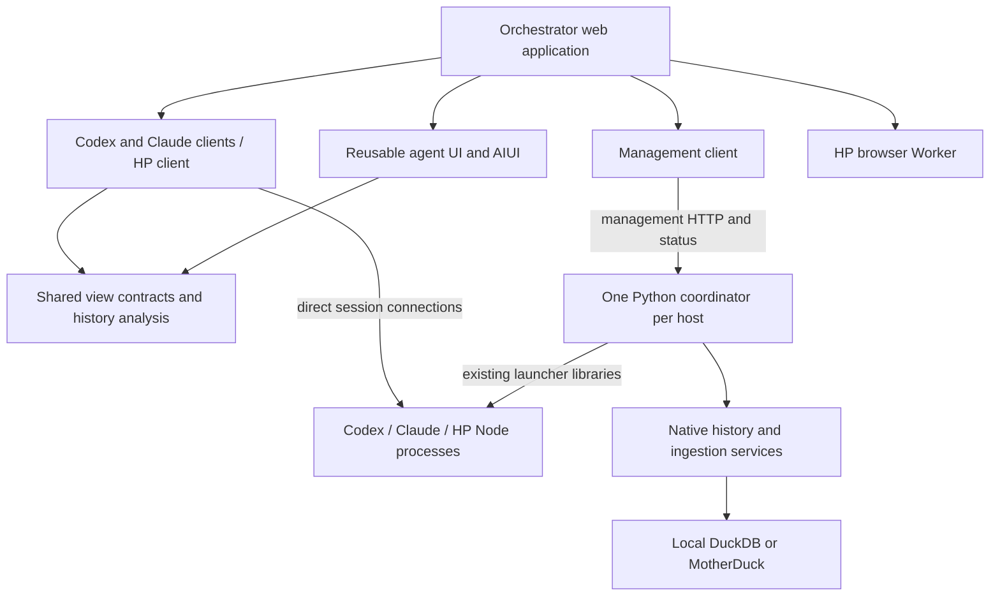
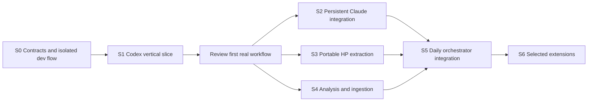
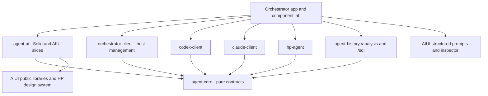

# System diagrams: Mermaid source

Generated previews accompany the review documents so diagrams remain readable in
Markdown viewers without a Mermaid extension. These sources are the editable
record; regenerate the SVG after changing a diagram. Rendered and checked with
the research workspace's Mermaid 12.2.0 in a real browser on 26 October 2026.

## Runtime layout

## Implementation dependencies

## Client library dependencies

