# Implementation sequence and dependency plan

**Library boundaries accepted; review guidance incorporated 26 October 2026.**
Begin with the [system/library map](../system-design.md). This orders construction
within that direction. It does not authorize publication, replace
the human-operated release workflow, or mark research code as production-ready.
The existing [Codex client plan](../../codex-client.md) remains the detailed native
API baseline; shared analysis and unified management now have the owners named here.

**S0 implementation checkpoint:** [the foundation guide](../../../orchestrator.md)
records the real coordinator/client/app, isolated dev command, portable pricing,
browser/HMR and process tests. No native agent is launched from the current app.
Matching source/protocol adoption remains an S1 gate: the installed 0.164.0
generator has been recorded, but the older vendor checkout is not asserted to match.

## Dependencies

[Open diagram](diagrams/stages.svg) · [Mermaid source](diagrams/README.md).

S2–S4 can proceed in parallel once their inputs from S0/S1 are stable. Small
independent preparation—such as separating pure pricing—can happen earlier, but
do not invent incompatible contracts in parallel. A coordinator owns shared
schemas, package catalogs/locks, generated protocols and integration. Agents own
disjoint library/slice directories, use isolated runtime state, and report both
implemented behavior and qualification limits.
Rich prompt-authoring experiments are a separate disposable lane and do not gate
this dependency graph. The initial application uses a text-only placeholder.

## S0 — Establish contracts and an isolated development instance

**Deliver:** a production-workspace application shell and development command,
with the smallest useful `agent-core` contracts and typed management description.
This is an implementation prerequisite, not another broad spike round.

- Review the current source/version baseline and reconcile the older Codex spec
  with RC-01–RC-14. Regenerate protocol types from the actual pinned Codex binary
  and matching source; do not reuse a historical schema/build mismatch.
- Define scoped references and capability/evidence distinctions: host, profile,
  owner/run, conversation, native turn/item/request, source and observation time.
  Keep normalized view facts separate from native objects and the Python-owned
  analytical schema. Define unknown delivery and partial coverage explicitly.
- Introduce `agent-core` only for primitives with real consumers. Establish
  `orchestrator-client` and the coordinator's typed operation/connection envelopes.
  Importing either must not launch processes. The descriptor carries provider,
  host/profile/run identity, endpoint, protocol/version and lifetime information.
- Separate the minimum pure usage/pricing/coverage entrypoint from existing
  `agent-history` Node I/O for S1. S4 extends this into broader health, corpus
  queries and host processing; S1 must not create a temporary competing calculator.
- Qualify the minimal current TypeScript `aiui-prompts` text-record → structured
  rendered content → provider-input path. Keep content separate from target and
  turn-delivery intent. No sophisticated editor/inspector is required. The older
  Python-based HP prompt fidelity migration remains an S3 extraction check;
  do not silently change its native prompt behavior.
- One dev command owns Vite, an isolated foreground coordinator and optional
  helper processes. Services bind available ports and report readiness/identity.
  Give each instance separate profiles, DBs, captures, caches and browser context.
  Dev credentials are explicit references; ordinary developer profiles are not fixtures.
- Connect AIUI source tooling, scoped actions and diagnostics from the start.
  UI HMR should retain application-owned connections where qualified; full reload
  and backend restart expose their actual lifetime effects.

**Acceptance:** two simultaneous dev instances start and stop independently;
wrong-instance cleanup is rejected by identity; no provider starts on page load;
browser imports contain no Node/database-driver leakage; source linking and one
real hot edit work. Capture mode/scope is visible. No paid call is required.

**Review state:** library boundaries and browser-first workflow are accepted.
Library internals, transport framing and type layouts are delegated engineering
work. Electron packaging and multi-host policy stay deferred.

## S1 — First useful Codex workflow

**Deliver:** one provider end to end, using the existing Python launcher through
the new coordinator and the new typed Codex client. Preserve all generated raw
methods even while the first UI exposes only selected operations.

The ordinary journey is: select an existing or isolated profile → inspect native
defaults/auth evidence → preview working directory and launch overrides → launch
server → create or explicitly join a conversation → send → inspect tools/usage →
answer a request from either browser → detach or stop with visible consequences.
The same provider library has a Node example. Read-only native history is usable
without launching model work; historical reads never repair themselves via resume.

Seed host/project/cwd from the UI action context and expose an override. Turn
model/effort/tier changes carry forward within the conversation without changing
saved defaults; default changes require a separate action naming that scope.
Include worktree intent, preferring verified native/existing provisioning on the
actual headless/app-server route; an existing worktree remains a valid cwd.

| Layer | Work and acceptance |
| --- | --- |
| Pure functions | Native-to-view projections, scoped identity, partial items, request outcomes and coverage; minimal shared `agent-history/analysis` counters and dated prices for observed live usage. Replay deterministic captures including unknown variants; unknown measurements remain explicit rather than fabricated. |
| Controls/cells | Declare launch/profile/session selection and explicit send/steer/interrupt/detach/stop actions. Async operations observe application-owned resources; cell re-evaluation cannot launch duplicate agents or submit turns. |
| Components | Dense list/detail, text/tool transcript, request panel and simple composer with model/effort/tier where supported. A source link resolves against its actual host/cwd and distinguishes current file bytes from captured history. |
| Application | Connect the same actions through UI, keyboard and AIUI tools. Keep drafts and connections across in-app route changes; show which owner disappears on reload. Two browsers share a native thread without a controller lease. |

**Runtime acceptance:** real native subprocess/WebSocket checks; passive history;
subscribed idle retention; unloaded-turn rejection and explicit rejoin; multi-client
requests; late join with incomplete prefix; ambiguous post-send disconnect; and
interruption distinct from tool/process termination. Carry RC-01–RC-10/12. Keep
native profile config unchanged by launch overrides. A small Luna turn qualifies
the actual browser and Node path, including the existing vanilla remote CLI
relay milestone where the relay changes.
Check that working overrides survive the next turn but do not alter saved model
defaults or sibling-conversation selections. Check contextual host/cwd selection,
explicit default saving, and verified worktree intent/resolved-directory mapping
when that provider supports creation.

**Scope:** initial overview can use process metadata and client-observed facts.
It does not retain a host subscription for richer metrics or keepalive (D3).
Normal active clients still subscribe. Expose longer unload timing at launch,
labelled as the native server-start setting shared by that server's threads.
Existing-server attachment shows the inherited value; do not silently restart it
or change global configuration. Exact longer default remains unset.
Unreviewed automatic reconnect/retry behavior stays explicit.

## S2 — Persistent Claude worker and official client integration

**Dependencies:** S0 envelopes/isolation; S1's reusable view/action boundary.
Own `pdum.claude_launcher` lifecycle changes and `claude-client` separately from
Codex implementation. Reuse official history helpers and the existing auth flows.

- Make launch/list/attach/stop separate operations. Keep one native process and
  its stdout journal independent of client count, as qualified in 068.
- Record/forward bytes asynchronously. Do not add a host SDK Query, semantic
  validation, input acknowledgement echo or shared-answer arbiter.
- Integrate the official SDK through a client-owned decoder/replay layer. Preserve
  all raw messages for projection while keeping historical control messages out
  of executable callbacks. Replace a closed Query on reconnection rather than
  trying to reuse it or replay uncertain commands.
- Qualify browser transport/environment adaptation in an isolated SDK realm and
  the Node virtual-process adapter. Do not globally override the application's
  WebSocket behavior or assume a public custom-transport factory exists.
- Integrate public native-response reconciliation for shared questions. Treat
  first-initialize options, hooks and SDK-hosted MCP as explicit client resources;
  avoid selecting a main observer. Ask D4 only if a concrete capability proves
  designated ownership necessary; do not build election or a server arbiter first.
- Promote setup-token references through the owning auth configuration, keeping
  acquisition separate from profile copying. Native dedicated login, API keys
  and explicit existing-login reuse remain first-class. Refresh is not inferred
  from a successful status check or reconnect. Credential actions do not inspect,
  pause, drain or protect other sessions. Let provider behavior/errors occur;
  no cross-session login coordination or busy-profile gate is required.

**Acceptance:** two actual browser/Node clients, no-client tool completion, exact
replay/live transition, resolved callback replay stays passive, pending permission
recovers, peer answer settles local UI, native malformed-input exit is visible,
stop/reap targets only owned work, and native resume/fork still preserve source
and drafts. Run a bounded Haiku check. RC-07/08/11/12/13 and 064–068/071 are the gates.
This stage changes the original disconnect behavior deliberately; existing clients
need a stated migration path rather than an accidental lifetime change.

## S3 — Portable HP runtime, history and hosts

**Dependencies:** S0 source/contract and prompt migration; S1 provider-view seam.
Extract actual modules from 039–052/070 with their meaningful regression cases,
not their dev servers or temporary paths.

- Preserve turn input/steering outcomes, interruption, parallel-tool scheduling,
  reusable subagents/mailboxes and independent jobs. Host tools declare their
  capabilities; browser code does not gain native filesystem access by naming it.
- Keep OpenAI connection/credential creation injected. Reuse the current prompt
  toolkit and verified Codex source/prompt/tool conventions; no new generic agent
  framework or copied Rust subsystem is required.
- Keep archive codec/read/list/restore/fork portable, with filesystem and browser
  storage adapters. Resume uses a new owner and explicit bindings. Exact checkpoint
  identity preserves pre/post-compaction context; no tool/job/mail resurrection.
- Provide Node host/CLI and browser Worker composition from the same core. The
  coordinator supervises HP Node as a child runtime; browser HP stays locally owned.
  Expose offline history from a Node helper without starting the agent loop.
- Add the production client/RPC bindings for helpers that 070 exercised directly;
  a passing archive helper is not already a deployed `thread/resume` endpoint.

**Acceptance:** same portable contract suite in Node and real Chrome; storage
transfer both directions; actual owner exit/reload then read/resume/fork; exact
cutoff and source preservation; no duplicate tool effects; job/input uncertainty;
two client attachments. A bounded Luna check and existing eval harness establish
provider compatibility. RC-04/07/08/09/12/14 guide the tests.

**Delegated initial policy (D5):** single-owner writes, asynchronous saves after
completed turns/compaction outcomes, visible last-committed versus pending/failed
state, and explicit fresh-owner restore from completed checkpoints. Save failure
does not halt or roll back work; shutdown attempts to finish pending saves and
reports failure. Cross-tab execution, stronger durability and seamless in-flight
recovery are separate later features, not questions to re-ask before this slice.

## S4 — Shared evidence, accounting and ingestion

**Dependencies:** S0 evidence contracts; S1 real Codex input. Implement portable
work while S2/S3 run; add their adapters as each lane provides versioned samples.

- Separate pure pricing/health functions and SQL definitions from Node I/O in
  existing `agent-history`, extending the minimal pricing entrypoint used by S1;
  keep Python schema ownership and generation checks.
- Fix the known source-scoping issues in joins and permit legitimate out-of-turn
  compaction records in invariants. Do not fake a turn or suppress a failed check.
- Add HP's transported export as a real ingestion source through existing staging,
  lineage and incremental publication. Preserve `history.yaml` ownership and the
  six-month coverage policy; the UI edits that config rather than a new scheme.
- Use the same pure reducers on live client observations, optional host processors
  and historical inputs, with each source's coverage retained. Estimate costs with
  dated rates and native token basis; do not infer context occupancy from usage.
- Qualify one coordinated local DuckDB execution/ownership path. TS supplies query
  logic; Python ingestion/query execution must not race a Node process holding the
  same local file open. MotherDuck is a separate configured driver/target.
- Introduce one optional application-owned TS analysis helper for host summaries,
  not one process per plugin. Observer failures leave execution/forwarding healthy
  and summaries stale. Optional Logfire/OTLP exports consume this evidence later.

**Acceptance:** independent live/archive/SQL cost totals agree; repeated observers,
imports and fork context do not double count; missing data remains visible; schema
and relevant invariants pass without special success fixtures; ingestion/query
handoff works under concurrent UI requests; observer stalls/failures preserve
traffic. RC-07/09/10/14 and 033–035/061/070 provide the baseline.

## S5 — Integrate the daily application

**Dependencies:** provider lanes and analysis integrated behind their reviewed
interfaces. Continue small vertical UI slices rather than merging all screens at once.

1. **Overview and navigation:** configured sources, collapsible groups, independent
   grouping/sorting/filtering, semantic density, visible known-cost/count fractions,
   stale/unknown state and browser-local HP entries. Small browser DuckDB/Mosaic
   updates drive facets; it is not a copy of the full analytical corpus.
2. **Conversation and family:** dense live/history transcript, tools/errors,
   subagent/job links, context/usage timeline and minimap, image/source lenses and
   pinned selections. Unknown messages and original evidence remain inspectable.
3. **Management:** adapt existing profile creation/native-config editing, contextual
   launch/worktree choices, working-versus-saved settings, simple independent auth
   actions, explicit shutdown and runtime ownership. Apply the settled D2/D7 scope
   rules rather than reopening them as general coordination questions.
4. **History and analytics:** native saved catalogue/read/resume/fork and separate
   ingestion/query views cross-link through scoped references. Agree annotation
   subject/owner (D6) before durable tagging across providers/sources.
5. **Prompt composition:** keep a simple text-only placeholder that emits a shared
   structured/rendered prompt. Destination adapters lower it into the proper native
   messages; source snippets can contribute text through the same boundary. Keep
   draft, submitted snapshot and delivered wire data distinct. Rich authoring,
   image capture and elaborate inspection are separate disposable experiments,
   not S5 gates. The future content boundary supports ordered text/image parts,
   but actual rich delivery still needs per-provider qualification (HP is currently
   text-only); never silently discard unsupported parts.
6. **Direct remote commands:** add a host/cwd-labelled command panel using qualified
   Codex process APIs or the coordinator's explicit host-workspace adapter, with
   HP host adapters where appropriate. A Claude-only file/command workflow must
   not silently start a Codex agent. Stream stdout/stderr,
   submit supported stdin and show exit/ownership. Test final-output draining,
   disconnect and cancellation separately. Pipes are not a PTY; PTY/resize and
   cross-provider generalization require their own capability check.

For every slice: pure projections/actions first; scoped controls and async cells
next; reusable components next; then application composition and end-to-end tools.
Declare action metadata so keyboard, mouse and agents use the same behavior. Space
opens the grouped key map outside text entry. Apply the Habemus Papadum visual
direction and real phone-width checks; preserve explicit intent rather than hiding
different native operations behind one ambiguous Send button.

**Acceptance:** run the ordinary daily workflow with real data for all three
providers, with independent Node client usage and two browser clients for managed
sessions. A user-reported wrong item can be traced through AIUI/DevTools to its
native evidence and reproduced using optional debug capture without another model
call. No generic live-event history service is required.

## S6 — Extend from reviewed needs

These owners exist in the design, but are not prerequisites for the first useful app:

| Extension | Existing owner and qualification trigger |
| --- | --- |
| Additional hosts and partner routing | Coordinator plus management client; qualify reachability, ownership and direct/relayed endpoint paths before promising remote operation. |
| MotherDuck publication and larger statistics | Existing history target/TS query drivers; preserve publication/config flow and validate intended datasets rather than inventing a separate cloud schema. |
| Rich prompting, voice, screen and pencil | Independent disposable side experiments chosen with the user, outside the main delivery sequence. A reviewed result later replaces the text placeholder through the structured-content boundary. |
| Electron | Same browser-compatible app with an explicit host adapter; select desktop need and coordinator lifetime before packaging. |
| Hostfork/cloud fleet | Existing Hostfork APIs plus coordinator environment adapter; validate process scope, cleanup and explicit history-based recovery on the actual host platform. |
| Automated health/recovery | Shared analysis plus policy-selected actions; first show evidence/advisories. Ask before automating mutation or interpreting silence as failure. |
| AIUI long-running reactive tools | Existing deferred control/observation contract: agents change controls and observe correlated settling; do not invent a `computeCell` command or make it an SDK prerequisite. |

## Validation and delivery discipline

Tests follow boundaries: pure projection/identity/cost cases; real local transports
and storage; native provider integration; actual browser UI; then bounded live
Luna/Haiku probes. Use captured native input for regression and controlled failure
injection, not fake provider success. Ordinary CI has no credentials/model calls.
Check browser import graphs, Node entry points, schema copies, generated protocol
provenance, source-linked builds, MkDocs and affected package builds.

Provider spend is centrally bounded and logged per investigation, separate from
assistant execution cost and actual subscription invoices. Default targets remain
USD 0.05–0.10; important validation may use the authorized ceiling. Production
runtimes do not inherit test quotas.

Each integration review names what changed, what works, what source/version was
tested, remaining uncertainty and the next question's trigger. Keep useful debug
evidence ignored and publication-safe summaries versioned. Commits and pushes
require the user's instruction. Release workflow execution, publishing and release
tags remain human-operated under the canonical repository policy.
