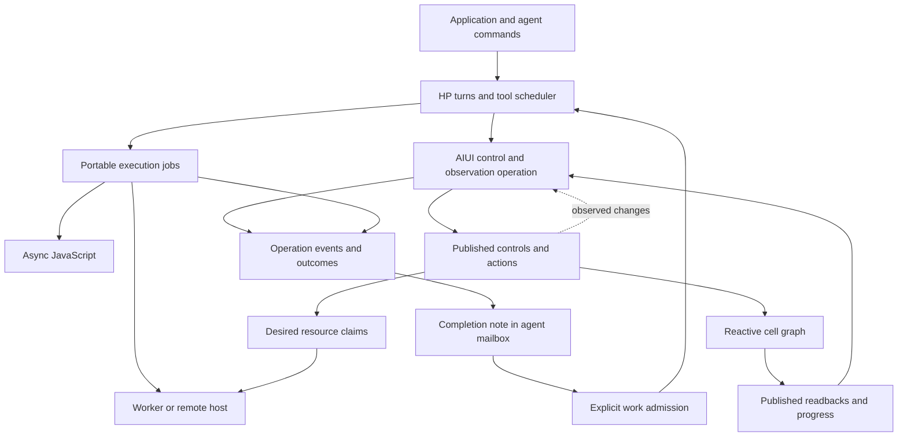

# HP Agent and AIUI: controls, observation and background work

**Design baseline, 18 October 2026.** HP should preserve Codex's distinctions
between turns, tool execution, background work and agent messages while allowing
the work itself to be an ordinary JavaScript calculation. AIUI is the primary
intended application framework. The agent core must remain usable in Node and a
browser without Solid, DOM or process dependencies.

This document defines the integration to investigate after the portable job and
parallel-tool work. **No HP cell adapter or integration UI is implemented by this
document.** The [power-user parity report](../hp-agent-parity.md) records the
preceding prototype and its evidence; this contract describes the additional
AIUI behavior, not a completed production library.
The subsequent [portable work findings](../hp-agent-work.md) record the
implemented registry, scheduling, client integration and their qualification.

AIUI is young and changeable. There is no requirement to preserve its present API
at the expense of a clearer design. Small upstream changes with tests and direct
demo migrations are preferable to layers of HP workarounds. The number and nature
of demo changes are a practical measure of disruption, not proof that every
external consumer is unaffected. A broad rewrite needs concrete evidence of its
benefit; compatibility shims are not the default answer.

## Discussion clarification: change controls, observe consequences

**Clarified with the user on 18 October 2026.** The primary agent operation is
to change published controls/signals or invoke a published application action,
then observe the resulting application state. The reactive graph decides which
cells evaluate. An agent does not request a cell calculation directly. Earlier
wording about a "cell job" was too close to an imperative compute API.

The current interaction is already sensible for fast updates: discover the
surface, call `set`, wait, then call `report`. The missing capability is a
generic, observable operation for slower consequences of those writes. For
example: "Set the dataset to A and iterations to 200; return the published
summary when the analysis has settled, and show progress while it runs."

The operation would combine these responsibilities, with API names still open:

1. Discover and validate the requested writes against the published surface.
   Return the values actually accepted, including clamping or snapping.
2. Establish observation and correlate the writes with an application revision
   or equivalent receipt, without missing immediate recalculation. Record when
   writes become effective separately from validation/acceptance.
3. Wait until the graph has processed those changes for the cells of interest,
   observing partial values, progress, errors and relevant intervening changes.
   Account for no-op, cancelled and failed work as well as completed computation.
4. Evaluate a pure result function over the resulting state and outcome record,
   or select named outputs directly. Preserve evidence of which changes and
   outcomes the returned result represents.

This belongs to AIUI's application tool surface and should be usable by HP,
Codex or Claude through their tool adapters. HP's job handles are one possible
way to expose its asynchronous lifetime, not a prerequisite for the application
semantics. The control/observation contract should also be usable in Node when
the application graph is hosted there, without requiring a rendered UI.

These are proposed semantics, not a shipped tool or a promise of an atomic
multi-control transaction. The current standard `set` changes one control per
call. Grouped writes, validation-before-write and failure halfway through an
application action need explicit treatment if a combined tool is introduced.

A validated control write is not evidence that its dependent computation has
finished. The existing setter returns the accepted value rather than re-reading
staged state. The test helper `whenReady` deliberately waits a tick before
checking readiness to avoid returning the pre-write value. A production
operation must additionally account for concurrent changes and the outputs it
is actually waiting for; copying that test polling loop does not establish
those semantics.

### What the operation observes

**Interview guidance:** waiting for named outputs and waiting for an
application-named completion condition need not be separate mechanisms. The
working interface is to apply controls, then wait for a graph observation point
where the selected cells have processed the changes and their outcomes can be
examined. A successful result requires valid values; cancellation/error can
settle the operation with an explicit outcome instead of success.

A graph state ID or revision may help establish that observation point. Its
existence and exact semantics in AIUI are unverified; this is a proposal for the
lab. A later global tick alone is insufficient evidence because an unrelated
cell could have advanced it. The lab must establish how accepted writes,
batched/queued updates, no-ops and per-cell outcomes correlate in the presence
of multiple changing signals. Do not require every selected cell to start a new
calculation: a no-op is a legitimate processed outcome.

The result can be selected in several equally useful ways: name the outputs,
provide a pure function over a subset, or provide a pure function that receives
the full application state plus the operation's outcome record and selects or
computes what it needs. Exact function transport/registration and how the wait
set is specified or derived remain open. The selector needs a consistent state
view, rather than mixing values read before and after another update; how to
establish that view is also part of the lab. The selector reads state and does
not introduce new control writes.

An app can have continuous streams and unrelated calculations that never settle.
Giving the selector access to the whole state does not by itself require waiting
for the entire application to become idle. Distinguish the cells whose processing
the operation awaits from the state made available to its result function.
Reading a plain control requires no artificial cell run. The existing full
application report remains a possible result.

One control operation can cause zero, one or many cell evaluations. Equal input
may need no recomputation; several writes can coalesce; dependency changes can
replace an evaluation. Operation identity therefore cannot be identified with
one cell generation. A ready result unchanged by the accepted write can be valid
if its provenance establishes that it satisfies the request. A held, errored or
still-streaming cell is not successful completion merely because it has a value
or has stopped reporting progress.

Relevant subsequent input changes should remain visible while waiting. The
caller should be able to select the desired behavior. **The user's provisional
default is to end the observation when its request is superseded**, with an
explicit outcome such as "Your request was superseded; inspect the current state
and try again later." Do not automatically retry or reapply the old controls.
This ends the observation request, not the application's replacement computation.

Two policies must not be silently conflated:

- **Observe the requested state (default direction).** If a relevant change replaces that request,
  return supersession/interference with the changed inputs identified. Do not
  present the replacement result as the answer to the original request.
- **Follow current application state.** Continue observing through changes,
  then identify the inputs associated with the returned result. This can be
  useful for an explicitly requested monitoring operation.

Caller selection and the conservative supersession default are interview
guidance; exact API shape, detection and additional policies remain for the lab.
Unrelated control changes need not invalidate an operation. Initially, explicit
application-declared result scopes and relevant inputs may be enough; complete
automatic causal tracking across an arbitrary reactive graph is not assumed.

**Interview close:** start with conservative defaults and leave hooks for the
caller/application to choose its own policies. For a selected cell's failure,
the starting default ends observation promptly with the error and current
statuses, rather than waiting indefinitely for the other selected cells. This
does not cancel unrelated computation or present retained/partial values as a
successful result. A caller may choose a different policy, such as collecting
the remaining outcomes. The hook shape and supported alternatives are deferred;
this is not a commitment to a general policy engine.

The same distinction applies to supersession: report the reason the request
ended, keep retry explicit, and preserve enough state/outcome information for
the caller to decide what to do next. Conservative observation defaults do not
impose locks, prevent user edits, or take ownership of shared calculations.

### Waiting, progress and stopping

A short operation could complete as one ordinary tool call. A slow one could
return an operation handle for later inspection/waiting, as a terminal tool
returns a session ID. This is a presentation choice over the same operation.
The UI can observe progress while a model-facing tool awaits its final result;
progress does not imply that arbitrary intermediate values can be streamed into
that model response or that each update should start another model call.

Stopping observation cancels only the wait. Stopping application computation is
a separate published application operation: for example, changing a run/pause
control or invoking a stop action with known scope. Aborting one evaluation
without changing the desired application state may allow the graph to start it
again. A generic observer must not reach inside a shared cell and abort it, or
restore old controls automatically and overwrite newer user input.

The portable job machinery may host the long-lived observation operation and
its event history. That handle owns the observation; it does not automatically
own every calculation the reactive graph performs. A small control update may
need coordinated writes, but waiting for its result should not hold exclusive
access to the whole application. How to separate that brief mutation from the
long wait is another concrete tool-design question.

### What to decide before implementing

The interview has established the broad control → graph processing → pure result
selection shape, caller-selected behavior and provisional defaults that end
superseded or failed observations promptly with explicit outcomes. It has not
established the correlation algorithm, policy-hook API or detailed cancellation
semantics. The initial interview is complete; further integration implementation
is deferred. Use a lab with one real slow or iterative
application to examine those cases. Include simultaneous signal writes, no-op
updates, unrelated graph ticks, multiple selected cells, supersession before
execution, error with a previous value, and coherent result selection. Then
decide whether to extend `set`/`report` or add a combined operation; API shape
should follow that evidence.

This clarification is worth recording now. A generic cell-job system is not the
next implementation commitment. Continue the portable client/runtime and
inspection foundation while keeping these boundaries available; return to the
AIUI operation with a concrete application and a small view of its lifecycle.
Upstream changes remain welcome when that exercise identifies what is needed.

## Responsibility boundaries

| Owner | Responsibility |
| --- | --- |
| HP session and agent core | Turns, steering, tool calls, context, child agents, mailboxes and admission of new model work. |
| Portable job registry | Execution identity, state, output, waits and cancellation, independently of the turn that started a job. |
| Execution adapter | Perform work in an async function, Worker, native process or remote host; report what actually stopped and what remains unknown. |
| AIUI operation adapter | Apply published control/action changes and observe selected readbacks; correlate effective inputs, relevant calculations and completion. |
| AIUI application | Controls, cell dependencies, standing settings, resource claims and presentation. |

These are ownership boundaries, not a requirement for five new packages. Keep
the small portable responsibilities together until actual consumers justify a
package split. Reuse upstream primitives where their behavior fits. Do not put a
second authoritative turn state machine in the UI.

The diagram separates completion notification from permission to start another
model turn. A finished job can be visible to the UI and queued in an agent's
mailbox while that agent remains idle.

## A job identifies one execution

A job is a particular execution with an owner and a terminal outcome. It is not
synonymous with a terminal session, a cell definition, an agent turn or a
subscription to progress. A live application may retain jobs across turns;
closing a view or interrupting one wait must not implicitly destroy them.
For the proposed AIUI operation, a job can execute the observation/wait itself;
ownership of that job does not confer ownership of the underlying reactive graph.

The adapter records the originating thread, turn and tool call when present.
These explain causality; they do not force the job to share the turn's abort
signal. An application may also start a job without an agent. Native processes,
Workers and remote jobs retain their own identities alongside the portable job
ID, so inspecting or cleaning up one job cannot accidentally target another.

The integration must distinguish these operations. Names below describe
semantics; they are not a finalized exported TypeScript interface.

| Operation | Meaning |
| --- | --- |
| Submit work | Accept a discrete request and return its identity. Repeated equal requests remain separate unless the caller explicitly requests reuse. |
| Change desired inputs | Update application state; normal reactive recalculation and supersession apply. This is not a FIFO task submission. |
| Observe | Subscribe to current state and subsequent events. Unsubscribing stops observation only. |
| Wait | Await a particular execution's terminal outcome, with optional cancellation of the wait. A cancelled wait leaves the execution alone. |
| Cancel execution | Ask its execution owner to stop that calculation. Record the request separately from evidence that work stopped. |
| Send input | Deliver structured input to a running job that advertises this capability. Unsupported jobs reject it explicitly. |
| Close owner | Dispose the jobs/resources that owner actually owns, with explicit outcomes for unfinished work. |

Cancellation is cooperative for ordinary JavaScript. A computation that ignores
its signal can finish after cancellation. Record the late outcome and prevent it
from being adopted as the result of a newer calculation. Side effects are not
rolled back by changing a job state. Worker termination and remote disconnection
also have different evidence from a successful cancellation acknowledgement.
A calculation has one accepted terminal outcome. Disposing its owner after it
completed must not retroactively change success into cancellation; late evidence
is an additional record rather than a second completion.

## A cell identifies a calculation rule, not one run

AIUI currently exposes a stable, scope-qualified `cellName`, reactive state,
latest value, progress, errors and `refetch()`. Its compute receives an
`AbortSignal`, previous value and progress callback. A newer dependency value or
owner disposal aborts the previous run. It does **not** expose a public run ID,
run handle or execution event stream.

The integration needs three linked identities:

| Identity | Example purpose |
| --- | --- |
| Cell identity | Identify `analysis/spectrum` across UI views and graph replacements. |
| Calculation identity | Identify one evaluation of that cell, including which graph instance and generation produced it. |
| Control/observation operation identity | Identify accepted control changes and the selected readbacks being observed; link zero or more resulting calculations. |

Calculation identity must remain unambiguous across graph hot replacement. A
local generation counter alone resets when a new cell instance is created.
Combining an instance identity with its generation is sufficient; a distributed
identity service is unnecessary.

For example, an agent sets the published dataset control to A and observes the
analysis result. Before it finishes, the user selects B. The shared graph is
allowed to supersede A with B. An operation observing A must explain that change;
it must never report B's result as success for A. The provisional default ends
the observation as superseded; following changed state requires caller selection.

Keep the primary integration distinct from an optional application capability:

- **Change controls and observe the application.** Apply a control/action, obtain
  a receipt, and correlate the selected readbacks with effective inputs. If the setting
  is replaced before Solid starts a calculation, report that the submission was
  superseded before execution. Reading the next `ready` value is insufficient.
- **Optional independent application task.** An application can separately publish
  an action that snapshots explicit inputs and invokes the
  same pure compute or Worker task under a separate job owner. The application
  may display its result without redirecting the user's shared cell. This is
  appropriate when both A and B must finish, but it is not the ordinary cell
  interface and is not a requirement for this integration.

AIUI can batch several writes into one reactive calculation. Therefore an
accepted submission and a calculation start need separate records. The adapter
must establish correlation at the command boundary; observing cell state after
a write cannot reconstruct it reliably.

The last visible value is also separate from the requested outcome. A refreshing,
held or errored cell can retain an earlier value. A job reports success only for
its stated observation condition and effective inputs, not because `latest()`
is populated. Internal run identities help explain this; the agent need not
name or schedule those runs.

## Shared ownership and changing inputs

A shared cell can have several observers and consumers. Cancelling an agent's
wait does not close the cell's dependency gate. Cancelling a producer requires
an explicit action directed at the owner that created that producer. This is an
ownership rule for avoiding accidental cancellation, not a client grant system.

For shared application state, use the application's normal command to pause or
replace the calculation and report which other request it superseded. For an
independent job, its job handle owns cancellation directly. Do not make
subscriber counting the implicit lifetime policy: UI unmounting is not evidence
that no one needs a calculation.

Most cells accept new inputs by recalculating. An interactive job may instead
accept messages during the same execution, such as a search-space refinement or
a request to emit an intermediate checkpoint. The tool description and job
capabilities must distinguish these cases. A terminal adapter can preserve its
byte-oriented input convention without forcing it on ordinary JavaScript jobs.

## Progress, history and waking an agent

Cell state is a useful projection of what is happening now. It is not an
execution journal: equality gates can hide repeated values, and `stream:
"latest"` can coalesce partial updates when a downstream consumer is pending.
Both behaviors are documented and tested upstream.

Record execution events at their source, before projecting them into reactive
state. Include job/calculation identity, per-job event order, origin, event type
and the associated result or error. Preserve distinctions among submission,
start, output, cancellation request, supersession and terminal outcome.
Historical inspection can then explain the same calculation that the live UI
shows. In-memory records are not crash durability; persistent replay is a
separate host capability.

Copying/enqueueing observation must not wait for UI rendering, parsing or export.
Report recorder failures and backlog; do not introduce default payload caps or
job quotas as part of this design. Progress may be coalesced for a view, but the
execution record must not silently claim completeness after losing events.

Default job completion queues one attributed result note for the owning agent.
It becomes model input at the existing safe admission boundary. Waking an idle
agent requires an explicit application choice, such as submitting a follow-up
task. Every progress update must not become another model call. A correlation ID
lets observers recognize the same terminal outcome without pretending that a
future network transport already provides durable exactly-once delivery.

## Mode settings and submitted tasks use different semantics

AIUI's framework-free mode engine has one command/reducer path for state changes.
Its resource claims derive a desired operation from settings and facts, then
reconcile actual resources to that desire. A claim serializes release/acquire,
aborts superseded acquisition and applies the newest desire. Independent claims
can proceed concurrently.

Use those semantics for standing choices such as "keep this agent connected" or
"maintain a Worker for the selected source." They fit UI, keyboard and agent
commands sharing one application state. They also help expose why an operation
is currently unavailable.

Discrete tasks need retained queue semantics instead. Submitting A, then B,
normally means execute both; it does not mean discard A when B arrives. Queue
acceptance, execution and commitment remain the HP session responsibilities.
Do not adapt tasks into claims by treating each new task as the latest desire.
Conversely, there is no need to add all intermediate slider positions to an
agent's FIFO work queue.

The current AIUI checkout exports `aiui-viz/mode-engine`. Its previous
`solidModeEngine` adapter was removed on 17 October, and the design note records
its reintroduction requirements. The older skill digest still lists that export.
Any new bridge must follow current source: synchronize both state and context,
keep the engine as the sole writer, and deliberately test Solid's staged writes
and commit behavior. The HP turn machinery does not require this bridge.

## Parallel tools and the Node/browser boundary

Tool concurrency and background jobs are independent. A concurrent tool can
finish within its current turn; a sequential tool can start a job that outlives
that turn. Independent agents can also overlap while their own tool batches are
sequential.

Use an explicit `supportsParallel?: boolean` declaration for the initial HP tool
scheduler. Tools marked eligible may overlap; an exclusive tool separates
parallel groups. Capture the schema, handler and eligibility for the model step
that advertised them, so registration changes cannot reinterpret an already
selected call. Preserve each call's result identity even when completion order
differs from model order. Cancellation must distinguish callbacks that never
started from executions with uncertain effects.

AIUI's read/write action classification is useful descriptive input, but does
not itself establish concurrency safety. A nominal read may change a cache or
acquire a resource; two writes to independent calculations may be safe. Begin
with deliberate per-tool declarations and tests. Introduce finer resource
coordination when a concrete application needs it, without serializing all work
in the application behind a global lock.

The same portable runtime and job logic should run in Node and a browser.
Async I/O overlaps in either environment. CPU-intensive JavaScript requires a
Worker or another execution host to avoid blocking that realm. A long CPU loop
must yield to its event loop to receive cancellation messages; microtask-only
yielding does not let Worker message events run. Native file/process tools remain
Node adapters. A browser may proxy them, with honest remote lifetime and
disconnection outcomes.

AIUI's current `durable()` registry survives module replacement within one
window. It does not survive page closure or restore a Worker after a process
crash. A component remount, graph hot replacement, tab suspension and application
termination must be tested as different events. Job ownership belongs to an
application/host lifetime chosen explicitly, not accidentally to a component.

## Pragmatic upstream changes to investigate

These are candidates supported by the present source, not changes already made
or a requirement to freeze these names before the integration experiment.

| Candidate | Why it belongs upstream | Scope and qualification |
| --- | --- | --- |
| Public calculation identity in `CellContext` and a current-run accessor | The cell itself knows when evaluation starts; HP cannot reliably infer this from state changes or equal results. | Include synchronous, Promise and AsyncIterable computations; retain distinct identities across graph replacement. Existing computes may ignore the extra context. |
| Calculation lifecycle hook or subscription | Distinguish start, successful completion, error, supersession, hold and owner disposal, even when UI updates coalesce. | Events must be ordered before reactive projections, failure-isolated and nonblocking. Give abort causes semantic reasons; do not infer cause from a generic `AbortError`. |
| Correlated control/action submission receipt | A write may be superseded before any calculation starts; `refetch(): void` cannot bind a requester to a result. | First qualify one real application command that carries a request revision into dependencies. Generalize only the reusable part; avoid adding imperative submission to every cell unnecessarily. |
| A narrow message-endpoint seam for `workerStream` | Its protocol is dependency-free but its public types require a DOM `Worker`. Node Workers and remote endpoints need adapters. | Preserve current `run/cancel` and reply semantics initially. Exercise actual Workers and terminal transport failure; an import-only Worker stub is insufficient evidence. |
| Optional structured input and cancellation acknowledgement in the Worker protocol | Current requests are only `run` or `cancel`; a local abort does not prove the Worker stopped. | Add only with an interactive job demo. Existing simple Workers can keep run/cancel; distinguish unsupported input, delivery and application. |
| A small Solid adapter for the mode engine, if the integration consumes it | One tested bridge is better than copied control/state mirroring in every application. | Follow the recorded retirement lessons, test state plus context and flush behavior, and migrate one real consumer before broadening it. |

First establish the control/observation semantics with one application. Add
calculation identity and lifecycle evidence where they are needed to support
that contract. Keep agent turns, queues, mailbox delivery and job policy
outside the cell primitive. Changes to AIUI should improve its own debugging and
application behavior as well as enable HP.

## Staged qualification

1. **Portable execution now.** Qualify parallel/exclusive tools and job
   lifetimes with real async jobs in Node and a browser. Exercise cancellation
   before execution, while waiting and after a job outlives its originating turn.
   Native process adapters additionally need actual subprocess tests.
2. **One control/observation example before an adapter.** Select a real slow
   calculation and define its published writes, readbacks, completion condition,
   input-change policy and stop action. Keep unresolved policies visible.
3. **One headless AIUI integration later.** Use the existing control surface and
   cell harness. Set A, supersede with B, set identical inputs
   twice, batch writes in one tick, retain a previous result through error,
   cancel one of two waits, and dispose/replace the graph. Pin the upstream
   semantics changed by the adapter in AIUI's tests.
4. **One observable application.** Adapt the walkthrough's real diffusion
   Worker or a similarly small demo. Show requested/effective inputs, observed
   outputs, progress, intervening changes and terminal outcomes. Exercise it
   through the published tools in a real browser. An independent calculation
   path is optional and requires a separate application action.
5. **Measure upstream disruption.** Run affected package tests, typecheck and
   lint; build affected demos and check the gallery. Record which demos required
   mechanical changes and which required changes in meaning. Test component and
   graph HMR separately. Expand the migration only when these results support it.

No provider call is required to establish most of these lifecycle properties.
After local evidence passes, a bounded model-selected tool scenario can verify
that the descriptions let the agent choose control changes, observation, waiting
and application stop actions correctly. Record its usage separately from local tests and the
assistants performing implementation.

## Source record

Inspected AIUI checkout: `~/src/pdum_aiui`, commit
`217f6d731c07e36586349aaf6feb2310d1d2b9bf`. This pass read source and existing
tests; it did not run the AIUI suite or change that repository.

| Evidence | What it establishes |
| --- | --- |
| [Standard tools](https://github.com/habemus-papadum/pdum_aiui/blob/217f6d731c07e36586349aaf6feb2310d1d2b9bf/packages/aiui-viz/src/standard-tools.ts), [controls](https://github.com/habemus-papadum/pdum_aiui/blob/217f6d731c07e36586349aaf6feb2310d1d2b9bf/packages/aiui-viz/src/control.ts), [test waits](https://github.com/habemus-papadum/pdum_aiui/blob/217f6d731c07e36586349aaf6feb2310d1d2b9bf/packages/aiui-viz/src/testing.ts) | Published `set`/`report` flow, validated accepted values and staged writes; the test helper accounts for pre-write readiness but is not a correlated production operation. |
| [Cell implementation](https://github.com/habemus-papadum/pdum_aiui/blob/217f6d731c07e36586349aaf6feb2310d1d2b9bf/packages/aiui-viz/src/cell.ts), [cell tests](https://github.com/habemus-papadum/pdum_aiui/blob/217f6d731c07e36586349aaf6feb2310d1d2b9bf/packages/aiui-viz/src/cell.test.ts) | Current public context/accessors; supersession, held/refreshing distinction, previous values, equality and streaming coalescence. No public run identity. |
| [Worker stream](https://github.com/habemus-papadum/pdum_aiui/blob/217f6d731c07e36586349aaf6feb2310d1d2b9bf/packages/aiui-viz/src/worker-stream.ts) | Correlated run/cancel protocol; partial/progress/done/error replies; no ongoing input or cancellation acknowledgement. |
| [Mode engine](https://github.com/habemus-papadum/pdum_aiui/blob/217f6d731c07e36586349aaf6feb2310d1d2b9bf/packages/aiui-viz/src/mode-engine/engine.ts), [claims](https://github.com/habemus-papadum/pdum_aiui/blob/217f6d731c07e36586349aaf6feb2310d1d2b9bf/packages/aiui-viz/src/mode-engine/claims.ts), [design and retirement record](https://github.com/habemus-papadum/pdum_aiui/blob/217f6d731c07e36586349aaf6feb2310d1d2b9bf/packages/aiui-viz/docs/mode-engine.md) | Framework-free reducer and resource reconciliation; latest desired operation wins; the former Solid bridge is retired. |
| [Durable registry](https://github.com/habemus-papadum/pdum_aiui/blob/217f6d731c07e36586349aaf6feb2310d1d2b9bf/packages/aiui-viz/src/durable.ts) | Create/adopt within a window for HMR, not persistent execution recovery. |
| [Walkthrough graph](https://github.com/habemus-papadum/pdum_aiui/blob/217f6d731c07e36586349aaf6feb2310d1d2b9bf/demos/walkthrough/src/model/graph.ts), [Worker](https://github.com/habemus-papadum/pdum_aiui/blob/217f6d731c07e36586349aaf6feb2310d1d2b9bf/demos/walkthrough/src/model/diffusion.worker.ts) | Existing pure-compute/cell/Worker separation, streamed calculations and macrotask cancellation delivery. |
