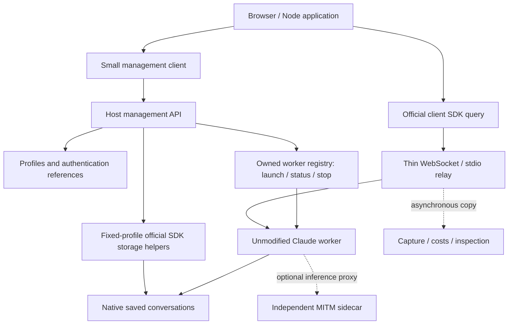

# Proposed Claude runtime architecture and work plan

**Production follow-up, 2026-10-13:** the operator subsequently approved a Python
launcher with official browser/Node clients. The
[production specification](../../../docs/specs/claude-launcher.md),
[implementation plan](../../../docs/plans/claude-launcher.md) and
[qualification report](../../../docs/claude-validation.md) now own that delivery.
Official Python SDK history helpers replace the proposed Node host helpers after
separate qualification. The research recommendation and evidence below are retained
as the record of the TypeScript spikes.

**Checkpoint, 2026-10-13:** the Python implementation has now passed live browser
and Node qualification, the three initial authentication paths and native profile
isolation checks. The package is unreleased; Linux qualification remains pending.
See the [handoff](../../../docs/claude-handoff.md) for what to pick up next.
References below to unimplemented production work or future qualification describe
the earlier research checkpoint, not the current Python package status.

**Recommendation, revised 2026-10-13:** keep the official SDK query in the
client. A foreground host manager launches one unmodified Claude Code worker
per client session and relays its protocol. A separate, small management API
exposes profiles, active workers and saved conversation operations through
public SDK helpers. Several workers can use the same profile concurrently.

This follows the user's clarified lifetime rule and the results of
[spike 016](../spikes/016-claude-client-sessions.md). It supersedes the original
server-owned-query recommendation from [spike 014](../spikes/014-claude-app-server.md).
Client disconnect ends the live session; surviving browser reloads and durable
execution recovery are not first-version requirements. The production packages
still do not implement this Claude service.

## Boundaries and ownership

An SDK query is the client-side JavaScript object holding the event iterator,
control requests and callbacks. It is not a single inference request. In the
streaming arrangement it can handle several turns during one live session.
Claude's native process performs the agent work. The relay neither creates
another query nor interprets callbacks on the client's behalf.

Use separate profile, conversation, worker and connection identities. A profile
is reusable configuration/authentication, not an exclusive process lease. Each
worker gets an independent client SDK query and normally an independent
conversation. An explicit resume starts a new worker for a saved conversation;
a fork makes a new conversation. Neither operation restores a live process or
clones a workspace. Concurrent writers to the same saved conversation remain
unqualified; independent conversations sharing a profile were tested.

The tested mode has one SDK controller per worker. This does not limit how many
workers share a profile. Shared-worker observers or several clients answering
one request would require an additional coordination design; they are not
silently provided by connecting independent SDK objects to the same worker.

## Management and native SDK interfaces

The application uses two adjacent clients. Its official SDK query handles live
messages, streams, hooks and controls. A small management client handles
profile selection, worker allocation and saved history. This avoids a custom
replacement for the SDK's live conversation API.

| Operation | Implementation boundary |
| --- | --- |
| Profile setup and authentication | Host-side setup flow, preserving native settings and provider mechanisms. |
| Launch, active status, stop | Foreground manager's registry and owned native processes. |
| List/read/rename/fork saved conversations | Official Node SDK helpers, called in a fixed profile/workspace environment. |
| Messages, callbacks, interruption, other qualified controls | Official client SDK through the relay. |
| Token/cost reporting and observation | Asynchronous copies and public result events, independent of control ownership. |

The published browser entry lacks the Node entry's storage helper exports.
The prototype therefore uses HTTP management routes beside a raw WebSocket
endpoint. Source and built helper paths work. A Python caller can eventually
use this management API and a suitable supported control adapter; Python does
not need to own a second Claude runtime.

Launch configuration belongs on the host. The browser query's options are not
identical to the Node query's spawn options. Pin executable/SDK versions and
qualify the selected launch mapping; do not claim automatic support for every
SDK option. The browser export's measured path needs an empty `process` shim.
Its published types still expose WebSocket while preferring SSE for newer
integrations; future transport changes are a version-upgrade check, not a reason
to emulate private hosted-service endpoints now.

## Profiles and authentication

A host profile selects its config root, workspace, settings sources, executable,
model/provider and authentication reference. Keep native fields native, including
unknown settings. Resolve paths and avoid accidental use of the developer's
ordinary configuration. Never change the manager's global environment between
profiles; launch workers and storage helpers with fixed environments.

Spike 016 measured `CLAUDE_CONFIG_DIR` isolation with a shared synthetic HOME,
plus `settingSources` selection of user and project agents, commands and an
output-style setting. A separate workspace is not required for user-config
isolation. Project configuration is shared when enabled and excluded in the
tested user-only mode. Full instruction/plugin/enterprise-settings and Keychain
behavior remain separate qualification work.

Profile creation should first select the provider, then its authentication
strategy, then offer native setup or a credential reference:

- Claude account login: run native login in the intended profile environment;
  qualify config-root/Keychain association before promising account isolation.
- Existing login reuse: an explicit convenience path for debugging. The live
  spikes borrowed a Keychain access token without copying normal settings or
  sessions. They did not qualify refresh.
- API key: pass a host-side key/reference using the supported mechanism.
- Federation/credential helper: use a provider-supported identity flow and
  establish the credential/renewal contract before implementing that adapter.
- Bedrock or another backend: preserve native provider configuration and use
  its identity mechanism. Remote Control availability must be checked separately.

Workers on the same profile may share its selected authentication. Credentials
stay on the host; the browser receives worker connection information, not model
credentials. The spike implements injected API-key/OAuth-token and explicit
Keychain-reuse paths. It does not implement the profile interview, native login
or cloud identity flows. Refresh remains deferred by agreement.

## Lifetime and recovery contract

Client transport closure ends its worker. Detect silent connection loss with
transport liveness checks, then stop only the owned native process/group.
Turn completion is distinct from connection closure. Explicit stop and manager
shutdown also end owned sessions. Preserve history after exit so the user can
inspect, fork or explicitly resume it.

Do not restore lost callbacks or automatically repeat uncertain inputs. There
is no durable worker registry or event journal in the first delivery contract.
A new worker can resume saved context through supported SDK/native options.
Document any lost in-flight work. Native internals and transcript surgery are
outside the implementation boundary.

The current spike allocates a worker before the client connects. If the client
never attaches, it stays `waiting` until stop or shutdown. Prefer deferring
native spawn until attachment when packaging, or retain an explicit manageable
waiting state. Do not add arbitrary connection-expiry policy by default.

Actual tests cover SDK closes, TCP loss, silent clients, pending-hook tab close,
orderly manager shutdown, and an incomplete HTTP request during shutdown.
Idle native EOF also exited after manager SIGKILL, but abrupt-manager-death and
background descendant cleanup do not have a general guarantee. Qualify those
cases if a deployment depends on them rather than attempting internal recovery.

## Organization and next delivery

Keep Claude-specific work in a separate TypeScript integration, with the
foreground runtime independent of HTTP/WebSocket adapters. Do not put Claude
behavior in `pdum.mitm` or Codex-specific modules. Keep MITM optional and generic.
No native fork, private PTY bridge or protocol impersonation is required for the
qualified browser flow.

| Workstream | Next deliverable / acceptance condition |
| --- | --- |
| Runtime packaging | Small async launch/stop library and adapters; retain the passing official-browser-SDK flow and native cleanup probes as upgrade checks. |
| Profile setup | Host-side native config creation and selected authentication setup; verify effective settings without copying ordinary developer state. |
| Management client | Typed profile/worker/history calls beside the official SDK; distinguish active workers from saved conversations. |
| Process hygiene | Resolve never-attached allocation behavior; qualify cleanup under the deployment's actual failure and background-work modes. |
| Observation | Replace the spike's in-memory capture harness with asynchronous recording and backlog/storage reporting, without truncating canonical captures. |
| Optional Remote Control | Test whether the same SDK-managed worker can be joined through an official desktop/phone app. Stop at documented unsupported boundaries. |

These workstreams can proceed independently once the management types and
launch configuration are agreed. Durable recovery, shared-worker multi-client
coordination and native terminal attachment are separate future decisions.

Each experiment records versions, scope, failures and cost. Spike 016's four
live Haiku turns totalled **USD 0.00152367** in reconciled SDK/list-price estimates.
Use public per-turn usage and previously observed cumulative totals; missing
final usage is unknown, not zero. Actual subscription billing and orchestration
agent costs are separate. Keep raw captures and authentication state ignored.
