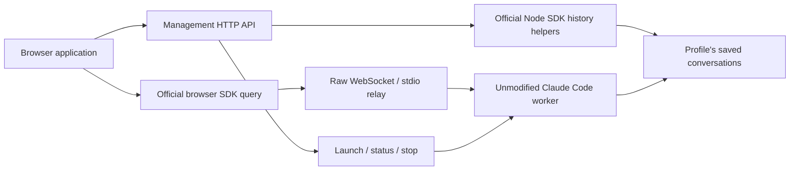

# Claude client sessions: thin relay and profile management

**Result, 2026-10-13:** the proposed starting point works for the tested paths.
Keep the official SDK in the client, launch an unmodified Claude Code worker
for each client session, and stop that worker when its client disconnects.
A small, separate management API can expose profiles, active workers and saved
conversation operations using official host-side SDK helpers. A profile can
serve several independent workers at once.

This is a runnable research implementation, not a new production package. It
revises the recommendation from [spike 014](014-claude-app-server.md): preserving
callbacks after client death is no longer required, so a server-owned SDK query
and replacement conversation API are unnecessary for this first version.
See the updated [architecture proposal](../proposals/claude-app-server-architecture.md).

## What we built and demonstrated

The prototype has two adjacent interfaces:

The manager never creates an SDK `query()` for the conversation. The browser's
query owns initialization, callbacks, streaming and controls. The relay forwards
bytes in both directions, including the SDK's periodic `keep_alive`; it does
not translate callbacks into a new application protocol. The published browser
bundle still needs the small empty `process` shim identified in spike 014.
Neither the SDK nor Claude executable was patched.

In actual Chrome, one automated flow passed 20 assertions:

1. List two profiles and initially empty saved history through management.
2. Launch two workers using **the same profile and authentication**, each with
   its own PID, conversation ID and official browser SDK query. Submit two short
   Haiku prompts together after their browser-hosted hooks rendezvous. Receive
   separate streamed replies.
3. Close one SDK session. Its worker stops; the other remains connected and
   answers an interrupt control. Close the second session.
4. List, read and rename the saved conversation after both workers have exited.
   The other profile, despite using the same workspace, lists none of this history.
5. Fork at a selected assistant message using the official helper. The original
   message history remains unchanged. Launch the fork, connect a new browser
   SDK query, and confirm that Haiku recalls the original marker.
6. Explicitly resume the original conversation in another new worker. Haiku
   recalls the marker again. Close it and verify every worker is stopped.

The profile is therefore not a live session. A saved conversation can also
outlive a live session. Resume is an explicit new launch using saved context;
it does not restore the previous process or its pending callbacks.

## Why a separate management API is needed

The pinned package exports `listSessions`, `getSessionInfo`,
`getSessionMessages`, `forkSession`, `renameSession`, `tagSession` and
`deleteSession` from its Node entry. Its published browser entry exports none
of those helpers. We checked both runtime exports and public declarations.

Our prototype exposes list/read/rename/fork through a fixed-environment helper
process for each profile. This avoids changing the manager's global environment
between requests. Workers and helpers share the selected config root and
workspace, while helpers receive no borrowed model credentials. Active-worker
status comes from the manager's own registry; saved-history metadata comes from
the SDK. Listing history does not launch a Claude worker.

This approach agrees with Anthropic's documented
[session-browser pattern](https://platform.claude.com/cookbook/claude-agent-sdk-05-building-a-session-browser).
It requires a small management client alongside the official browser SDK,
rather than a replacement client for its conversation API. The local adapter
covers the selected operations and launch options; full SDK option parity is
not claimed.

## Profile isolation

Ten credential-free native workers tested synthetic profiles A and B sharing
one HOME and workspace. Each profile had its own `CLAUDE_CONFIG_DIR`, user agent,
command and output-style setting. A synthetic default `~/.claude` held another
distinct set. Explicit profiles saw their own user entries and did not see the
other profile or default-home entries. A worker launched without
`CLAUDE_CONFIG_DIR` saw the default entries and neither A nor B's entries.

The supported setting-source flag provided the expected additional selection:

| Setting sources | Observed custom configuration |
| --- | --- |
| `user,project` | Selected profile's user agents/commands plus shared project agents/commands; project output style took precedence. |
| `user` | Selected profile's user agents/commands and output style; project fixtures excluded. |
| `project` | Shared project agents/commands and output style; user fixtures excluded. |
| Empty | Neither custom tree; built-in agents and commands remained. |

Two workers on one profile answered concurrent discovery/control requests, and
stopping one left the other usable. The separate live browser flow added actual
model turns and saved history for that same-profile arrangement.

These findings cover the tested agents, commands and output-style discovery.
They do not establish every instruction, plugin, MCP, enterprise setting or
Keychain isolation rule. The developer's ordinary HOME/configuration was never
used as a test fixture. See [profile details](016-profile-details.md).

## Disconnect and shutdown

Credential-free tests verified native PID disappearance after browser-SDK close
under Node, virtual-process Node-SDK close, abrupt TCP disconnect, pre-init
disconnect, manager shutdown and SIGTERM. A silent client that stopped answering
WebSocket pings was detected and reaped with a 250 ms probe heartbeat. The normal
prototype default is 1000 ms. An actual 58-second SDK idle period also verified
that its own NDJSON keep-alive passes through and the worker remains usable.

A separate real Chrome check held a native `UserPromptSubmit` callback unresolved
in the browser, with no credentials and no inference. Closing the tab destroyed
that SDK query; the manager observed disconnect and the owned native PID exited.
The worker returned exit code 1 for this interrupted callback, which is recorded
as a stopped session rather than a successful turn.

Review caught two harness issues which were fixed and retested: built JavaScript
initially omitted its storage-helper file, and an incomplete HTTP request could
hold foreground shutdown open. The helper is now emitted in the build, and
shutdown closes outstanding HTTP connections. An exited storage helper is
replaced on the next management request. See [lifecycle details](016-lifecycle-details.md).

Remaining lifecycle limits are explicit:

- Launching a worker and never opening its WebSocket leaves it in `waiting`
  until explicit stop or manager shutdown. There is no arbitrary connection
  expiry. A production implementation could defer process creation until attach.
- SIGKILL of the manager caused its native worker to exit on pipe EOF in the
  observed idle case. That is not a general orphan-cleanup guarantee.
- Active provider-request cancellation and background descendant cleanup were
  not qualified here. A pending client callback was tested; a completed result
  does not prove all possible background work has finished.
- The spike reuses the in-memory capture harness from 014. It has no production
  backlog monitoring or disk-failure resilience. Its complete captures are
  useful evidence, not a long-running telemetry implementation.
- One official SDK controller per worker remains the tested mode. Multiple
  workers freely share a profile. Multiple independent SDK controllers against
  the same worker remain outside this scope.

## Cost and evidence

Four live Haiku 5.5 turns used the previously authorized existing Keychain access
token, injected into the isolated profile environment. The token was not written
to reports or copied into profile files. Refresh and native profile login remain
unqualified.

| Turn | Incremental SDK estimate, USD |
| --- | ---: |
| Original conversation: save marker | 0.00067740 |
| Concurrent second conversation | 0.00067280 |
| Resume selected-message fork | 0.00013129 |
| Resume original conversation | 0.00004218 |
| **Total** | **0.00152367** |

That is approximately **0.15 cents**, not $0.15. The original conversation's
resumed result reported a cumulative USD 0.00071958; the ledger subtracts the
previously observed USD 0.00067740. Independent pricing of public per-turn token
usage, including the reported cache-write TTL, matches the incremental total.
The dated [Haiku pricing](https://platform.claude.com/docs/en/models/haiku-5-5/overview)
was checked on 2026-10-13. The accounting code reads our protocol captures, not
private transcript cost records. A missing result makes total cost unknown
while preserving an explicitly labelled observed subtotal.

The SDK/list-price estimate is not an inspected subscription invoice.
Orchestration-agent costs and provider work absent from SDK accounting are
excluded. The profile, lifecycle and idle probes submitted no model prompts;
the real tab-close probe stopped inside a credential-free pre-inference hook.

Environment: Agent SDK **0.3.296**, bundled Claude **2.1.296**, Node **26.10.0**,
Darwin **25.6.0** arm64, Chrome **155.0.0.0**. Version hashes accompany local
evidence under ignored `artifacts/016-claude-client-sessions/`:

- `browser/run-0LS31r/`: four live calls, browser assertions and cost ledger.
- `browser/run-5S2uz5/`: real tab-close callback evidence and stopped PID.
- `run-2UEl1Q/`: final combined credential-free profile/lifecycle probe.
- `lifecycle-final-20261013/`: lifecycle recheck after the final relay changes.
- `keepalive-20261013-a/`: the published SDK's idle keep-alive.

The [source and commands](../../spikes/016-claude-client-sessions/README.md) reproduce
the checks. Raw state/captures remain private local artifacts. No production
package was changed, no sudo or Linux host was needed, and native Claude internals
were not reverse-engineered for this implementation.

Validation passed: the combined native profile/lifecycle probe, three focused
management/accounting regression tests, all research-workspace TypeScript
checks/builds, built-helper execution, and the strict MkDocs build. The latter
checks the production documentation tree; the research Markdown's relative
links were checked separately.

## Recommendation

Proceed with a foreground process manager, official client SDK and separate
host management API. Profile setup should select native settings sources and
an authentication strategy; native login, key references and cloud-provider
identity can be added as distinct setup flows without changing this transport
boundary. Credential refresh remains separate work.

Package the tested launch/storage boundary next, with owned-process cleanup,
lazy launch or an explicit waiting-worker policy, and asynchronous observable
capture. Keep durable recovery and shared-worker multi-controller behavior out
of the first delivery contract. Remote Control with desktop/phone remains a
separate optional investigation; this spike did not test it.
