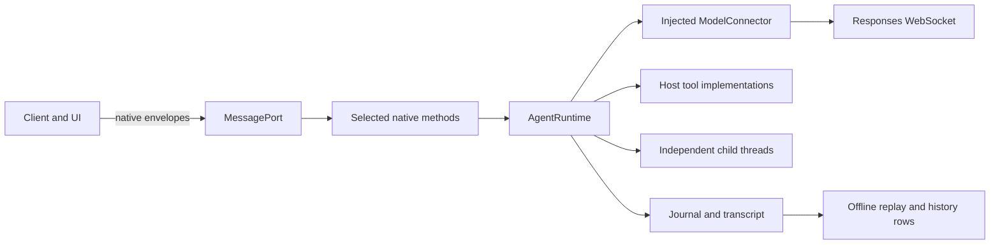

# HP Agent: portable execution and native protocol subset

**Later control pass:** [047](../047-hp-dynamic-control/README.md) refactors the
current source into session, agent/mailbox and tool modules, and adds wakeable
waits, explicit message/follow-up operations and interruption scopes. The original
demonstration below remains reproducible; its first-round observations do not
describe every capability now present. [049](../049-hp-control-integration/README.md)
qualifies the combined updated core.

This experiment owns an agent loop in ordinary TypeScript and drives it through a
small Codex app-server message surface. The same client flow runs over Node
`MessageChannel` and a browser `MessagePort` transferred to a Worker. Model
connections and host tools are injected. No production library is introduced.

The local demonstration uses a **deterministic provider fixture**. It proves local
execution, transport and recording mechanics. It does not prove model quality,
provider compatibility or native Codex behavior. Live qualification belongs to
[the integrated experiment](../040-hp-integration/README.md), which uses the
[038 connector](../038-hp-sdk-fit/README.md).

## Run

From `experiments/`, after `pnpm install --frozen-lockfile`:

```sh
pnpm --filter @agent-spike/039-hp-agent-runtime test
pnpm --filter @agent-spike/039-hp-agent-runtime typecheck
pnpm --filter @agent-spike/039-hp-agent-runtime demo
pnpm --filter @agent-spike/039-hp-agent-runtime build
pnpm --filter @agent-spike/039-hp-agent-runtime serve
```

Open `http://localhost:8039` and select **Run local demonstration**. It makes no
model requests. The Node demonstration writes journal, history rows and its report
under ignored `experiments/artifacts/039-hp-agent-runtime/`.

The browser also exposes `window.runHPDemo({live:true,url,instructions})` for the
coordinated live experiment. `url` selects the host's authenticated Responses
WebSocket integration. This does make paid requests. The demo fixes Luna, a
512-output-token request bound, reasoning `none`, and the default service tier.
Those are experiment settings, not agent-runtime quotas. The Worker owns the
runtime; a relay forwards model traffic only. Credentials never belong in saved
reports. Closing the demo terminates its Worker; that is a lifecycle decision by
this hosting application.

## What the demonstration does

1. Initialize the client and create a thread.
2. Submit a turn, run an `echo` tool supplied by the host, and steer the response.
3. Require committed steering, a completed turn and exactly one successful tool
   call; merely sending a steer is insufficient.
4. Fork the idle parent and spawn a separately addressable child. Send the child
   another message and wait for each operation to finish.
5. Execute a turn on the fork. Verify that parent history has not changed.
6. Replace the fork's model input with an explicit host checkpoint. Keep its full
   transcript intact. This is **not** automatic or model-generated compaction.
7. Reconstruct all three threads from the journal with a pure replay function.

The fixture result has three threads, five visible turns (one inherited on the
fork), fourteen items, one actual host tool execution, and zero usage records.
Usage is intentionally absent because no model was called.

## Implementation boundaries



- `runtime.ts` owns sessions, turns, context, tool execution and child lifecycles.
  It has no network, filesystem, credential, Node or UI imports.
- `protocol.ts` supplies native request/result/error envelopes and a native-shaped
  method subset. It keeps numeric and string IDs distinct. Two clients can listen
  and submit operations to the same runtime; there is no client ownership lock.
- `fixture.ts` supplies deterministic test events and an actual host `echo` tool.
  The optional `agentTools` expose spawn/message/wait operations as tools, with
  explicitly prototype-specific schemas. These are independent child loops, not
  handoffs that replace the parent agent. The demonstration invokes child control
  from the harness; model-selected child tool calls are not qualified by that run.
- `worker.ts` owns the loop in the browser. `browser-connection.ts` accepts
  customizable WebSocket construction. Client attachment, Worker lifetime and
  model connection lifetime remain different concepts.
- `history.ts` maps records to the existing agent-history v5 columns.
- The [041 prompt adapter](../041-hp-codex-fidelity/README.md) belongs at the model
  request construction boundary. `beforeModel` is an awaited **preparation** hook;
  inspection subscribers are queued, and their failures become diagnostics.
  Actual wire capture must happen in the connector after its continuation/input
  transformations. A prepared cumulative request is not necessarily the sent one.

## Compatibility contract

The reference is Codex source revision
`6c372fbef45f730b6d8aa727b0ec8332365588db`, especially
`app-server-protocol/src/protocol/v1.rs` and `v2/{thread,thread_data,turn,item}.rs`.
This prototype intentionally accepts a small parameter subset. Unsupported
methods and parameters fail rather than appearing to succeed.

| Method or event | Implemented meaning |
| --- | --- |
| `initialize` | Native result keys; synthetic `/` home and portable platform identity, no real Codex home. |
| `thread/start` | Model and cwd metadata; ephemeral in-memory history. No configuration or permission engine. |
| `thread/read` | Metadata or full local transcript; never starts model work. |
| `thread/list` | All local threads; no pagination or filters. |
| `thread/fork` | Full independent context and transcript copy at an idle turn boundary. No native path-based or mid-turn fork behavior. |
| `turn/start` | Returns an acknowledgement, execution continues separately. Concurrent starts fail; native Codex can treat them differently. |
| `turn/steer` | Checks expected turn ID. During a model response it sends steering; committed `inputItem` enters context. During tools it queues input for the next request. |
| `turn/interrupt` | Signals model and active tool cancellation; tools must honor their signal. Completed side effects are not undone. |
| `item/started`, `item/completed`, `item/agentMessage/delta`, `turn/started`, `turn/completed` | Selected native payloads, validated against pinned generated schemas. |
| `hp/agent/*`, `hp/context/*`, `hp/recording/read`, `hp/model/*` | Explicit extensions. No claim that native Codex implements these methods. |

`thread` and `turn` payloads retain native field names and recognizable item
shapes. Runtime/version identity remains explicit. Notifications pass the pinned
schema, but this does **not** qualify a vanilla remote Codex CLI against HP Agent.
The shared production client has not been built, so reuse is demonstrated by the
small transport-neutral client, not by a released client package.

Sent steering stays visible as user input in the transcript. Provider-queued
steering enters effective context at its confirmed insertion position. Locally
queued input has a distinct included-but-unconfirmed preparation state; failed
preparation removes that input and retains its uncommitted record. A failed or
uncommitted steer is never silently replayed by a later turn. Detailed states
remain in the model events, input records and `hp/model/steering` notifications.

Transcript history, model input, context checkpoints and execution state are
distinct. Pure `replay(journal)` restores saved data without creating a connector.
It is not a promise to resume a lost model response or running host tool. Forking
copies conversation data; it does not clone host files, browser application state,
or an external tool's side effects.

## Existing history schema and evals

From the repository root, write exported rows using the existing Python schema:

```sh
uv run --frozen python experiments/spikes/039-hp-agent-runtime/write_history.py \
  experiments/artifacts/039-hp-agent-runtime/history-rows.json \
  experiments/artifacts/039-hp-agent-runtime/new-history.duckdb
```

The writer refuses an existing output database, mismatched schema version, unknown
tables and unknown columns. It uses the current `pdum.agent_history.schema`
implementation rather than maintaining another SQL schema. The observed fixture
database contains three threads, five turns, fourteen items and blobs, one fork
edge, one spawn edge, three coverage records and one provenance record.

Actual model calls populate `responses` with native response ID, model, timestamp,
ordinal and usage. Forked turns/items have `origin = 'copied-context'`; child calls
belong to their own thread. `dynamicToolCall` maps to the shared generic `toolCall`
for the existing eval's tool-count query, with its exact original item retained
in `item_blobs`. Missing reasoning usage/window size remains unknown.

Three pre-existing eval details require attention before treating its cost and
tool-byte metrics as authoritative for these traces:

- `evals/bin/report.py` has a Luna price tuple that differs from the dated prices
  used by this round's ledger. Do not treat that evaluator estimate as provider
  billing or the spike's actual cost.
- Its tool-call query excludes copied context, but its tool-byte sum currently
  includes it. A fork can double-count inherited tool bytes. This exporter keeps
  truthful inherited rows instead of erasing them to make a metric look correct.
- Its main-thread selection ranks response counts. The integrated browser trace
  tied parent and child counts and selected the child; root identity should be explicit.

The full existing coding eval was not run. Connecting to its schema is a
compatibility check, not a quality comparison with its $3–8 baseline arms.

## Validation and remaining work

The tests exercise real Node MessagePorts, two attached clients, tool success and
failure, steering preconditions and uncommitted input, cancellation, independent
fork data, offline replay, observer failure and unsupported native operations.
They do not replace provider checks. To validate recorded native notifications
against a selected generated schema directory, run from the repository root:

```sh
uv run --frozen python experiments/spikes/039-hp-agent-runtime/validate_protocol.py \
  experiments/artifacts/039-hp-agent-runtime/journal.json \
  experiments/artifacts/025-codex-baseline/built-1792000637463418000/schema-experimental/v2
```

That directory is ignored local evidence; a fresh checkout must generate the
schemas from the pinned Codex build first. The observed 39 notifications all
validated (3 thread starts, 4 turn starts, 4 completions, 10 item starts, 10 item
completions, 8 deltas).

Unimplemented: automatic/model-generated compaction, skills and MCP execution,
Codex filesystem/shell/apply-patch tools, prompt-inspector UI, durable storage
backends, process recovery, context-window estimation, native request/approval
handling, image inputs, and arbitrary native method compatibility. The runtime
also does not reproduce Codex's parallel tool scheduler. Historical journals
currently contain complete snapshots for simplicity; storage and incremental
replay performance need a later measurement.

Environment: 18 October 2026, macOS arm64, Node 26, pnpm 11.9.0, TypeScript 7.0.2,
esbuild 0.28.2. This track spent $0 on model requests. See the integrated report
for actual browser and provider observations and the shared usage ledger.
