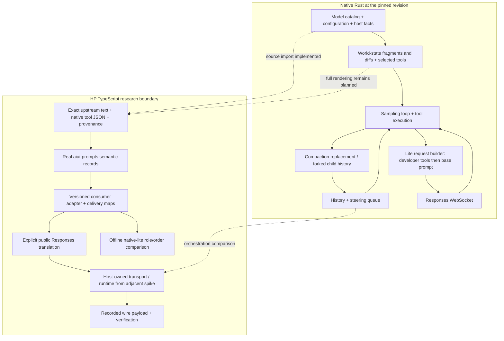

# HP Codex: source fidelity boundary

This bounded, credential-free spike asks how a TypeScript agent can reuse Codex's
actual model text and native tool definitions while retaining inspectable,
replayable prompt records. It is research code, not a production agent library.
The adjacent [runtime spike](../039-hp-agent-runtime/README.md) owns execution.

The observed proof uses the real `@habemus-papadum/aiui-prompts` source, the pinned
Codex model catalog and native `apply_patch` grammar. It preserves their text
through semantic storage, replay, two explicitly different request layouts and
wire verification. No provider request occurs. Full native request equivalence
has **not** been demonstrated: the specimen contains one native source tool,
not the complete effective code-mode tool surface.

## Reproduce

From `experiments/`, after the shared workspace installation and
[vendor setup](../../vendor/README.md):

```sh
AIUI_PROMPTS_CHECKOUT=/Users/nehal/src/pdum_aiui pnpm --filter @agent-spike/041-hp-codex-fidelity test
AIUI_PROMPTS_CHECKOUT=/Users/nehal/src/pdum_aiui pnpm --filter @agent-spike/041-hp-codex-fidelity probe
pnpm --filter @agent-spike/041-hp-codex-fidelity typecheck
pnpm --filter @agent-spike/041-hp-codex-fidelity build
```

The loader defaults to the repository's ignored `.dev/aiui` link, created by
running `./scripts/link-aiui.sh` from `pdum_agent_tools/`. This replaces the
machine-specific default path; the explicit environment override still works.
`AIUI_PROMPTS_CHECKOUT` names a **repository root** containing
`packages/aiui-prompts/src/{index,operations}.ts`. It defaults to the local checkout
above for this research environment. The npm package lookup returned 404 during
this round; this explicit checkout input does not install another npm environment,
link or modify the sibling repository. `CODEX_SOURCE_CHECKOUT` can relocate the
Codex checkout, but its HEAD must match the pin. `FIDELITY_MODEL` selects another
catalog model for the probe; tests intentionally use `gpt-6-luna`.

Generated files remain in ignored `artifacts/041-hp-codex-fidelity/`:

- `summary.json`: revisions, dirty state, model settings, text/tool/frame hashes,
  role/order/tool-location fingerprints, replay results and limitations.
- `source-inventory.json`: purpose, path, byte count and SHA-256 for 23 source files.
- `{codex-lite,responses}.{operation,wire}.json`: semantic records and offline
  serialized-boundary captures. These contain public upstream prompt text.
- `browser-proof.mjs`: actual aiui-prompts plus this consumer bundled with
  esbuild's browser platform. The probe executes that ESM in Node; this checks
  browser resolution and DOM-free execution, not an actual browser engine.

Observed 2026-10-18: six tests, typecheck, probe and browser build pass. Node
26.10.0, pnpm 11.9.0, TypeScript 7.0.2, tsx 4.23.15 and esbuild 0.28.2.
Codex HEAD `6c372fbef45f730b6d8aa727b0ec8332365588db` was clean. aiui HEAD
`217f6d731c07e36586349aaf6feb2310d1d2b9bf`, package `0.21.0+dev`, had unrelated
`aiui-pencil` changes; `packages/aiui-prompts` was clean. Source identity is
recorded again on every run. Model requests: **0**; cost estimate: **USD 0**.

## Integration API

[`src/core.ts`](src/core.ts) has no Node, DOM, SDK or aiui runtime import. It takes
the actual toolkit as an injected, API-checked structural boundary. Node obtains it using
[`loadPrompts`](src/local.ts); a browser host imports the package's root and
`operations` exports and supplies them through `bindPrompts(content, operations)`.

```ts
import { recordRequest, prepareRequest, createFidelityAdapter } from "./src/core.ts";
import { loadNativeInputs, loadPrompts } from "./src/local.ts";

const { prompts } = await loadPrompts(process.env.AIUI_PROMPTS_CHECKOUT);
const native = await loadNativeInputs("gpt-6-luna");
const operation = recordRequest(prompts, {
  instructions: native.instructions,
  tools: native.tools,
  model: "gpt-6-luna",
  input: [{ type: "message", role: "user", content: [{ type: "input_text", text: "Example" }] }],
  layout: "responses", // explicit public Responses translation
  fields: { store: false, include: ["reasoning.encrypted_content"] },
});
const prepared = prepareRequest(prompts, operation);
// The host owns sending. Capture the actual serialized payload at that boundary.
const serialized = JSON.stringify(prepared.payload);
const wire = prompts.captureWire(prepared, JSON.parse(serialized), {
  capturedAt: new Date().toISOString(), transportId: "host-boundary",
});
const verified = prompts.verifyWire(operation, wire, [createFidelityAdapter()]);
```

`loadNativeInputs` returns `{instructions,tools,compact,summaryPrefix,provenance,
selection,toolSources}`. `instructions` is `{text,origin,label}`; `recordRequest`
also accepts disjoint UTF-16 source-owner spans. The core calls **actual**
`importText({text,origin,spans?,label?})`, `snapshot`, `consumerOperation` and
`lowerOperation`. Tests exercise `serializeRecord` / `parseRecord` / `rehydrate`
and `serializeOperation` / `parseOperation`, followed by `captureWire` /
`verifyWire`. The toolkit coalesces text parts; source owners survive in the
semantic record rather than forcing one wire fragment per owner.

Tools remain plain native JSON in operation params. The toolkit's convenience
tool snapshots accept JSON-function schemas and project `strict:false`; they
cannot faithfully carry native custom grammar, namespaces or hosted tools.
The consumer adapter retains those schemas unchanged and uses delivery maps for
the imported instruction text. Provider input items, including reasoning,
encrypted content, phases and custom tool outputs, pass through unchanged.

`layout:"codex-lite"` is the default **offline comparison**, with
`additional_tools` developer prefix → base-instruction developer message →
caller input. `layout:"responses"` explicitly uses top-level `instructions`
and `tools`. Neither layout has been sent by this spike. Wire verification here
compares parsed JSON values against deterministic derivation; it does not assert
identical JSON key order, raw transport bytes or parity with a native process.

## Source inventory and execution comparison

Paths below are relative to the ignored pinned `vendor/codex` checkout. The
[findings](../../docs/spikes/041-hp-codex-fidelity.md) link the critical source
locations at their immutable revision.

| Native responsibility | Source | HP implication / current boundary |
| --- | --- | --- |
| Literal model prompt | `codex-rs/models-manager/models.json`; `prompts/src/model_instructions.rs` | Imported exact model-owned template; no copied huge prompt in git. Missing templates are distinct from supplied empty templates. |
| Sparse model overrides | `prompts/src/model_messages.rs` and its child modules | Catalog and bundled fallbacks are resolved per family; a universal prompt file is insufficient. Not ported here. |
| Permissions, collaboration, environment, model switches, plugins, AGENTS | `core/src/session/world_state.rs`; `core/src/context/world_state/*` | Initial fragments and later diffs differ. AGENTS is user content; model base and skills are developer content. Need recorded inputs and per-message records, not concatenation into one string. |
| Skill catalogs / changes | `ext/skills/src/{catalog_prompt,world_state,host_prompt}.rs` | Catalog visibility, budgets and explicit skill loading matter. HP should own discovery/host facts and import exact rendered text. No skill loader implemented here. |
| Effective native tool surface | `core/src/tools/spec_plan.rs` | Feature/config/model/host selection decides visibility and deferred discovery. GPT-6 pin selects `code_mode_only`; the sample patch tool alone is not the effective native surface. |
| Schema serialization | `tools/src/tool_spec.rs`; `tools/src/responses_api.rs` | Function, namespace, hosted, tool-search and custom grammar are distinct. Lite groups plain function/custom under `functions`; grouping tested here. |
| Shell / patch / plan / MCP / user / subagents | `core/src/tools/handlers/{shell,apply_patch,plan,mcp_resource,request_user_input,multi_agents}_spec.rs` | Constructors include dynamic options and model text. Only patch freeform constructor with environment ID disabled is extracted here. |
| Code-mode freeform execution | `core/src/tools/code_mode/{execute_spec,wait_spec}.rs` | Preserve JavaScript grammar and generated execution brief. Runtime function registration and yielding/waiting remain separate host work. |
| Turn loop | `core/src/session/turn.rs:164`; `core/src/tasks/regular.rs` | Pre-sampling compaction, world state, skill/MCP resolution, sampling, tool execution and continuation are orchestration, not prompt compilation. |
| Steering | `core/src/session/{turn_input,input_queue}.rs` | Acceptance checks expected active turn; pending input is drained at safe loop boundaries. Replacing a socket frame is insufficient. |
| Request / socket | `core/src/client.rs:951`; `codex-api/src/common.rs:331` | Native GPT-6 uses lite additional-tools prefixes, developer model instructions, stable IDs and request metadata. Public translation is explicit. |
| Compaction | `core/src/compact.rs`; `core/src/compact_remote_v2.rs`; `prompts/templates/compact/*` | Summarizing and remote-v2 paths differ; replacement history, retained outputs, encrypted compaction and fresh world-state injection matter. Only template hashes captured here. |
| Context windows / resume | `core/src/context_manager/history.rs`; `core/src/context/world_state/context_window_guidance.rs` | Window accounting and retained state determine when and what to compact. Passing old input unchanged is not compaction. |
| Fork / subagents | `core/src/agent/{control,child_config}.rs`; `core/src/agent/control/spawn.rs` | Forked histories, config inheritance, task identity, mailboxes and lifecycle all matter. Native v1/v2 semantics differ; model pin selects v2. Not implemented here. |



The minimum practical public-API clone can retain exact imported text, original
function/custom schemas, provider items and inspectable records, while accepting
different request framing and host implementations. Matching native behavior
also requires effective code-mode/MCP/skills surfaces and turn/steer/compact/fork
semantics. Those need behavioral comparison against native runs, not assertions
derived only from these offline constructors. Browser auth and provider feature
acceptance belong to the adjacent protocol/SDK probes.
