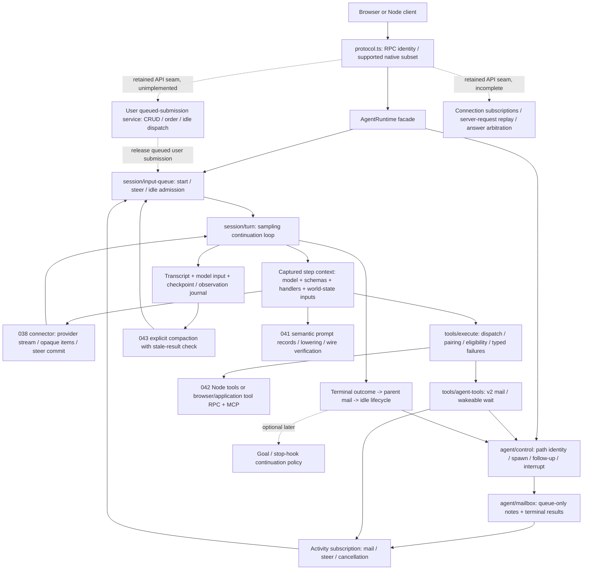

# HP power-user contracts and source-aligned structure

This is a source-guided audit, not an implementation of every advanced feature.
The reference is Codex **6c372fbef45f730b6d8aa727b0ec8332365588db**, with GPT-6's
multi-agent **v2** and code-mode selection. Installed Codex **0.163.0** is used
only by the separately labeled raw command/exec probe below. Neither is silently
substituted for the other.

The central conclusion is structural: keep **turn admission**, **sampling**,
**mailbox delivery**, **tool execution**, **context/history** and **host resource
lifetime** as separate owners. A single generic send/wait interface loses the
native differences that make background and multi-agent work usable.

## Reproduce and assess the evidence

From `experiments/`:

```sh
node spikes/046-hp-power-user-audit/audit.mjs --write-doc
node --import tsx spikes/046-hp-power-user-audit/lifetime-probe.mjs
```

Or use `pnpm --filter @agent-spike/046-hp-power-user-audit run verify-sources`
and its `probe` script. The citation verifier requires the
[pinned source checkout](../../vendor/README.md); `CODEX_SOURCE_CHECKOUT` can
relocate it. The lifetime probe resolves the installed `codex` executable, or
uses `HP_AUDIT_CODEX_BINARY`; it records that executable's actual version and
isolates `HOME`, `CODEX_HOME`, cwd and processes. Neither command submits a model
turn. There are no new dependencies or native builds.

The verifier records **36 feature contracts**: 8 P0, 26 P1 and 2 P2. Every row
has native source and test references, an observable contract, HP evidence or
remaining gate, a decision, and a confidence boundary. It resolves exact line
links and fingerprints native and HP files. The complete human-readable matrix
is retained as [`feature-matrix.md`](feature-matrix.md). `--write-doc` regenerates
that safe source report; JSON and another Markdown copy remain under ignored
`artifacts/046-hp-power-user-audit/`. The registry is
[`inventory.mjs`](inventory.mjs). Citation checks **do not execute referenced
Rust tests or prove behavioral parity**. Existing HP observations are identified
as existing evidence; this round's new structural work must earn its own tests.

The actual credential-free lifetime probe writes `lifetime-probe.json`. It
observed HP pipe `write_stdin` preserving raw byte `0x03`, leaving the command
running until originating-turn cancellation/host cleanup. Installed native
0.163.0 **app-server command/exec pipes also did not interpret raw `0x03`**:
after 250 ms they required explicit `command/exec/terminate` (exit 137). This
does not contradict pinned **model unified-exec tool** tests: that higher tool
layer explicitly maps Ctrl-C to interruption, including a shell trap result 42
and default result 130. It demonstrates why matching an app-server pipe endpoint
is insufficient to claim complete model-tool behavior. Source pin, installed
version and observed layer are kept separate in the result.

Environment: 2026-10-18, macOS arm64, Node 26.10.0, pnpm 11.9.0. This audit and
probe made **0 provider calls**, estimated USD 0. Referenced earlier paid
observations belong to their individual reports and are not rerun here.

Current qualification is stronger than the pre047 baseline: **17** portable
control checks and the **13** original runtime tests pass after the structural
refactor. The same final 17 checks pass unchanged in **real Chrome 155**, together
with 049's six browser integration scenarios: **23 portable cases** pass in the
browser. The two last review cases cover preparation-await cancellation and
cancellation before actual tool invocation. The recorded final browser summary
is ignored `artifacts/049-hp-control-integration/browser-controls-final.json`.
Selected live Node 049 mailbox/steer-wait/interrupt plus
next-turn flows passed with six responses. The actual browser 045 recheck also
passed six responses of model-selected spawn, child tool use, completion mail,
targeted wait and parent application update. These runs qualify their named
flows, not every inventory row. This audit made no additional provider calls.

## Contracts that must survive the next refactor

P0 means retain before broadening the surface. P1 means retain the explicit
boundary early, while implementation/qualification may remain partial. P2 is
deferred behavior with an intentional extension point. `Host` preserves a
specific contract while letting browser/application/Node adapters own physical
resources; it does not mean reducing the API to the least capable host.

| Priority / feature | Native contract easily lost | HP evidence and decision |
| --- | --- | --- |
| P1 user submission queue | `thread/queue/add/list/delete`, update/reorder/start preserve queued user work and identity independently of active steering. | Unimplemented in HP; retain its own service/API seam. Agent mail/follow-up is not this queue. |
| P1 multi-client join/replay | Read, resume/subscribe, pending-request replay and unsubscribe differ; leaving clients do not own runtime work. | Two real HP MessagePorts work; native-shaped join, replay/cursors and durable restore remain gates. |
| P1 competing request answers | Ordinary callbacks resolve once; repeated/replayed request IDs and late answers must not create extra work. | HP keeps client IDs distinct but has no server-request broker/arbitration. Carry forward native028 evidence separately. |
| P0 queue-only mail | A note does not start an idle agent; acceptance is not a model-read receipt. |047 local/browser controls and selected live Node mail flow pass; durable/opaque native mail remains unsupported. |
| P0 follow-up task | Same message machinery, different wake mode; root cannot be a follow-up target. |047 separates modes and root restriction, with local/browser checks; full native spawn/schema parity remains absent. |
| P0 activity wait | V2 waits on the caller's mailbox/steer activity, not a list of target completion promises. |047 caller wait, bounds and wakeups pass local/browser checks; selected live Node waiting-parent flow passes. |
| P0 completion delivery | A result is queued once per terminal child turn, including later follow-ups; UI activity is separate. |047 per-turn mail checks pass; browser045 model-selected child result flowed into the parent update. |
| P0 startup steering | Admission/queued input/recording/provider dispatch/commit are different stages. |047 startup queue and failure-state checks pass locally and in earlier browser controls; not universal provider admission parity. |
| P0 answer boundary | Completed final/untagged assistant output closes mailbox delivery unless explicit same-turn work is already pending. |047 boundary, prior-work exception and tool-continuation reopening checks pass in final17 Node/Chrome suites. |
| P0 interrupted tool pairs | Every recorded function/custom call needs the right result or explicit abort outcome. |047 local/browser checks repair NOT EXECUTED versus OUTCOME UNKNOWN and keep late side effects observable separately. |
| P0 transport terminal truth | Failure, incomplete output and ambiguous disconnect are not successful completion or safe-to-replay work. | 038 edge suite and039 terminal tests; more SDK cases belong to their owner. |
| P1 agent addresses | Task paths/IDs and process handles differ; interrupt rejects root/self and returns previous status. |047 canonical path/ID subset and restrictions pass; relative task names/full native registry remain absent. |
| P1 child settings | Capture invoking step model/reasoning/provider, cwd, runtime policy, environment and plugin choices. |047 cwd/model/injected baseline checks pass; full role/reasoning/provider/environment overrides remain unsupported. |
| P1 child lifetime | Turn interrupt, agent unload/shutdown and tree shutdown differ. |047 parent wait cancellation preserves children; local/browser controls and selected live Node interrupt/next-turn pass. |
| P1 tool concurrency | Parallel-eligible handlers share a read gate; exclusive handlers take a write gate. |047 sequential batch boundary is tested; native eligibility/concurrent scheduler remains absent. |
| P1 step tool snapshot | A deferred call executes against the router that advertised it. | Static HP map is stable today; dynamic mutation needs captured per-step schemas/handlers. |
| P1 Host background jobs | Yielded unified sessions survive turn interruption; managed one-shot commands are stopped. | 042 always binds to turn abort: explicit deviation until a job/lifetime registry exists. |
| P1 polling/exit | Per-session read/write serialization, final output drain and exit watcher are separate. |042 incremental polls/cancellation work; Ctrl-C normalization, PTY and watcher parity remain gaps. |
| P1 wakeable clock | Sleep wakes on current input/mail; reminders depend on window, interval and boundaries. | No clock/reminder proof yet; share activity source and inject a host clock. |
| P1 compaction | Canonical provider window replaces input; transcript and endpoint usage remain separate. |043 real compact/opaque reuse and discard-race proof; automatic thresholds remain a gate. |
| P1 fork | Selected history/settings/context copy independently; host files/jobs are not cloned. |039 idle fork and043 compacted fork evidence; full child-history fork is separate. |
| P2 rollback/revert | Conversation rewind, source-call rollback and filesystem undo are different operations. | Defer; reject unsupported RPCs rather than imply side-effect reversal. |
| P1 recovery | Durable recorded input and environment identity are prerequisites; old pipe handles cannot be restored. |039 replay and047 uncommitted-input checks pass; durable runtime/process recovery remains unimplemented. |
| P2 goals | Explicit objective/accounting/status plus idle-only admission and deferral; never an unconditional continuation loop. | Defer implementation; preserve an optional turn/idle extension point. |
| P1 dynamic tools | Advertisement, application request, cancellation and exactly-once response differ. |042 remote adapters/041 schema records exist; callback reply races remain a gate. |
| P1 skills | Catalog listing, exact source loading, changed-state injection and dependency resolution differ. |042 explicit roots/load/hash work; no native plugin/cloud/budget precedence claim. |
| P1 MCP sessions/results | Discovery/schema/calls/cancel/content/errors/resources/prompts have distinct typed contracts. |042 real official-SDK HTTP tests; not all MCP methods or model media delivery. |
| P1 MCP elicitation | Child/tool-origin questions route to the right responder while execution/results may be held. | No responder broker yet; retain typed request identity and cancel/answer races. |
| P1 human questions | Mode-sensitive request_user_input differs from immediate-return async questions. | Generic RPC result promises are insufficient; add a host request broker. |
| P1 Host approvals | Optional command/patch/permission requests carry identity, context and paused-result ordering. | Default remains approvals/sandbox off; don't introduce mandatory policy machinery. |
| P1 images/item fidelity | Preserve item order/detail/phase/opaque content; stringified media JSON is not an image input. |038 opaque JSON/039 final phase/043 reasoning proof; real image delivery unqualified. |
| P1 context/usage | Window remaining, response usage, cached subset, cumulative cost and compact usage differ. | HP retains unknown token counts; bytes are not a context meter. |
| P1 structured errors | Cancelled tool, nonzero command, provider error and missing usage have different meanings. |047 local/browser failure/unknown-input checks strengthen038/039/042; complete native error taxonomy remains a gate. |
| P1 observations | Native work/admission timing differs from subscriber delivery; HP inspection must remain non-gating. |047 local/browser late-result observation passes; backlog/storage and async rejection coverage remain incomplete. |
| P1 code-mode runtime | Native GPT-6 also has JS freeform execution, nested tools and yielded cells. | Deliberate direct-Responses-tool difference; defer full JS cells rather than fake code-mode names. |
| P1 world-state/extensions | Instructions/AGENTS/environment/skills/modes have roles, placement and changed-state transitions. |047 source split has30 Node checks and23 browser portable cases;041 exact text still is not a native world-state/extension engine. |

The queued-submission row deliberately covers the user's stored queue controls,
not the internal active-turn pending-input array. The source queue service owns
identity/order, CRUD and idle dispatch, while the session admission path owns
start/steer decisions. Native025–034 research on administration/search/history,
remote filesystem/process operations, health and accounting remains relevant;
the047 agent-loop refactor does not implement or replace that wider client API.
The separate join/replay and answer-arbitration rows retain028's observed native
contracts, dated as prior native evidence rather than new HP qualification.

The registry supplies the exact native source/test references for **each** row;
the [tracked matrix](feature-matrix.md) resolves them to immutable GitHub line links. Confidence is
per described contract/evidence boundary, never a blanket compatibility score.

## Exact v2 delivery and waiting rules

Native [`send_message`](https://github.com/habemus-papadum/codex/blob/6c372fbef45f730b6d8aa727b0ec8332365588db/codex-rs/core/src/tools/handlers/multi_agents_v2/send_message.rs)
and [`followup_task`](https://github.com/habemus-papadum/codex/blob/6c372fbef45f730b6d8aa727b0ec8332365588db/codex-rs/core/src/tools/handlers/multi_agents_v2/followup_task.rs)
both parse `{target,message}`, reject unknown fields/empty text, and use
`message_tool.rs`. Their only dispatch distinction is QueueOnly versus
TriggerTurn. Both produce empty successful tool text, not a newly invented ID
receipt. The backend may have its own acceptance receipt, but that is not a
claim that the model has read the message.

[`wait_agent`](https://github.com/habemus-papadum/codex/blob/6c372fbef45f730b6d8aa727b0ec8332365588db/codex-rs/core/src/tools/handlers/multi_agents_v2/wait.rs)
subscribes before checking pending activity, preventing a missed wake race. It
returns `{message,timed_out}` and does not drain the mailbox. Mailbox activity,
steering and timeout are different outcomes. Native default bounds are 10,000 /
30,000 / 3,600,000 ms for minimum/default/maximum, while validated configuration
can set zero. A requested value above maximum rejects; a below-minimum value is
clamped with an explanation. A tiny test clock may use explicit test bounds;
that does not redefine the native-facing default tool contract.

The answer boundary occurs when a **completed**, nonempty assistant final-answer
or untagged item is recorded, not at its first streamed delta and not merely at
`response.completed`.
[`stream_events_utils.rs`](https://github.com/habemus-papadum/codex/blob/6c372fbef45f730b6d8aa727b0ec8332365588db/codex-rs/core/src/stream_events_utils.rs#L96)
passes that fact into `input_queue`. Its deferral is skipped if explicit
same-turn input is already pending; queue-only notes alone do not keep the turn
open. Stop-hook continuation can reopen admission. This is why an explicit
mailbox admission phase is needed in addition to transport response state.

[`control/completion.rs`](https://github.com/habemus-papadum/codex/blob/6c372fbef45f730b6d8aa727b0ec8332365588db/codex-rs/core/src/agent/control/completion.rs)
captures terminal child outcomes, routes result mail to the parent and completion
activity to the initiating task, and records best-effort delivery success or
failure. A completion watcher installed only at initial spawn is insufficient
for later child turns.

## Mapped structure, not a Rust-file transcription

The **047 mapping** inside 039 is now implemented with session turn/input/state,
agent control/mailbox and tool execution/agent-tool modules behind the preserved
facade. Existing adapters keep their boundaries. Optional or future boxes below
remain labeled; implementing the mapped owners does not qualify every native feature.



| Native concept | Proposed/mapped HP ownership | Keep this distinction |
| --- | --- | --- |
| `Session`, `TurnContext`, `StepContext` | facade + `session/types`, `session/turn` | Thread defaults, admitted turn settings and sampled-step settings differ. |
| `TurnInputRequest`, input queue and mailbox delivery phase | `session/input-queue` | Start/steer acceptance differs from eventual provider commit. |
| Queue extension / queued-submission store and request processor | distinct retained user-queue service / protocol seam, unimplemented | Stored user submission CRUD/start/order is not an agent note, active steer or follow-up task. |
| Thread subscription / outgoing server callback registry | retained connection/request broker seam, incomplete | Joining/replay and first-answer arbitration do not imply single-client execution ownership. |
| `AgentControl`, metadata/registry and completion routing | `agent/control`, `agent/mailbox` | Addressed agents differ from workers/process handles; result delivery differs from join. |
| `ToolCallRuntime`, router snapshot and parallel gate | `tools/execute` plus captured step binding | Eligibility and dispatch lifetime differ from task completion or observation. |
| Unified process manager, environment executor |042 Node host / browser RPC / explicit job registry | Keep unified-session, managed-one-shot and standalone application lifetimes distinct. |
| History/context-manager and world-state transitions | transcript/input/checkpoint owner +043 +041 | Visible transcript, model window and host resources are not one mutable array. |
| Dynamic tool/question/elicitation responses | typed application request broker | A correlated reply, queued user input and provider event have different ownership. |
| Extension lifecycle / goals / hooks | optional captured lifecycle hooks | Do not hard-wire an unconditional resampling loop or second conversation query. |

For process lifetime, keep an explicit intent blueprint: **unified session**
survives turn cancellation until job/environment termination; **managed one-shot**
is cancelled with its owning operation/turn; **standalone application task** is
owned by its hosting application. This round does not change042's default policy
in isolation: doing so without a background registry, receipts and final-output
ownership would simply trade deterministic cleanup for leaked/unobservable work.

## Next qualification gates

The smallest useful next suite is a cross-host, deterministic contract battery:
queue-only idle delivery; follow-up idle/active/answer-boundary delivery; already
queued and racing mailbox wakeups; exactly one parent result per child turn;
startup steer before response creation; interruption after call recording but
before execution; nonparallel tools mixed with parallel-eligible tools; and
separate model/worker/job shutdown. Use real MessagePorts/Workers and real host
subprocess/MCP peers where relevant. These establish the shared semantics;
selected paid provider probes then qualify only provider boundaries.

Keep unsupported rollback, full native daemon recovery, goals, complete dynamic
discovery, code-mode JS cells and native world-state reconstruction explicit.
Do not cover them with successful fixtures or add generic client grants,
connection expiry, secret classification, quotas or mandatory approval machinery
to compensate for unimplemented contracts.
