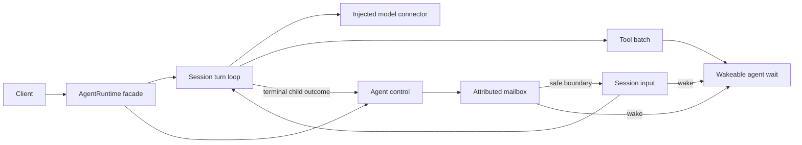

# Dynamic input, waits and independent agent control

This pass reorganizes the portable 039 runtime around the same responsibilities
that the pinned Codex source separates: session sampling and input, agent-tree
mailboxes/control, and tool execution. It preserves the `AgentRuntime` facade and
the earlier `fixture.ts` exports. There are no browser/Node branches in the agent
loop and no second conversation owner.

The [046 audit](../046-hp-power-user-audit/README.md) distinguishes source contracts
from gaps. [049](../049-hp-control-integration/README.md) qualifies the integrated
browser and live-provider flows. This track makes no paid requests.

## Reproduce

Run from `experiments/`:

```sh
pnpm --filter @agent-spike/039-hp-agent-runtime test
pnpm --filter @agent-spike/047-hp-dynamic-control typecheck
pnpm --filter @agent-spike/047-hp-dynamic-control test
pnpm --filter @agent-spike/047-hp-dynamic-control probe
```

Seventeen deterministic checks use the real portable runtime, including its actual
tool callbacks, timers, cancellation signals, input records and child loops. The
suite exports `runControlChecks()` from `checks.ts` without Node imports so the
same scenarios can execute in a browser. Provider events are deliberate fixtures;
the suite does not count as upstream compatibility evidence. The original thirteen
039 tests also pass after adapting assertions to explicit mailbox completion
delivery and visible input-failure records.

## Code responsibilities

| Code | Responsibility | Native source correspondence |
| --- | --- | --- |
| `039/src/runtime.ts` | Public facade, session records and wiring | Public session/agent control boundary |
| `039/src/session/turn.ts` | One sampling/tool continuation loop | `core/src/session/turn.rs` |
| `039/src/session/input-queue.ts` | Accepted input state and atomic subscribe-before-check wakeups | `session/input_queue.rs`, `turn_input.rs` |
| `039/src/agent/mailbox.ts` | Attributed mail retained across idle periods | `agent/control/mailbox.rs`, `delivery.rs` |
| `039/src/agent/control.ts` | Tree routing, queue versus trigger, wait and completion delivery | `agent/control/completion.rs`, `interrupt.rs`; v2 tool handlers |
| `039/src/tools/execute.ts` | Sequential tool batch, cancellation and honest late outcomes | Tool runtime and context normalization boundaries |
| `039/src/tools/agent-tools.ts` | Native-v2 operation meanings and named legacy wrappers | `tools/handlers/multi_agents_v2/*` |

The reference is clean Codex revision
`6c372fbef45f730b6d8aa727b0ec8332365588db`. Correspondence here means similar
responsibilities and tested selected semantics, not a line-by-line port.



## Input and wait semantics

`sendMessage(sender, target, text)` accepts an attributed queue-only note. It can
wake a waiting recipient but never starts an idle model turn. `followupTask` is
separate: it starts a task on an idle child, or queues explicit input for a running
child. Triggering the root through this native-v2-style operation is rejected;
ordinary client `start` remains available. Targets accept thread IDs or generated
canonical paths; caller-relative task names and a full native task-name registry
are not implemented.

`waitAgent(caller, {timeoutMs, signal})` watches the caller's mailbox and user-input
activity. It returns a reason and timeout status, not a child's answer. Completion
content arrives as attributed mailbox input. It subscribes before inspecting
pending input, so a message queued before the wait is observed immediately. Its
default bounds match the pin: 10-second minimum, 30-second default and one-hour
maximum. Requests below the minimum include a clamp warning; requests above the
maximum fail. Tests configure shorter bounds explicitly.

The old targeted `wait` tool calls `waitForChild`: completion, incoming input and
caller cancellation compete. Cancelling or steering a waiting parent does not
cancel its child. The `send_input` compatibility wrapper remains an explicit
start-or-steer operation. The additional `agentControlTools` expose `send_message`,
`followup_task`, `wait_agent` and `interrupt_agent`. Public function-tool JSON
framing is a translation; it does not reproduce Codex's Responses Lite code-mode
tool interface. The old `spawn_agent` declaration remains prototype-shaped.

Child completion is delivered once per terminal child turn, as queue-only mail.
An idle parent remains idle. The record keeps sender, recipient, message kind,
turn association and state; a readable attributed message is rendered only when
the session consumes it. Encrypted native inter-agent envelopes are unsupported.

Completed visible assistant messages with phase `final_answer` or absent phase
close current-turn mailbox delivery unless explicit same-turn work was already
pending. Commentary does not close it. A later followup starts another turn;
queue-only mail waits. User steering and a required tool continuation reopen
current-turn delivery. These rules are based on the pinned
`stream_events_utils.rs` and `session/input_queue.rs`, with checks for input both
before and after the answer boundary.

## Input outcomes and interruption

`inspectInputs(threadId)` exposes states with deliberately different meanings:

| State | Meaning |
| --- | --- |
| `queued` | Accepted locally, awaiting a model/tool boundary or response startup. |
| `included` | Included in a proposed local request, not yet confirmed by the provider. |
| `sent` | Steering dispatched; provider lifecycle remains separately visible. |
| `committed` | Request creation confirmed local input inclusion, or provider steering produced a committed input item. |
| `failed` | A known dispatch/provider rejection. |
| `uncommitted` | Execution ended without confirmed application; this input is retained for inspection and not automatically replayed. |

Opening a connection no longer drops steering. The runtime queues it until the
connector announces response creation, then dispatches it. A failed preparation
hook/factory removes included-but-unconfirmed items from future model context
using their exact object identities. Transcript input and outcome records remain.
Pending input belonging to an interrupted turn is never silently applied by a
later task. Provider-rejected steering is distinguished from connection loss after
acceptance. The connector's receipt ID and native insertion index preserve the
ordering of provider-committed steering relative to tool outputs.

Request preparation itself is cancellable from the runtime's perspective. A hook
that never settles cannot keep an interrupted turn active or prevent the next
turn. A hook that settles later is logged against its original turn; its old
request is never dispatched.

`interrupt(threadId, turnId)` affects the named thread. Passing
`{scope: 'subtree'}` explicitly selects its descendants too. The native-v2-style
`interruptAgent` rejects root/self targets and reports the target's prior status;
the subtree option is an HP management extension. Children inherit cwd, model and
the injected instruction/tool baseline. Neither spawning nor forking clones host
files or application side effects.

Tools selected in one model response execute sequentially as a batch. User/mailbox
input is consumed after that batch; a wait tool is wakeable inside it. This is an
explicit prototype scheduling policy, not native Codex's complete parallel-tool
scheduler. Cancellation can finish the turn even when a host callback ignores its
signal. The host action may still finish later:

- A recorded call that never started gets a `NOT EXECUTED` output.
- An interrupted started call gets `INTERRUPTED / OUTCOME UNKNOWN`, warning that
  side effects may have occurred.
- A late host result is recorded and emitted as `hp/tool/lateOutcome`. It never
  replaces the earlier result, enters a later turn or triggers automatic replay.

This closes native call/output pairs so later context is well formed while
preserving the interrupted transcript. The implementation follows the purpose of
native `context_manager/normalize.rs` and interrupted-turn warnings, while using
more explicit experimental output text. It cannot roll back external effects.
The execution marker is set immediately before invoking the host callback, after
the cancellation check. Cancelling between the item-start notification and the
callback therefore remains `NOT EXECUTED` and produces no false late-host result.

The browser connection factory now uses the opening AbortSignal only until the
socket opens. The connector owns cancellation afterward. A completed turn's old
signal therefore cannot close a socket reused by a later turn; an opening abort
still rejects and closes the connecting socket.

## Evidence and limits

The seventeen portable checks cover startup steering, retained notes, triggered
followup, timeout/clamp/abort, parent wait cancellation, steer wakeup, late child
completion, thread versus subtree interruption, skipped and late tool effects,
batch boundaries, before/after-answer input, preparation/factory failures,
provider rejection versus loss, pre-invocation cancellation, unresolved/late
preparation hooks, and browser factory lifetime. Both relevant
TypeScript typechecks and the original 039 tests pass.

The parent-owned 049 live Node probe additionally observed real Luna
`wait_agent` wakeups from a mailbox message and user steering, interruption during
wait, and a successful next turn on the same thread. Its ledger belongs to 049;
this track's provider spend is $0. Browser execution of these same tests is
reported there rather than inferred from bundling.

Deferred gaps include native hierarchical task-name registration, native spawn
options/history inheritance, process-job lifetime parity, parallel tool
scheduling, goals/queues, stop-hook reopening behavior, encrypted agent messages,
durable mailboxes and process recovery. These remain explicit design work. No
production library or shared history-schema changes were made in this track.
