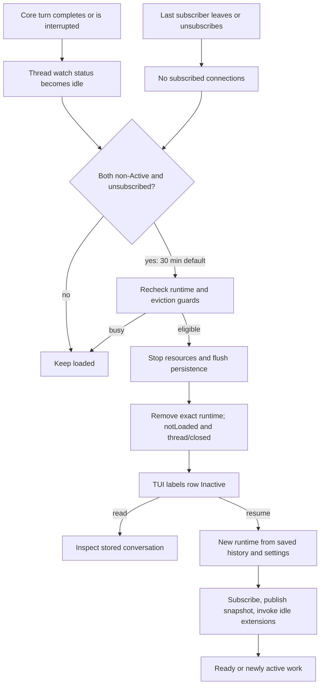

# 056 — Why a Codex task becomes inactive

**Source investigation, 19 October 2026.** The question came from the native
`codex agents` command center: old tasks were labelled **Inactive** without the
operator explicitly stopping or archiving them. This spike follows the label
through the TUI, app-server lifecycle and core session shutdown. It does not change
the user's Codex home, daemon, tasks or configuration.

The [short report](../../docs/spikes/056-codex-inactive-lifecycle.md) is the review
entry point. This document preserves the implementation detail for future client
and coordinator design.

## Source identity and method

The primary source is the official **0.163.0 release**, commit
`83086188ae0614bd882818ff1aa23f3194962012`. The local research checkout remains at
`6c372fbef45f730b6d8aa727b0ec8332365588db`; release files were read with `git show`,
without checking out another revision or modifying the vendor tree. The release
object was already available locally. The coordinator verified the release tag
against upstream and ran the installed `/Users/nehal/.local/bin/codex` 0.163.0.

The key lifecycle, status, label, subscription and V2 residency files are identical
between those revisions. The release adds async-compaction shutdown to session
cleanup and has some unrelated configuration/resume changes; all source links
below refer to the **release**, not an assumed match with the older pin.

Reproduce the source inspection from `experiments/`:

```sh
git -C vendor/codex rev-parse HEAD
git -C vendor/codex show 83086188ae0614bd882818ff1aa23f3194962012:codex-rs/app-server/src/request_processors/thread_lifecycle.rs
git -C vendor/codex show 83086188ae0614bd882818ff1aa23f3194962012:codex-rs/tui/src/app/agents_overview_view.rs
```

The local protocol probe is in `probe.mjs`; its run evidence is separate from
these source-derived findings. Source tests cited below were **read, not run** by
this source investigation. Earlier live-provider findings are identified by spike
and version rather than represented as new 0.163.0 measurements.

## Local protocol observations

Run from `experiments/`:

```sh
node spikes/056-codex-inactive-lifecycle/probe.mjs
```

The final run, `artifacts/056-codex-inactive-lifecycle/run-1792422279861`, passed
**18 assertions** on installed Codex 0.163.0, macOS arm64 and Node 26.10.0. Binary
SHA-256: `8813367285524ac798dd96d1b071aea30d58708c7226fd236cd275cf1cfdee31`.
The isolated temporary home had no credentials. The provider was deliberately
set to unreachable local `http://127.0.0.1:1`; no `turn/start` was submitted.
Work consisted of explicit local `thread/shellCommand` commands. Provider usage
and estimated experiment inference cost were zero; research-agent effort is not
included in that figure. The [usage ledger](usage-ledger.md) records all seven
attempts, including preliminary failures, separately from assistant cost.

The probe used a **two-second unload delay**, rather than waiting thirty minutes.
The default is source-qualified; the short configured timer is runtime-qualified.

| Runtime case | Observed result |
| --- | --- |
| Subscribed idle thread | Remained loaded beyond the configured delay. |
| Unsubscribe, then warm resume before expiry | Reattached the existing thread and cancelled pending unload. |
| Last subscriber leaves while observer polls | Acknowledgement arrived while still loaded; became `notLoaded` after **2,067 ms** and disappeared from `thread/loaded/list`. |
| Full read and cold resume after closure | Retained the shell-output marker and reloaded the same thread ID. |
| Two subscribed clients | One leaving did not unload it; the final subscriber leaving did. |
| Four-second local shell task, then no subscribers | Still Active after 2.3 seconds; completed before unloading, **6,136 ms** after shell start. |
| Socket disconnect | Removed the last subscription and allowed delayed unload. |
| Archive/unarchive | Archive unloaded; unarchive alone left the runtime unloaded and metadata readable. |
| Shell-only fixture discovery | Absent from ordinary unarchived listing, present in archived listing; explained by the empty-preview filter below. |

The final fixture uses explicit paginated history and no injection or
archive/unarchive preparation. The earlier failed attempts are retained in the
ignored artifact directory. They exposed a read-during-teardown race and an
incorrect initial assumption about empty-preview listing; neither is hidden by
the final passing run. Background-terminal eviction, approvals and subagent
eviction remain source-qualified or earlier-spike evidence, not new cases in
these 18 assertions.

## The labels mean runtime state, not task completion

The mapping is explicit in
[AgentsOverviewGroup::for_status, lines 76–96](https://github.com/openai/codex/blob/83086188ae0614bd882818ff1aa23f3194962012/codex-rs/tui/src/app/agents_overview_view.rs#L76):

| App-server `ThreadStatus` | Command-center presentation | Meaning |
| --- | --- | --- |
| `active`, `waitingOnApproval` or `waitingOnUserInput` | Needs you / Needs input | Loaded and waiting for an interactive response. |
| `active`, otherwise | Working | Loaded with an active turn. An ordinary tool wait can have no special flag. |
| `idle` | Ready | Runtime is loaded; no active turn or flagged interactive request. |
| `systemError` | Needs you / error presentation | Loaded runtime has recorded a system error. |
| `notLoaded` | Inactive | This app-server does not report a loaded runtime for that thread. |

The internal TUI enum calls the last group `Finished`, but its user label is
Inactive and its input is strictly `NotLoaded`. It is **not** evidence that the
task's objective was completed, that it failed, that it was archived, or that no
OS process elsewhere is still doing related work.

The status is local to the app-server being queried. Listing historical sessions
in a shared home does not make this a machine-wide census of runtimes owned by
other app-server processes. The
[status enrichment](https://github.com/openai/codex/blob/83086188ae0614bd882818ff1aa23f3194962012/codex-rs/app-server/src/request_processors/thread_enrichment.rs#L14)
consults that server's thread manager and watch state.

The visible `Updated` age is not the unload timer. The screenshot's 2-day,
16-day and 6-day ages cannot reveal which unload path occurred. A server restart,
explicit archive/stop, or ordinary timed unload can all leave historical data
without a live runtime.

## Exact automatic unload trigger

The app-server owns this decision; the model does not choose to become Inactive
after a period of silence. Completing a response normally changes **Working →
Ready**, through `TurnComplete` and `note_turn_completed`, rather than directly
unloading the session.

Each thread's listener owns an `UnloadingState` that watches:

1. Whether **any client connection is subscribed to this thread**.
2. Whether the server's `ThreadStatus` is `Active`.

Only when both are false is there an unload deadline:

```text
deadline = max(time last subscriber left, time thread became non-Active)
           + thread_unload_delay_secs
```

The default is **1,800 seconds (30 minutes)**. It is a native configuration value;
zero is supported for immediate eligibility. A new subscription or active status
removes the deadline; a subsequent transition starts a fresh interval. This is
not a time since last assistant message and it is not a UI selection timeout.
The receiver values are rechecked immediately before teardown.

Sources:
[deadline and watches, lines 23–124](https://github.com/openai/codex/blob/83086188ae0614bd882818ff1aa23f3194962012/codex-rs/app-server/src/request_processors/thread_lifecycle.rs#L23),
[default, lines 4031–4039](https://github.com/openai/codex/blob/83086188ae0614bd882818ff1aa23f3194962012/codex-rs/core/src/config/mod.rs#L4031).

There are further race checks at the deadline:

- If core still reports `AgentStatus::Running`, postpone and restart the delay.
- Serialize teardown against subscriptions and other pending unloads.
- For V2 children, attempt the guarded eviction described below; a busy/error
  result postpones rather than forcing it.

See [listener unload branch, lines 398–543](https://github.com/openai/codex/blob/83086188ae0614bd882818ff1aa23f3194962012/codex-rs/app-server/src/request_processors/thread_lifecycle.rs#L398).

### What counts as an attached client?

`thread/start` and `thread/resume` attach the requesting connection to the thread.
`thread/unsubscribe` detaches just that connection; it is not an immediate stop.
Connection cleanup removes all of that connection's subscriptions. Other clients
can keep the thread loaded. Disconnect cleanup first drains in-flight RPCs with
a 30-second bound, so physical socket closure and timer arming need not coincide.

The command center deliberately retains rows independently of subscriptions. It
uses `thread/list`, `thread/loaded/list`, `thread/read` and history requests to
inspect them. Merely seeing a row does not pin its runtime. There is no public
`thread/watch` or `thread/unload` method in this investigated protocol; internal
`ThreadWatchManager` is an implementation component.

Sources:
[unsubscribe handler](https://github.com/openai/codex/blob/83086188ae0614bd882818ff1aa23f3194962012/codex-rs/app-server/src/request_processors/thread_processor.rs#L1034),
[connection membership removal](https://github.com/openai/codex/blob/83086188ae0614bd882818ff1aa23f3194962012/codex-rs/app-server/src/thread_state.rs#L651),
[disconnect cleanup](https://github.com/openai/codex/blob/83086188ae0614bd882818ff1aa23f3194962012/codex-rs/app-server/src/message_processor.rs#L866),
[overview membership and reads](https://github.com/openai/codex/blob/83086188ae0614bd882818ff1aa23f3194962012/codex-rs/tui/src/app/agents_overview_threads.rs#L1).

### Waiting is not necessarily idle

The status reducer counts active turns and outstanding permission/user-input
guards. Either pending interactive counter makes the status `Active`, even if
the model is not currently generating. Therefore the normal inactivity timer
does not expire a genuine pending approval or user-input request while that flag
persists. Dynamic-tool waits need not have one of those flags, but ordinarily
remain part of an active turn.

A completed/aborted turn clears those counters. A system error is non-Active and
therefore eligible for eventual unloading when unsubscribed; the visible
Needs-you category alone cannot be used as an eviction guard.

Sources:
[runtime facts and reducer, lines 439–468](https://github.com/openai/codex/blob/83086188ae0614bd882818ff1aa23f3194962012/codex-rs/app-server/src/thread_status.rs#L439),
[turn transitions, lines 147–190](https://github.com/openai/codex/blob/83086188ae0614bd882818ff1aa23f3194962012/codex-rs/app-server/src/thread_status.rs#L147).

## Background work is the important gotcha

[Follow-up 057](../057-launcher-inactive-turns/README.md) now directly qualifies
the ordinary managed-terminal case through the production launcher, including
native registry evidence, a verified OS PID, heartbeat cessation and a successful
new turn after explicit resume. The following source investigation remains the
explanation of that behavior and its limits.

An ordinary **managed background terminal does not keep the status Active**.
There is no terminal-count guard in either the ordinary unload predicate or the
V2 child predicate. Earlier [Spike 032](../../docs/spikes/032-codex-health.md)
observed a real 0.162.1 thread that was idle while a background command remained
alive. Combining that prior observation with the release source gives a specific
conclusion: a thread can become eligible for automatic unloading while such a
terminal is still running.

Unload is actual runtime shutdown, not just a label change. In 0.163.0,
`shutdown_session_runtime` stops conversation activity, aborts session tasks and
async compaction, shuts down hooks, terminates all processes in the unified-exec
manager, stops MCP prewarming/runtime and invokes session-end lifecycle hooks.
Persistence is then flushed/shut down. Managed terminal handles do not survive
this as resumable terminal handles. The source does **not** establish that an
independently daemonized or externally managed service is killed; process
ownership matters.

Sources:
[session resource shutdown, lines 290–347](https://github.com/openai/codex/blob/83086188ae0614bd882818ff1aa23f3194962012/codex-rs/core/src/session/handlers.rs#L290),
[managed process termination, lines 1795–1811](https://github.com/openai/codex/blob/83086188ae0614bd882818ff1aa23f3194962012/codex-rs/core/src/unified_exec/process_manager.rs#L1795),
[persistence shutdown, lines 350–401](https://github.com/openai/codex/blob/83086188ae0614bd882818ff1aa23f3194962012/codex-rs/core/src/session/handlers.rs#L350).

`thread/shellCommand` is a useful zero-model active-work test, but it runs a
regular user-shell task through `execute_exec_request`; it is not a way to create
the model's retained unified-exec background terminal. A successful shell probe
must not be described as runtime proof of background-terminal eviction.
[User-shell implementation](https://github.com/openai/codex/blob/83086188ae0614bd882818ff1aa23f3194962012/codex-rs/core/src/tasks/user_shell.rs#L103).

### Subagents and durable waiting

Threads are assessed individually. A parent's status is not an aggregate of its
children's statuses; inspect descendants separately. Multi-agent V2 has additional
residency policy. A candidate child can be evicted only when its core status is
PendingInit/Completed/Errored/Interrupted, it has no active turn, no outstanding
durable sleep, and no trigger-turn mailbox items. Residency/delivery guards also
prevent eviction during concurrent work. Capacity pressure can evict an old idle
child separately from the app-server's 30-minute timer; that path skips
never-started PendingInit children.

The V2 eviction path preserves queued mail and environment selections in the
parent runtime and materializes history before stopping the exact child runtime.
It is designed to reload persisted children on demand. Ephemeral children are
not enrolled in the same disconnected persisted-child listener path. This is
not a promise that every evicted child can reload, or of full agent-tree recovery
after the owning server dies. An upstream test explicitly expects an interrupted
child in its fixture to remain lost after residency eviction; preserve that
case rather than treating child eviction as universally reversible.
[Interrupted-child eviction test](https://github.com/openai/codex/blob/83086188ae0614bd882818ff1aa23f3194962012/codex-rs/core/src/agent/control/residency_tests.rs#L85).

Sources:
[child eviction and retained mail, lines 35–99](https://github.com/openai/codex/blob/83086188ae0614bd882818ff1aa23f3194962012/codex-rs/core/src/agent/control/residency.rs#L35),
[capacity eviction, lines 215–265](https://github.com/openai/codex/blob/83086188ae0614bd882818ff1aa23f3194962012/codex-rs/core/src/agent/control/residency.rs#L215),
[eligibility, lines 304–327](https://github.com/openai/codex/blob/83086188ae0614bd882818ff1aa23f3194962012/codex-rs/core/src/agent/control/residency.rs#L304),
[persisted-child listener condition](https://github.com/openai/codex/blob/83086188ae0614bd882818ff1aa23f3194962012/codex-rs/app-server/src/request_processors/thread_processor.rs#L3780).

An explicit model tool to close a child is a separate path: `close_agent` marks
its spawn edge closed and shuts down the child's live subtree. That is a real
agent-directed close operation, not the automatic ageing decision.
[Explicit child closure](https://github.com/openai/codex/blob/83086188ae0614bd882818ff1aa23f3194962012/codex-rs/core/src/agent/control/legacy.rs#L48).

## What unloading and resuming actually do

Ordinary unload cancels remaining client callbacks, removes subscription/listener
state, submits session shutdown and waits for cleanup. Ten seconds is a **warning
threshold**, not a timeout that abandons cleanup. Only afterward does it remove
the exact runtime from the thread manager, publish `notLoaded` and send
`thread/closed`. Runtime identity checks prevent late cleanup removing a newer
runtime under the same thread ID. A concurrent resume may receive “thread is
closing; retry … after the thread is closed.”

[Teardown, lines 559–623](https://github.com/openai/codex/blob/83086188ae0614bd882818ff1aa23f3194962012/codex-rs/app-server/src/request_processors/thread_lifecycle.rs#L559).

| Operation | Runtime consequence | History consequence |
| --- | --- | --- |
| `thread/read` / historical listing | Does not attach or reconstruct a live agent. | Reads stored/live projections as available. |
| `thread/resume` before unload | Joins existing runtime, adds subscription, prevents pending idle unload. | Returns requested history plus live state; pending callbacks are replayed. |
| `thread/resume` after unload | Builds a new runtime from persisted history/settings under the same thread identity, then subscribes. | Restores persisted conversation; does not resurrect terminated shells, old MCP connections, or arbitrary in-memory jobs. |
| `thread/archive` | Explicitly shuts down selected thread and discovered spawned descendants. | Marks stored records archived and removes them from the usual unarchived listing. |
| `thread/unarchive` | Does not itself start a new runtime. | Restores unarchived visibility; subsequent resume can load it. |

For loaded threads, resume uses a serialized listener command, merges live turn
state, subscribes before returning the response, then replays usage and pending
requests. For unloaded threads, the handler reads persisted history and invokes
`start_thread` with `initial_history`, then attaches. V2 children resume through
their parent authority, not arbitrary caller configuration; the parent may need
resuming first.

Sources:
[warm/cold branch, lines 3841–4045](https://github.com/openai/codex/blob/83086188ae0614bd882818ff1aa23f3194962012/codex-rs/app-server/src/request_processors/thread_processor.rs#L3841),
[cold construction, lines 4202–4328](https://github.com/openai/codex/blob/83086188ae0614bd882818ff1aa23f3194962012/codex-rs/app-server/src/request_processors/thread_processor.rs#L4202),
[warm subscription and response ordering, lines 846–969](https://github.com/openai/codex/blob/83086188ae0614bd882818ff1aa23f3194962012/codex-rs/app-server/src/request_processors/thread_lifecycle.rs#L846),
[archive, lines 1716–1805](https://github.com/openai/codex/blob/83086188ae0614bd882818ff1aa23f3194962012/codex-rs/app-server/src/request_processors/thread_processor.rs#L1716),
[unarchive, lines 2118–2146](https://github.com/openai/codex/blob/83086188ae0614bd882818ff1aa23f3194962012/codex-rs/app-server/src/request_processors/thread_processor.rs#L2118).

Opening an inactive task in the command center takes this resume path. It checks
`NotLoaded`, reconstructs resume configuration, and calls the app-server resume
API. Browsing historical data can instead stay on `thread/read`.
[TUI open/resume flow, lines 546–685](https://github.com/openai/codex/blob/83086188ae0614bd882818ff1aa23f3194962012/codex-rs/tui/src/app/agents_overview.rs#L546).

**Resume is not guaranteed to be passive.** Both warm and cold resume invoke idle
lifecycle extensions after publishing snapshots. Earlier
[Spike 029](../../docs/spikes/029-fork-details.md#goal-and-queue-side-effects)
observed a saved active goal start a new turn on cold resume. Do not promise that
Inactive → Ready always stops at Ready, or use resume just to gather fleet metrics.
[Cold resume idle hook](https://github.com/openai/codex/blob/83086188ae0614bd882818ff1aa23f3194962012/codex-rs/app-server/src/request_processors/thread_processor.rs#L4442).

### Reads during teardown and discovery

Preliminary runs polled status through `thread/read(includeTurns:true)`. Some
requests straddling teardown failed with “not materialized yet; includeTurns is
unavailable before first user message,” even though the shell history had been
materialized. This was not evidence of lost history: isolated file inspection of
run `1792422178672` found the paginated JSONL (21,810 bytes), its SQLite metadata
row, and the shell history intact. Earlier successful runs had the same paginated
history mode, not a different legacy mode. The failed read was submitted before
closure; in another attempt its error arrived after the closure notifications.

**Source-supported diagnosis:** a full read can capture the loaded runtime before
shutdown finishes, then attempt to persist its live writer. Shutdown removes that
writer before the app-server removes the runtime. `persist_thread` can therefore
find no live writer and return `ThreadNotFound`, which the history-read adapter
maps to the misleading “not materialized yet” error. The exact interleaving was
not instrumented, but the error, intact files and source ordering support this
race rather than a persistence-loss conclusion.

The final probe polls metadata without turns, verifies the thread is absent from
`thread/loaded/list`, then reads full history and cold-resumes successfully. An
inspection client should tolerate/reconcile a read racing with lifecycle change;
it should not translate that error into “conversation lost.” This does not
authorize replaying mutating requests. Untouched threads still need their own
materialization checks; the successful fixture had actual recorded shell output.

Sources:
[read captures a loaded runtime](https://github.com/openai/codex/blob/83086188ae0614bd882818ff1aa23f3194962012/codex-rs/app-server/src/request_processors/thread_processor.rs#L2960),
[paginated live read requests persistence](https://github.com/openai/codex/blob/83086188ae0614bd882818ff1aa23f3194962012/codex-rs/app-server/src/request_processors/thread_processor.rs#L3155),
[shutdown removes the live writer](https://github.com/openai/codex/blob/83086188ae0614bd882818ff1aa23f3194962012/codex-rs/thread-store/src/local/live_writer.rs#L169),
[writer lookup returns ThreadNotFound](https://github.com/openai/codex/blob/83086188ae0614bd882818ff1aa23f3194962012/codex-rs/thread-store/src/local/live_writer.rs#L316),
[history error mapping](https://github.com/openai/codex/blob/83086188ae0614bd882818ff1aa23f3194962012/codex-rs/app-server/src/request_processors/thread_processor.rs#L6271).

There is also a separate discovery gate: normal unarchived listing excludes rows
with an empty preview. Raw injected model-context messages do not set the
user-message preview. The metadata reducer recognizes the native user-message
event/completed user item; a shell-only or injected-history probe can be readable
by ID yet absent from the usual list. Archived listings, explicit section
listings and some ancestry listings have different empty-preview rules. This is
not proof that the conversation was deleted on unload.

Sources:
[empty-preview list filter, lines 1410–1446](https://github.com/openai/codex/blob/83086188ae0614bd882818ff1aa23f3194962012/codex-rs/state/src/runtime/threads.rs#L1410),
[raw-message versus native-event tests, lines 257–299](https://github.com/openai/codex/blob/83086188ae0614bd882818ff1aa23f3194962012/codex-rs/state/src/extract.rs#L257),
[metadata update inputs, lines 299–309](https://github.com/openai/codex/blob/83086188ae0614bd882818ff1aa23f3194962012/codex-rs/thread-store/src/thread_metadata_sync.rs#L299).

`persist_user_shell_output` explicitly requests materialization after standalone
shell output. The final run demonstrates subsequent unloaded read/resume for this
paginated fixture. [Shell persistence request](https://github.com/openai/codex/blob/83086188ae0614bd882818ff1aa23f3194962012/codex-rs/core/src/tasks/user_shell.rs#L449).

## Call graph to keep in mind



## Source test evidence and remaining boundaries

Relevant upstream tests were inspected, not executed in this spike:

- [`thread_unsubscribe_keeps_thread_loaded_until_idle_timeout`](https://github.com/openai/codex/blob/83086188ae0614bd882818ff1aa23f3194962012/codex-rs/app-server/tests/suite/v2/thread_unsubscribe.rs#L44): warm resubscription cancels unload; later unsubscribe unloads; persisted history resumes.
- [`thread_unsubscribe_during_turn_keeps_turn_running`](https://github.com/openai/codex/blob/83086188ae0614bd882818ff1aa23f3194962012/codex-rs/app-server/tests/suite/v2/thread_unsubscribe.rs#L202): active work is retained, including zero-delay configurations.
- [`websocket_disconnect_keeps_last_subscribed_thread_loaded_until_idle_timeout`](https://github.com/openai/codex/blob/83086188ae0614bd882818ff1aa23f3194962012/codex-rs/app-server/tests/suite/v2/connection_handling_websocket.rs#L452): actual WebSocket disconnect and delayed unload.
- [`idle_unload_finishes_after_slow_writer_shutdown`](https://github.com/openai/codex/blob/83086188ae0614bd882818ff1aa23f3194962012/codex-rs/app-server/tests/suite/v2/thread_unload.rs#L23): blocked persistence cleanup can exceed ten seconds but still completes removal.
- [`residency_slot_reservation_unloads_oldest_idle_v2_agent`](https://github.com/openai/codex/blob/83086188ae0614bd882818ff1aa23f3194962012/codex-rs/core/src/agent/control/residency_tests.rs#L23): capacity-based child eviction.

The ordinary lifecycle is clear from source. What this source pass does not
establish is the exact past cause for the screenshot's three inactive sessions,
Linux process behavior, full agent-tree crash recovery, or every extension's
reaction to shutdown/resume. No user task was stopped to discover that history.

## Consequences for our client and coordinator

Keep at least three separate facts: conversation storage/archival, runtime
residency, and current turn/work state. Keep observation freshness separate too.
Show “inactive / runtime unloaded” without silently calling the objective complete.

An overview that resumes every task to subscribe to its full transcript would
change native resource lifetime and can activate goals. A passive fleet view
should use native metadata/history reads and global status notifications; full
subscription should have an explicit purpose and lifecycle. If we want a
background terminal to survive, retaining a subscription is one native mechanism,
but adopting such a policy belongs in a later coordinator decision, not in this
spike.

Make **inspect history**, **join loaded runtime**, **resume from history** and
**archive** distinguishable actions. For HP, decide our own job-retention policy;
do not copy the overloaded Ready/Inactive labels as a universal provider contract.
Our [Claude launcher checkpoint](../../../docs/claude-handoff.md) records a
different implemented lifetime: disconnect ends its client-owned worker; saved
history can be explicitly resumed in a new worker. This investigation does not
qualify an equivalent native Claude Code idle-unload timer. No private Claude
runtime or recovery format was reverse-engineered. HP job retention remains a
separate policy choice for the later live-client slice.

Official [SessionEnd documentation](https://learn.chatgpt.com/docs/hooks#sessionend)
corroborates the default idle/unopened interval and distinguishes it from immediate
unsubscribe. It also documents cancellation of unfinished background hooks at
session end. Managed terminal cleanup is established by the separate source
anchors above. These are distinct kinds of background work.
